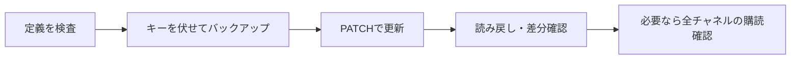

# AIによるPower Automateフロー作成と更新の検証

Claude CodeがFlow APIでフローの定義を作成・更新し、実行履歴と読み戻しで確認した経験を整理する。約60アクションのTeams向けAIボットを作ったという事例で、要件と方式の判断、実機での投稿・テスト、キー入力は人が担っている。

以下は2026-11-09〜11-11の提供資料による作業記録である。今回の取り込みでは、ツールのインストール、サインイン、APIアクセス、フローの作成・変更を行っていない。資料中の承認手順や作業指示文は、当該開発の運用ルールを記録したものとして読む。

## 作成する役と判断する役

| 担当 | 資料で担ったこと |
|---|---|
| 人 | 要件・制約・方式を決め、段階ごとの指示を承認し、Teams上の操作とキー入力を行う |
| 設計役のAI | 方式比較、設計、作業指示文、報告のレビュー |
| 作業役のAI（Claude Code） | Flow API経由の定義作成・更新、検証、実行履歴の調査 |
| 調査役のAI | 行き詰まった方式について、確認済みの事実と除外条件を踏まえて再調査 |

人がAI間で文章を受け渡す構成だった。「AIが作れる」は、要件や本番変更の権限までAIが決めることを意味しない。

## MCPと直接APIの経路を区別する

資料ではPower Automateプラグインを紹介する一方、当該環境では管理設定によりMCPを利用できず、プラグイン経路は未実行だった。IT部門へMicrosoft APIの直接利用が制限の対象外と確認したうえで、Azure CLIのサインインを使うFlow API経路を採用したと記録される。

この確認を、別の環境でも直接APIが許可されているという根拠にはしない。プラグインのツールが表示されないことだけで管理制限の原因を確定できるわけでもない。

Flow APIのベースURL、APIバージョン、CRUD・実行履歴のパス、Azure CLIの手順は原本に保存している。トークンと署名付きの入出力URLは認証情報として扱う、という当該作業の方針も含む。

Graphについてはチーム・チャネル一覧まで読めたが、メッセージ本文を読めなかったと報告される。Flow APIとGraphの認証対象・権限を同一視せず、この事例で読めなかった範囲をGraph全般の仕様とはしない。

## 更新と検証の流れ

1. 送信前に、名前の重複、参照先、`runAfter`の接続を検査する。
2. 現行定義をバックアップする。資料ではOneDrive外へ保存し、キーを`SET_YOUR_KEY`へ置き換えた。
3. APIで更新し、サーバー側の定義検証の結果を確認する。
4. 保存後に読み戻し、自動付与項目を除いて送信定義と比較する。キーの保持は値を表示せず確認し、オン・オフも照合する。
5. トリガーを変更した場合は、対象チャネルすべての購読作成結果を確認する。

バックアップはキーを伏せているため、それだけで即座に戻せる完全な復元物ではない。ロールバック時に現在のキーを入れ直す、という復元手順と組になっている。

## 部品の組み合わせは先に小さく試す

送信WebhookからHTTPトリガーを呼べると仮定し、設計・作成後に401で失敗した。部品単体の存在を、組み合わせの動作実績へ読み替えていたことが教訓になっている。

資料では同じ認証条件の1回の疎通試験で原因を切り分けた。また、返信のID、HTMLの形、式の境界条件は、読み取り専用の検証フローで実測して直した。実装を進める前に、不確かな接続や制限を小さく確かめるという経験である。

## 作業指示と確認処理の具体性

「キーを変数へまとめる」だけでは変数作成で終わり、参照が置き換わらなかった。資料の指示書式では、対象フロー、変更するアクション・項目・値、保持する状態、報告内容を列挙している。

完了報告も「依頼した変更」「確認なしで判断した点」「実機で未確認の点」を分ける。削除・オンオフ・本番の向き先変更の承認は、元資料の開発に適用した権限管理である。

購読確認の処理が先頭の1件しか見ず、成功を失敗と判定して自動復元した事例もあった。確認用のスクリプトも、対象全体を検査しているかの確認が要る。読み戻しで定義が一致することと、実際に投稿へ応答することも別の検証である。

## 未確認事項

- MCPプラグインが使える環境での実際の操作手順。
- Power AutomateのCopilotで構築できる範囲。言語対応等の記述も資料時点の情報。
- 一時フォルダにある作業スクリプトの保存・再利用。今回の添付はナレッジ文書であり、スクリプト本体を含まない。
- 別環境でのAPI権限、管理ポリシー、実行条件の再現性。

## 関連・参考資料

- [[Power AutomateからLLM APIを呼ぶ実装パターン]]
- [[TeamsからPower Automateを起動する方式と認証の制約]]
- [[Teams AIボットの構成と運用引継ぎ]]
- [[AI開発をコーディングから工程管理へ広げる]]
- [[AI実行ガバナンスと人間の監督]]
- 原本：[[Sources/Power Automate and Teams 20261111/AIによるPower Automateフロー作成の元資料]]。
- 元ファイル：`AI-Built-Power-Automate-Knowledge-20261111.md`。
- 資料の調査期間：2026-11-09〜11-11。取り込み日：2026-11-12。
- 提供資料の主な参照先：[Power Automate plugin for external tools](https://learn.microsoft.com/power-automate/power-automate-plugin-external-tools)。Flow API手順・実測は運用者とClaude Codeの作業記録による。
