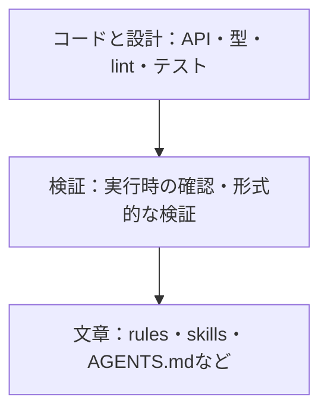

# AIエージェントの信頼を支えるコード環境と検証

大量のコード生成と品質の維持を両立するため、コードベース、決定論的なチェック、実行時・形式的な検証を整えるという講演の解説。自動化の規模を増やす前に、エージェントが繰り返す誤りを環境側で減らすという主張である。

提供資料は2026-11-19に英語講演を音声認識し、未修正の文字起こしから整理したもの。動画の元投稿URL、話者・製品・一部ツールの名前は確定できていない。以下の数値と実践は講演者の発言として記録し、今回の取り込みで講演や成果を独立に検証していない。

## 設計・検査・文章を組み合わせる

講演では、エージェントを支える環境を大きく次のように捉える。

コードベースはエージェントが参照する入力でもある。回避策、不要コード、アンチパターンが残っていると、それが既存のやり方としてコピーされうる。誤りを個別に指摘するだけでなく、原因になる設計と既存パターンを修正し、再発を検出できる形へ変える。

決定論的なチェックは、同じ条件で繰り返し検査できる強みを持つ。ただし、ルールに書いた範囲しか検査できず、チェックの通過だけで要件の妥当性や品質全体が証明されるわけではない。

## 講演に出た具体例

| 問題 | 話者側が取った対応 | 適用範囲 |
|---|---|---|
| 誤用しやすいReactの`useEffect` | 製品コードでは禁止し、フレームワーク内部へ利用を集める | 講演者のチームの設計選択。全プロジェクトへの禁止ではない |
| Electronのメイン側と描画側の混在 | ディレクトリを分け、相互importを依存分析・lintで禁止 | 意図しない依存を機械的に検出する例 |
| 応急処置としてのタイマーの拡散 | アーキテクチャの不一致という根本原因を直し、検査へ反映 | タイマー一般の禁止ではない |
| 注意書きが実装されない理由を正当化する | コメントを大幅に減らし、lintと修正を促すエラーを使う | 「コメントの99%を禁止」は話者側の方針であり、普遍的な品質指標ではない |

訂正をlint・型・設計の変更に変え、同じ問題が再び入らないようにする。仕様や意図の説明が不要になるという意味ではない。機械的に扱える規則と、文脈を伴う人の判断を区別する。

## 検証成果物をレビューに使う

話者は、エージェントが自らコードを動かし、その証拠として動画、スクリーンショット、図、形式検証の結果等を示すことを重視している。

- **実行時検証**：ブラウザのデバッグ手段、専用CLI・ドライバを使ってアプリを操作する。機能マップは利用者視点の機能名を共有するために使う。
- **モデル検査**：TLA+で複数デバイス等にまたがる通知の状態遷移を検査する例が挙げられる。
- **証明支援**：Leanで仮想化ライブラリのアルゴリズムに関する性質を確かめる例が挙げられる。
- **プロパティベーステスト**：多数の入力を使い、UIで成り立つべき性質を確認し始めたと話者は説明する。
- **状態機械の図**：振る舞いを図示し、動画や画像と併せてレビューする。

スクリーンショットは見えた状態を示す証拠であり、考えられる全状態の正しさの証明ではない。形式検証も、書いた仕様・モデル・仮定と検査範囲に依存する。資料でも万能な手段ではなく、検証の一層として位置づけられている。

資料中の「トークンの70%を検証に使う」は、話者が紹介した**別の開発者**の発言である。話者自身も大半を検証に使うと述べたが、同じ70%だとは記録されていない。

## 実績として語られた数値

| 項目 | 話者の自己申告 |
|---|---|
| 前月の本番PR | 個人約3,000件、チーム約11,000件 |
| 10月のPR参加者 | 1件以上出した人が約227人 |
| 差し戻し率 | 相対的に減少し、約0.5%で安定 |
| 安定版リリース | 約1日1回 |

PRの数え方、差し戻し率の分母・期間、品質や性能の測り方は資料中で確定していない。PR件数や低い差し戻し率から、品質・生産性の因果関係を一般化しない。講演はCI所要時間の短縮を測ったものでもない。

## 自動化の前に整えること

話者は、雑な結果を出す内側の開発ループをそのまま自動化すると、雑な変更とトークン費用が増えると述べる。まず既存の悪いパターンを直して再発防止の検査を追加し、次に実行時の確認や形式的な検証を強くする、という順序である。

紹介された運用では、リリースごとにアプリをfuzzし、発見した不具合の修正PRを自動マージする流れもある。これは話者のチームの経験・判断であり、人のレビューを不要にするための一般的な条件が確立したことを示すものではない。

## 未確認事項

- 元動画の投稿URL、話者名、製品・フレームワーク・ツール名。
- PR件数や差し戻し率の定義、集計期間、比較条件。
- 性能改善の測定指標、形式検証を適用した範囲、プロパティベーステストのツール。
- 使用した音声認識の誤りと、解説中の推測の原発言への対応。

## 関連・参考資料

- [[AI実行ガバナンスと人間の監督]]
- [[AnthropicのAIコードレビューと人間の説明責任]]
- [[エージェント時代のCI高速化と検証範囲の管理]]
- [[AI開発における理解負債]]
- 原本：[[Sources/Knowledge Batch 20261122/AIエージェントの信頼と実行環境の元資料]]。
- 元ファイル：`Agent-Trust-Environment-Knowledge-20261119.md`。資料の調査日：2026-11-19。取り込み日：2026-11-22。
- 提供資料の出典はX経由で入手した17分18秒の動画と、未修正の音声認識による文字起こし。元の投稿URL・動画ファイルはこの取り込みに含まれない。
