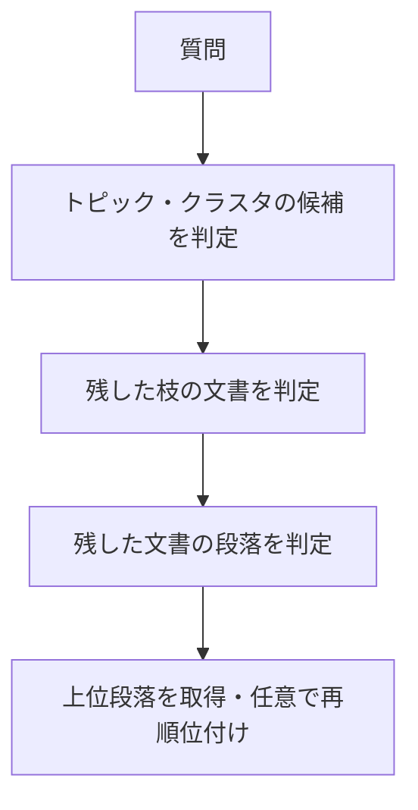

# DecisionRAGの階層検索と文書の正本判定

DecisionRAGは、文書集合の階層を決定モデルでたどり、有望な枝にある段落を取得する検索手法として紹介される。ただし、質問への関連度が高いことと、その文書が採用済みの現行版であることは別の属性である。

以下は2026-11-03の提供資料を整理したもの。論文の著者報告、関連研究の調査、会話での設計案を含む。今回の取り込みでは論文・製品仕様の再確認や検索システムの実装・評価を行っていない。

## 決定モデルで階層を下りる

提供資料では、決定モデルを、文脈と複数の質問を受けて回答の確率を返すモデルとして説明する。自由文を順に生成して探索する方式と異なり、同じ階層の候補をまとめて判定する。論文で使用したモデルはJevとされる。



比較対象の密検索は、ベクトルの近さで候補を取得してからリランカーで並べ替える。DecisionRAGは、候補を取得する段階からモデルの判断を使う。同じ文脈に候補を並べると、個別に採点する場合より確率を比較しやすくなったと報告されている。

「ベクトル索引が不要」は、検索前の準備が不要という意味ではない。階層とノードの短い説明をオフラインで用意する。

- 構造がある領域では、ヘルプセンター、ページ、見出し、URL等を使う。
- 構造がない領域では、タイトルと冒頭文の埋め込みをクラスタリングし、クラスタの説明を生成する例がある。
- 階層や説明が不適切なら検索品質が下がる。外した枝の下は探索しないため、上位の判断で正解を失う可能性がある。

残す枝を増やす、次点も残す、従来の密検索の候補を最後に混ぜる、といった対策が資料に挙げられている。

## 報告された性能と比較の範囲

提供資料が紹介する論文の数値は次のとおり。いずれも著者報告であり、未整理の社内ファイルサーバーでの実測ではない。

| 項目 | 提供資料の記載 | 読み取れる範囲 |
|---|---|---|
| 検索精度 | 8Bリランカー付き密検索に対し、MultiDoc2DialのR@1で13.8ポイント、Natural QuestionsのHit@1で17.4ポイント改善 | 指定された比較構成・指標での差 |
| 遅延 | 1クエリ0.7〜1.8秒、268万段落のWikipediaで約1.7秒 | 論文の階層・並列処理・API条件での値 |
| 費用 | 1クエリ0.2〜2.3セント | 資料時点の実験条件での値 |
| 生成型の階層探索との比較 | 遅延が34〜145分の1、費用が21〜25分の1 | 比較した先行手法の構成に対する結果 |

資料は探索時間が主に階層の深さに依存すると説明するが、大きい層を並列要求へ分割することが前提にある。文書量を増やしても費用・要求数・構築負担が一定、と一般化しない。

VectifyAIのPage Search APIとの比較では、1文書の全ページを採点する方式と、大きな文書集合を枝刈りする方式の対象範囲を分ける。Page Searchの内部に決定モデルが使われているかは資料でも未確認であり、両者の優劣を直接測った結果ではない。

## 関連度だけでは正本を決められない

「最終版」「決定版_v2」「コピー」が混在していても、内容が似ていれば複数の版が高い関連度を持つ。どの版を組織が採用したかが口頭の決定にしか残っていない場合、ファイルの内容だけからは確定できない。

提供資料の調査では、未整理のファイルサーバーをそのまま入力し、正本まで決める既製手法や公開評価を見つけられていない。これは調査範囲での未発見であり、そのような手法が存在しないことの証明ではない。

| 調べること | 手がかり | 限界 |
|---|---|---|
| 同じ文書の版か | 近重複、差分、Wordのrsid、PDFのXMPの系譜情報 | 編集・変換経路で情報が欠ける。派生関係だけでは採用を証明できない |
| どれが現行らしいか | 系列内の後継関係、参照・利用履歴、承認の記録 | 人気度、コピー数、更新日時だけを正本の証拠にしない |
| 版の差が回答に影響するか | 質問に関係する条件・数値・手順の対比 | 衝突分類自体にも誤りがあり、モデルの確信度だけでは確定できない |

資料はrsidを編集セッションの識別子として紹介する。数値順で版を並べず、共有・包含関係を手がかりにする。OSでコピーしただけの同一ファイルは区別できず、Word以外の編集やPDF化で情報が失われる場合もある。

稟議への添付、PDF化、押印済みスキャンを現行らしさの信号に使う案は、会話での仮説である。採用の事実として扱えるかは別途評価する必要がある。

## 関連研究の結果をそのまま移さない

- GVDの系列構築F1 0.97という報告は、120文書・59系列で、人が承認したルール単位を入力にした条件。生のOfficeファイル全般の精度ではない。
- VersionRAGの正答率90%という報告は、版番号が明示された技術文書に対する版を意識した質問の評価。版情報のない共有フォルダへそのまま移せない。
- 決定モデルによる衝突分類の研究では、正答率50.0〜67.0%と記録されている。同実験で日付の寄与が測れなかったことを、日付一般が無意味という結論にはしない。
- EvidentialRAGは、衝突を残しながら直接回答・衝突を説明した回答・棄権へ分ける方式として紹介される。

引用が付いていても利用者が確認するとは限らない、という人の判断に関する研究も資料に含まれる。「答えが版で変わるときに衝突を見せる」という設計の動機であり、その画面設計をこの用途で検証した結果ではない。

## 版の系列を載せる設計案

次は提供資料の提案であり、DecisionRAG論文が検証した構成ではない。

```text
トピック・フォルダ
  └─ 論理文書（同じ文書の版を束ねた系列）
       ├─ 版A → 段落
       └─ 版B → 段落
       属性：派生のグラフ、現行らしさ、衝突の有無
```

系列を先に選び、似た版が候補を占有するのを抑える。現行らしさは検索関連度と分けて外部で計算し、同じ系列の版を同じ文脈で比較する。推定値を確率として使うなら、正しい現行版のラベルによる校正も未検証の課題になる。

版で答えが変わらない場合は通常回答へ進み、変わる場合は現行版の根拠と変更点を示す。決められない場合は対比・利用者への確認・棄権へ分ける。ファイル更新時に関連ノードだけ更新する案も含むが、差分更新の実装や精度は未検証である。

## 未確認事項

- 階層の構築・更新にかかる時間と費用、公式コードの公開状況。
- 未整理の文書集合やソースコードでの精度と、枝刈りによる取りこぼし。
- 実際のファイル群に残る系譜メタデータの割合と、現行版の正解ラベル。
- 外部APIであるJevへ社内文書を渡す場合の利用条件とデータ取扱い。
- 提供資料が未確認とした先行手法・検索製品の詳細、PDF書き出し時のXMP仕様。

## 関連・参考資料

- [[検索拡張生成の限界とナレッジグラフ]]
- [[検索拡張生成とナレッジグラフの併用]]
- [[Parallel Decisions APIによるWeb根拠付きの型付き判断]]：Web調査を含む型付き判断APIとの用途の違い。
- [[日本ハーネスの規範・事実モデルと設計凍結]]：設計で合意した内容と、収集した事実の区別。
- 原本：[[Sources/DecisionRAG/DecisionRAGと文書バージョン管理の元資料]]。
- 元ファイル：`DecisionRAG-Document-Version-Knowledge-20261103.md`。
- 資料の調査日：2026-11-03。取り込み日：2026-11-05。
- 提供資料の主な参照先：DecisionRAG「Retriever-Free Retrieval: Navigating Documents with Decision Models」（arXiv:2610.35868）、VersionRAG（arXiv:2510.08109）、GVD（arXiv:2609.17696）。その他の出典・確認範囲は原本に保存。
