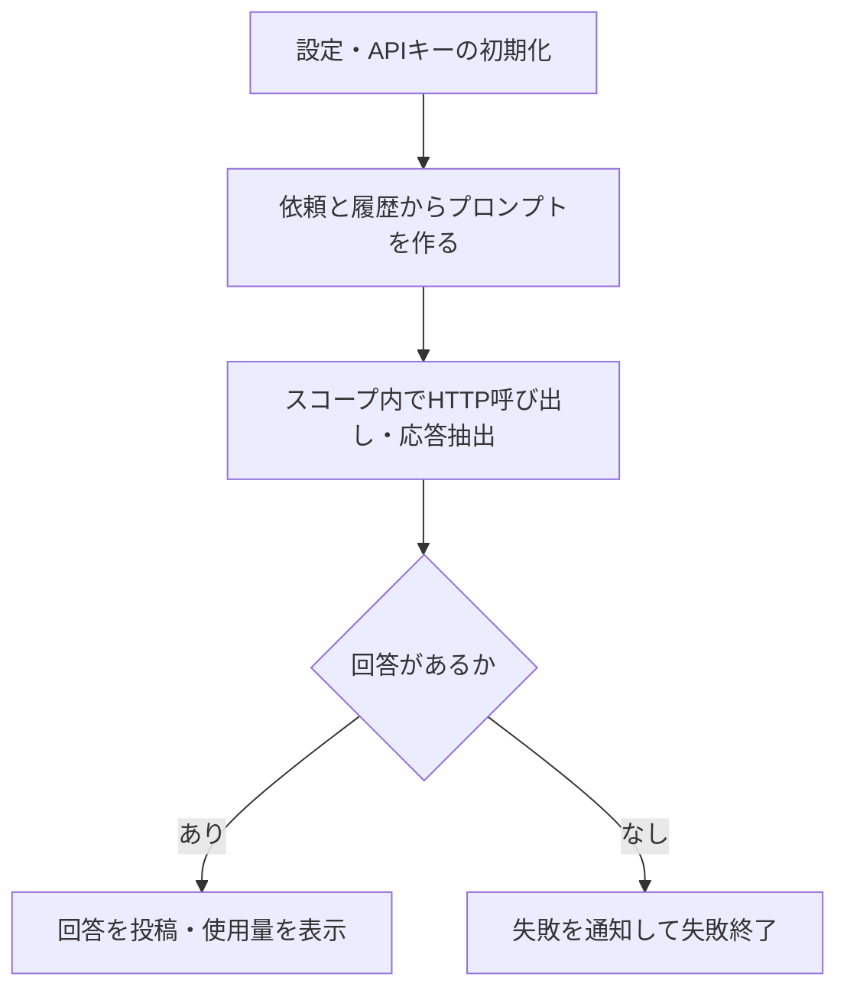

# Power AutomateからLLM APIを呼ぶ実装パターン

Power AutomateのクラウドフローからHTTPアクションでLLM APIを呼び、応答の抽出、失敗の通知、使用量の表示までを組み立てた記録。Claudeの同期呼び出しを実測した経路と、作成したが未実行のOpenAI経路を分けて読む。

以下は2026-11-09〜11-11の提供資料の整理である。今回の取り込みではAPI仕様・料金・制限の再確認やフローの実行を行っていない。本文の実測は元資料の作業環境での報告を指す。

## 設定から回答までの構成

モデル、出力上限、システムプロンプト、料金表等は先頭の「作成」アクションへJSONで集約する。トリガーは後続アクションを参照できず、変数の初期化は最上位に置く必要があったため、すべてを同じ設定オブジェクトへ移す構成ではない。

## APIキーとJSONの扱い

提供資料で採用したのは、キーを変数1つに置き、初期化の入力・出力とHTTPアクションの入力を保護する方式。実行履歴で隠す設定であり、フロー編集者から定義内のキーを隠す仕組みではない。

キーの前後の改行がヘッダーを壊した事例から、参照時に`trim()`するよう変更した。キーを含む定義をそのまま書き出さず、バックアップでは値を伏せる。カスタムコネクタの接続やKey Vault連携は、条件の異なる代替案として記録されている。

文字列を連結してJSON本文を作る経路では、バックスラッシュ、引用符、改行のエスケープを行った。本文をオブジェクトとして組み立てる経路へ同じ処理を重ねると、二重エスケープの可能性がある。OpenAI経路はこの点も含めて未検証である。

## 応答の抽出と失敗の扱い

- Claudeの`content`配列から、`type`が`text`のブロックを選ぶ。資料の実装は最初のtextブロックを使うため、複数ブロックの連結を実装した記録ではない。
- 空配列の`first()`がnullとなった実測を受け、`coalesce(…,'')`で空文字へ寄せた。抽出結果が空なら、成功回答として扱わない。
- HTTPと抽出をスコープへまとめ、後続の回答確認は成功・失敗・タイムアウト・スキップを実行条件に含める。
- 通知を投稿してから失敗終了する。「終了」を先に実行すると、フロー全体が止まり通知へ進まない。
- 金額の計算だけが失敗した場合も回答を投稿できるよう、回答と末尾表示の成否を分ける。

再試行は、重複課金と待ち時間を避ける目的で「なし」にした当該フローの方針である。すべてのAPI連携で再試行を禁止する一般則ではない。

## 同期・非同期と時間の制約

| 経路 | 提供資料の結果 | 確認の範囲 |
|---|---|---|
| Claude Messages API・同期 | API部分2〜5秒、フロー全体11〜17秒 | 当該チャット用途の実測 |
| Claude Message Batches API・非同期 | 30秒おきに状態確認し、回答まで2分48秒 | 一度の構成・負荷での実測 |
| OpenAI Responses API・background | 15秒おきに状態確認する経路を作成 | 未実行 |

資料はHTTPアクション1回の上限を120秒、フロー全体の上限を30日と記録する。個々の要求の待ち時間と、要求を分けた長期処理を区別する。長い生成の実測や、設定変更で超過を防げる頻度は未確認である。

## 使用量とTeams表示

概算金額は、応答の入力・出力トークン数に、資料時点のUSD／100万トークン単価を掛けて求める。応答の`model`に対応する単価がなければ「不明」とし、推測の値を出さない。

サーバー側フォールバックの設定例もあるが、切替時の`usage`が途中の消費をすべて含むかは資料でも未確認。表示額を請求総額の確定値としない。モデル名、`effort`、ベータヘッダー、単価の詳細は原本に保存した当時の設定例である。

Teams向けには、HTMLを素のテキストへ直して履歴にし、回答はHTMLエスケープ後に改行を` `へ変換した。文字数による切り詰めはエスケープ前に行い、エンティティの途中を切らない。資料の約28KBという上限と、文字数の上限は同じ単位ではなく、文字数だけで投稿サイズを保証するものではない。

資料の「TeamsではMarkdownを使わない」は、この投稿経路の表示方針として扱う。Teamsのすべての投稿機能について表示形式を確認した結果ではない。

## 式のつまずきと未確認事項

| 資料の観測 | 設計へ残す点 |
|---|---|
| `coalesce`は空文字で代替値へ切り替わらなかった | 空文字を含む場合は`empty()`で条件を分ける |
| 整数同士の`div`で整数の結果になった | 金額計算では`float()`へ変換する |
| `substring`の開始位置で範囲外になった | HTML断片の処理を`split`等へ変更した経緯を残す |
| フィルターは各要素の変換には使えなかった | 要素を残す処理と、「選択」による変換を分ける |

OpenAI経路、長時間生成のタイムアウト頻度、フォールバック時の課金内訳は未解決。入力整理後に文字数が減ったという比較は、同一環境の観測であり、回答品質を統制して測った評価ではない。

## 関連・参考資料

- [[TeamsからPower Automateを起動する方式と認証の制約]]
- [[AIによるPower Automateフロー作成と更新の検証]]
- [[Teams AIボットの構成と運用引継ぎ]]
- 原本：[[Sources/Power Automate and Teams 20261111/Power AutomateからLLM APIを呼び出す構成の元資料]]。
- 元ファイル：`Power-Automate-LLM-API-Knowledge-20261111.md`。
- 資料の調査期間：2026-11-09〜11-11。取り込み日：2026-11-12。
- 元資料はAnthropic API資料とClaude Codeの作業記録を参照するが、一次資料の具体的なURLは記載されていない。
