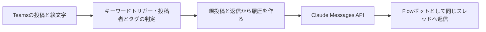

# Teams AIボットの構成と運用引継ぎ

標準チャネルの投稿にカスタム絵文字を付けると、Power Automateがスレッドの会話を読み、Claudeで回答を作って同じスレッドへ返すボットの運用記録。元資料では2026-11-11に本番稼働を開始したと記録されている。

このノートは2026-11-09〜11-11の提供資料を整理したもの。今回の取り込みでは現行フローの定義・稼働状態・所有者・購読を確認していない。`status: Researching`はナレッジの確認状態であり、元資料が報告した稼働状況とは別である。

## 呼び出しと処理の構成

資料の投稿者表示は「Workflows」。文字だけの呼び名やボットの投稿で起動した場合は、回答せず正常終了する。依頼の投稿を取得できない場合は失敗終了し、通知も投稿しない。AI呼び出し後に回答が空・失敗となった場合は、失敗通知を返信して失敗終了する。

履歴には、別に取得した先頭投稿と返信を使う。呼び出した投稿を依頼と履歴へ二重に入れず、「考え中です…」と失敗通知も除く。過去のボット回答は残してよいが、使用量の行を外し、HTMLと絵文字タグを素のテキストへ整える。

## 当時の設定と実測

| 項目 | 提供資料の記録 |
|---|---|
| 構成 | クラウドフロー1つ、キーワードトリガー、Claudeの同期API |
| モデル設定 | `claude-sonnet-5-5`、`effort: high`、`max_tokens: 16000` |
| 履歴と表示 | 履歴件数50、表示上限8000文字 |
| 待ち時間 | 全体11〜17秒、うちClaude部分2〜5秒 |
| 費用表示 | 1回答約$0.002〜0.006と報告 |
| 実行量 | 1回答約90アクションと報告。定義上のアクション数とは別 |

すべて当該環境・時点の記録である。モデルの現在の提供状況、現在単価、別環境の速度・実行枠を保証しない。金額は応答の使用量と設定内の料金表による計算で、フォールバック時の請求内訳は未確認である。

トリガーのチーム・チャネル・キーワードは直接設定し、モデル・出力上限・プロンプト・料金表等は先頭の「設定」アクションへ置く。APIキーは専用変数にある。プロバイダ選択の値があっても、OpenAI経路は未検証のため、切替だけで動作確認済みとはならない。

## 変更・引継ぎ時に参照する場所

| 対象 | 元資料の運用手順 |
|---|---|
| チャネルの追加・削除 | トリガーの一覧を変更し、対象ごとの購読を確認する。新規チャネルは自動追加されない |
| 呼び名 | トリガーのキーワードと設定の呼び名をそろえる。絵文字の実際のタグも確認する |
| モデル・プロバイダ | 設定、対応するAPIキー、料金表を一緒に確認する |
| キーの更新 | 値を文書・ログへ出さず、履歴の保護を維持する |
| オン・オフ | 購読の解除・再作成を伴うと記録されている |
| 復元 | キーを伏せたバックアップへ現在のキーを入れ直し、読み戻して確認する |
| 別チームへの展開 | 複製先のチーム・チャネル・設定を変更し、対象全件の購読と実機動作を確認する |

定義変更前のバックアップと変更後の確認は元資料の運用手順である。今回、実フローの変更・展開を実施したものではない。トリガー履歴の`responses`は先頭だけでなく、チャネル数に対応する全件を見る、という失敗からの教訓を残す。

## 障害の切り分け

| 症状 | 資料の確認点 |
|---|---|
| 呼んでも起動しない | 対象チャネル、絵文字がタグになっているか、フロー状態、最近の購読登録 |
| 「考え中です…」以降が出ない | 実行履歴のAI呼び出しと前段の状態 |
| 失敗通知が返る | API応答のエラー種別、キーの種類・失効、残高・上限・拒否 |
| 回答が絵文字や使用量に触れる | プロンプトへ渡す履歴の整形 |
| フローが連続起動する | ボット投稿の除外。元資料の緊急対応は停止してから調査 |
| 金額が不明・表示されない | 応答モデルと料金表、計算アクション。回答の成功とは分けて見る |
| `@AIBot`でエラーが出る | 以前の送信Webhookが残っていないか |

入力・出力の履歴には社内の会話が残る。資料に含まれるのは処理・設定の説明で、APIキーや環境・チーム・チャネル等の実IDは記載されていない。

## 引継ぎに残る課題

- 所有者は資料時点で1名、共同所有者なし。不在時の接続・管理継続が課題として挙げられているが、現在も同じ状態かは未確認。
- 購読応答の`Deprecation`・`Sunset`ヘッダーの意味が未確認。稼働実績だけで将来の継続性を判断しない。
- 会話は外部AIサービスへ送られ、実行履歴にも残る。利用範囲とデータ取扱いの運用を引き継ぐ必要がある。
- HTTP待ち時間、1日あたりの実行枠、OpenAI経路、設定箇所の区切り等が未解決。
- 絵文字はIDではなく名前で判定している。元資料群の`aibot`／`AIBot`表記と実設定の対応も要確認。

## 関連・参考資料

- [[Power AutomateからLLM APIを呼ぶ実装パターン]]
- [[TeamsからPower Automateを起動する方式と認証の制約]]
- [[AIによるPower Automateフロー作成と更新の検証]]
- [[AI実行ガバナンスと人間の監督]]
- 原本：[[Sources/Power Automate and Teams 20261111/Teams向けAIボットの運用と権限管理の元資料]]。
- 元ファイル：`Teams-AI-Bot-Operations-Knowledge-20261111.md`。
- 資料の調査期間：2026-11-09〜11-11。取り込み日：2026-11-12。
- 提供資料の主な参照先：[Teamsコネクタ](https://learn.microsoft.com/en-us/connectors/teams/)、[Get chatMessage](https://learn.microsoft.com/en-us/graph/api/chatmessage-get?view=graph-rest-1.0)。作業記録、システムプロンプト、当時の料金表は原本に保存。
