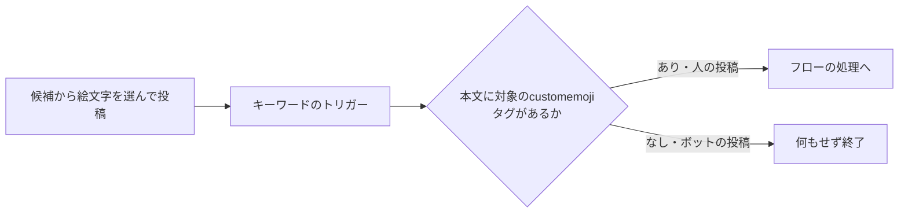

# TeamsからPower Automateを起動する方式と認証の制約

Teamsのチャネルからフローを呼ぶ入口を比較し、カスタム絵文字とキーワードトリガーを採用した記録。送信WebhookからHTTPトリガーへの直結が認証で拒否されたことが、方式を選び直すきっかけになった。

以下は2026-11-09〜11-11の提供資料の整理であり、今回の取り込みではTeams・Power Automateの現在仕様の再確認、設定変更、投稿や疎通試験を行っていない。実測と、文献・他サービスの事例による検討を分けて読む。

## 送信WebhookとHTTPトリガーの組み合わせ

資料の構成では、Teams送信Webhookの`Authorization: HMAC …`と、HTTPトリガーURLのSAS署名が同じ要求へ付いた。入口で401と`DirectApiRequestHasMoreThanOneAuthorization`が返り、フローの実行・トリガー履歴にも残らなかったと報告される。

```text
Teams送信Webhook
  └─ URLのSAS署名 + AuthorizationのHMAC
       └─ Power Automateの入口で401
            └─ フロー本体は起動しない
```

同じURLをAuthorizationヘッダーなしで呼ぶと起動した、という切り分けも実施されている。Bearer認証向けの設定へ変えるだけではHMACを受ける方式にならない、というのが資料の調査結果である。

これは資料時点の構成・認証条件に対する結論であり、将来の対応やすべての中継構成まで不可能としたものではない。中継で受け直す案は他サービスの事例を参照した検討で、当該Teams環境での実測ではない。

## 採用したカスタム絵文字の入口



キーワード`aibot`がカスタム絵文字の`alt`に一致して起動し、本文の`<customemoji …>`タグを確認して呼び出しかどうかを決める。文字だけの`aibot`でもトリガーは起動するが、タグがなければ回答しない。ボット自身の投稿も除外し、連続起動を防ぐ。

候補から選ぶ操作はできるが、本物の`@`メンションではなく、メンションの通知や相手の表示も持たない。文字のまま送った`:aibot:`へ反応する仕様でもない。

元資料群には`aibot`と`AIBot`の表記がある。実際のトリガーのキーワード、設定の呼び名、保存されたタグの`alt`が一致するかは、大小文字も含めて導入先で確認する必要がある。

## トリガー選択の比較

| 方式 | 資料の観測・記載 | 制約の読み方 |
|---|---|---|
| キーワードが言及された場合 | 0.3〜1.3秒で通知、返信でも起動を実測 | メッセージ全体の文字にも一致するため、後段の絞り込みが必要 |
| チャットまたはチャネルに新しいメッセージが追加されたとき | Webhook型、返信でも起動を実測 | 全投稿が対象になりうる |
| チャネルに新しいメッセージが追加されたとき | ポーリング型、返信は対象外と記載 | 名前が近い別トリガーと区別する |
| チャネルで自分がメンションされたとき | 3分おきのポーリング、返信は対象外と記載 | 接続したユーザーへのメンション |
| 自分が@メンションされたとき | Webhook型、返信対応はコミュニティ解説による | 既定環境等の条件があり、当該環境では未実測 |

資料の選定条件では、専用ユーザー、中継サーバー、Copilot Studio等を使えなかった。カスタム絵文字は、この条件下で動いた代替案であり、どの組織にも最適という比較ではない。

対象チャネルは明示的に列挙し、チーム内の新規チャネルを自動で取り込む構成ではない。非公開・共有チャネルは資料の対象外。トリガー固有の条件を、Teamsの全API・全機能の制約へ広げない。

## 親投稿と返信の取得

- 資料のトリガー出力では、新規投稿の`replyToMessageId`は自身のID、返信では親IDになった。
- 返信IDを「メッセージの詳細を取得する」へ渡すとNotFoundになったため、親IDで返信一覧を取得し、IDで絞った。
- 親投稿は返信一覧に含まれないので別に取得する。資料で使用した返信一覧は新しい順・最大50件だった。
- ボットの投稿には`from.application`があり、`from.user`がないことを確認した。初回投稿時のシステム通知も通常の依頼と区別する。

これらは使用したコネクタの出力・アクションの観測であり、Graph全体で返信やページングが同じ制限になることを意味しない。

## 購読と未確認事項

キーワードトリガーは、指定したチャネルごとに購読を作ったと記録される。期限72時間、約6時間おきの再登録は資料の観測であり、現在のサービス保証ではない。

購読応答には`Deprecation: 2024-04-29`と`Sunset: 2026-04-29`があった一方、11月の検証では通知が届いた。ヘッダーが何を指すかは未確認で、廃止済み・今後も利用可能のどちらにも断定しない。

他の未確認事項は、Webhook中継のTeamsでの実測と、「自分が@メンションされたとき」の返信対応の公式記載・実機確認である。

## 関連・参考資料

- [[Power AutomateからLLM APIを呼ぶ実装パターン]]
- [[AIによるPower Automateフロー作成と更新の検証]]
- [[Teams AIボットの構成と運用引継ぎ]]
- [[Microsoft Copilotの現在地]]
- 原本：[[Sources/Power Automate and Teams 20261111/Teamsを入口にPower Automateを呼び出す構成の元資料]]。
- 元ファイル：`Teams-to-Power-Automate-Knowledge-20261111.md`。
- 資料の調査期間：2026-11-09〜11-11。取り込み日：2026-11-12。
- 提供資料の主な参照先：[Teamsコネクタ](https://learn.microsoft.com/en-us/connectors/teams/)、[送信Webhook](https://learn.microsoft.com/en-us/microsoftteams/platform/webhooks-and-connectors/how-to/add-outgoing-webhook)。個別の検証範囲とその他の出典は原本を参照。
