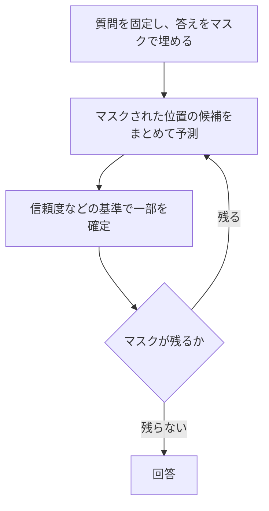

# テキストのマスク拡散と自己回帰生成の違い

マスク拡散による文章生成は、答えの一部を穴にした状態から複数の位置を予測し、何回かに分けて埋めていく方式である。前から次のトークンを生成する自己回帰と比べ、1回の計算で複数の位置を進められる可能性がある。

以下は2026-11-19作成の提供資料の整理。説明するのは、穴の中から自信のある位置を確定し、確定後には書き直さない例である。すべての拡散言語モデルが同じ確定方法や注意範囲を使うわけではない。今回の取り込みでは論文の再確認やモデル実行を行っていない。

## 穴を繰り返し埋める例

元資料の例では、先に埋まった位置も参照して残りを予測し直す。1回で全文を確定する方式とは異なる。入力と出力の長さの決め方、同時に確定する数、確定済みの位置を再びマスクするかは、モデルや生成手順によって異なる。

## 自己回帰と比べる

| 項目 | 一般的な自己回帰生成 | 資料で説明するマスク拡散 |
|---|---|---|
| 生成の進め方 | 直前までの文脈から次のトークンを生成 | 複数の穴を予測し、一部を確定して繰り返す |
| 参照する位置 | 因果マスクで未来の位置を隠す | 例では、答えの前後にある確定済み位置も参照する |
| 途中結果の再利用 | 過去トークンのKVキャッシュを使える | 答えの状態が各回で変わるため、そのまま同じ再利用はできない |
| 早い時点の誤り | 生成済みの前文が後続へ影響しうる | 確定済みを直さない方式では、誤確定が残りうる |

「語」は説明上の単位であり、実装上は通常トークンとして扱う。自己回帰でも、KVキャッシュの効果や実速度は実装・ハードウェア・生成条件に左右される。

因果マスクは、注意機構の各位置から未来の位置への参照を制限する仕組みである。誤差逆伝播はモデルの学習で勾配を計算する方法で、生成が自己回帰か拡散かとは別の軸になる。

## 速さと品質の条件

資料の例では、1回で多くの位置を確定できる一方、残りを埋めるたびに広い範囲を再計算する。通常の自己回帰用KVキャッシュをそのまま使えないため、反復回数を減らせば必ず速いとは限らない。固定された入力部分の再利用や、拡散向けのキャッシュ・ブロック化などの工夫を一律に否定するものでもない。

確信度のしきい値を下げて1回で多く確定する方法には、早く進む可能性と、誤った位置を固定する可能性がある。確定後に修正しない方式では、誤りが後の予測の前提になりうる。しきい値と品質の関係は、各方式とデータで評価する。

比較には少なくとも、同等の品質・回答長、反復回数、キャッシュ、バッチサイズ、ハードウェア、最初の応答までの時間と生成全体の時間をそろえる必要がある。複数位置を並列に扱えることだけでは速度差は決まらない。

## 調査時点の見立て

提供資料は、ゼロから学習した8Bの拡散モデルについて、数学やコードで自己回帰との差が残る一方、差は縮んでいるという論文紹介を挙げる。対象の評価条件や全分野を今回確認したものではない。

「精度が追いつけば主流になりうる」は会話中の見通しであり、将来の普及や速度優位を示す実験結果ではない。

## 未確認事項

- 自己回帰と同等の品質条件での速度・計算費用・必要メモリ。
- 反復回数、しきい値、早期の誤確定と修正方法の関係。
- 数学・コード・日本語・長文等での品質差と、比較モデルの条件。
- 拡散向けキャッシュやブロック化が実際にどこまで有効か。

## 関連・参考資料

- [[Diffusion Qwen3.8 27Bの双方向化と未検証の性能]]
- [[LLMを理解するためのニューラルネットワーク基礎]]
- [[ローカルLLMはなぜ検索なしで答えられるのか]]
- 原本：[[Sources/Knowledge Batch 20261122/テキスト拡散言語モデルの元資料]]。
- 元ファイル：`Text-Diffusion-LM-Knowledge-20261119.md`。資料の調査日：2026-11-19。取り込み日：2026-11-22。
- 提供資料の参照先：[8B拡散モデルの論文紹介](https://hyper.ai/ja/papers/2606.25331)。元資料は論文紹介を参照しており、今回の取り込みで論文本文を確認していない。
