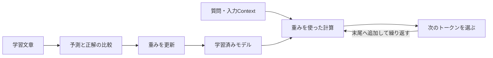

# ローカルLLMはなぜ検索なしで答えられるのか

検索機能を接続していないローカルLLMは、学習で調整された重みと、その時に渡された入力から、次のトークンを計算して文章を生成する。外部の文書を検索することと、重みを使って計算することは別である。

このノートは2026-10-23調査の提供資料を整理したもの。モデル別の仕様・公開日・容量・ベンチマークや研究結果は資料時点の記載であり、今回の取り込みでは出典の再検証やモデル実行を行っていない。学習の仕組み、研究の条件、会話での推測を区別する。

## 学習・推論・外部情報を分ける

| 段階 | 何をするか | 重みとの関係 |
|---|---|---|
| 学習 | 文章から次のトークンを予測し、誤差を使って調整する | 重みを更新する |
| 推論 | 入力と重みから次のトークンの確率を求め、選んで続きを作る | 通常の推論だけでは学習済み重みを更新しない |
| 検索・RAG | 関連する外部情報を探し、質問と一緒に入力する | 入力Contextを補う |



知識は、項目別の辞書のように一か所へ格納されるというより、多くの重みの組み合わせとして表れる。ここでいう重みと、検索用データベースは同じものではない。

同じ質問でも、トークンの選び方などの生成条件によって回答が変わる場合がある。流暢な続きを出すことは、内容の事実確認を済ませたことを意味しない。

## パラメータ数とMoE

`B`は10億を表し、8Bは80億パラメータという読み方になる。MoEはトークンごとにエキスパートの一部を選ぶ構成であり、総数とアクティブ数を分けて読む。

| 数字 | 主な見方 | その数字だけでは分からないこと |
|---|---|---|
| 総パラメータ数 | 重み全体の保存容量・配置を考える目安 | 実際の知識量、必要な全実行メモリ、品質 |
| アクティブパラメータ数 | 1トークンで使う計算量の目安 | 実機での速度、転送・通信の負担 |

資料中の命名例`Qwen3.6-35B-A3B`では、35Bが総数、A3Bがアクティブ3Bという説明になっている。アクティブ3Bだから重みの保存先も3B分だけでよい、とは判断しない。

DenseとMoEの大小は、同じ数字だけで比較しない。MoEでも重み全体の配置先と、必要な部品を読み出す方法が問題になる。CPUメモリへの配置やGPU間の構成が速度へどう影響するかは実測する。

## 量子化は個数を減らす操作とは違う

量子化は重みを表す精度・表現を変えて容量を減らす方法であり、枝刈りのように重み自体を取り除く操作と区別する。

重みだけの単純な容量計算は次のように置ける。

```text
重みの概算バイト数 = 総パラメータ数 × 保存ビット数 ÷ 8
```

| 総パラメータ数 | 16bit | 8bit | 4bit |
|---|---:|---:|---:|
| 8B | 約16GB | 約8GB | 約4GB |
| 35B | 約70GB | 約35GB | 約17.5GB |

表は十進GBでの理論的な重み容量である。量子化方式の付加情報、KVキャッシュ、作業領域、実行基盤等を含む実使用メモリとは別にする。4bitの全パラメータが同じ扱いになるとも限らないため、配布ファイルと実行設定で確認する。

量子化による品質変化はビット数・手法・モデル・用途で評価する。資料の「8bitなら差が小さい」「4bitも実用的」という説明を、あらゆるタスクで無劣化という保証にしない。

## 約2bit／パラメータという研究結果の範囲

提供資料は「Physics of Language Models: Part 3.3, Knowledge Capacity Scaling Laws」の結果として、十分に学習させた条件で約2bit／パラメータの知識容量、8bit量子化でもその値が保たれたという報告を紹介している。

これは重みを保存する精度の8bit・4bitとは別の指標であり、市販モデルが常に同じ割合で知識を保持する保証でもない。資料では同じ知識を約1,000回見せる条件に触れている。4bit以下でも同じ容量を保つかは、資料の確認範囲に含まれない。

実際の学習データには雑音、重複、出現頻度の差がある。「頻出の事実は残りやすく、まれな話題は残りにくい」という部分は、提供資料でも推測を含む。容量の議論を、そのまま各モデルの知識を正確に数えた結果とは扱わない。

## 古い・不足した知識を入力で補う

学習済みの重みだけでは、学習後の出来事や不足している事実を確実に答えられない。関連資料を検索してContextに渡すことで補うのが、提供資料の整理である。


ここでは重みを学習し直したのではなく、現在の入力を増やしている。会話や入力を保存する仕組みと、モデルへの学習も別である。

RAGは関連情報を検索して生成へ渡す仕組みとして捉える。文書が的外れ、根拠が誤っている、必要な部分がContextに入らない場合は、検索をつないだだけでは正答を保証できない。

知らない内容でももっともらしい回答を作りうる点は重要だが、この資料の知識容量の説明だけで、ハルシネーション全般の原因を一つに決めない。

## 大きいモデルと賢いモデルを同一視しない

提供資料にはGLM・Qwenの複数世代の総数・アクティブ数、4bit容量、メーカーのベンチマークが記載されている。比較では次を分ける。

- どの世代・版を比較しているか。
- 総数かアクティブ数か。
- 保存精度・量子化方式は何か。
- 知識量、推論、コーディング等のどの能力を評価しているか。
- メーカー公表値か、独立検証か。

「GLMがQwenの3倍」という表現も、比較する版と数字によって向きが変わる。元資料の最新・最大という表現を、取り込み後も有効なランキングとして固定しない。

新しい小型モデルが古い大型モデルを上回る例も資料にあるが、データ品質、合成データ、蒸留、学習後の調整等を原因とする説明は、会話中の見立てを含む。モデル容量だけで実用上の品質を判定しない。

## 未確認事項

- GLM-5.3の744Bと公開ファイル集計約753Bの差。
- 資料に登場するモデルより新しい世代・仕様の有無。
- 世代ごとの学習トークン数と出現頻度・知識保持量の関係。
- 4bit以下の量子化が知識容量とタスク品質へ与える影響。
- メーカーのベンチマークの独立検証。
- 手元の実行環境での重み配置、作業メモリ、速度、品質。

具体的なモデル名・容量比較・参照URLは元資料に全文保存している。

## 関連

- [[LLMを理解するためのニューラルネットワーク基礎]]
- [[LLMの「賢さ」と品質グラフの読み方]]
- [[DeepSeek Harnessのプラグイン構成とKVキャッシュ]]
- [[企業向け完全ローカルAIアシスタント]]
- [[検索拡張生成とナレッジグラフの併用]]
- [[企業向け蒸留モデル]]

## 参考資料

- 原本：[[Sources/Local LLM Weights/ローカルLLMの重みとモデルファイルの元資料]]。
- 元ファイル名：`LocalLLM-Weights-Knowledge-20261023.md`。
- 資料の調査日・取り込み日：2026-10-23。
- 研究結果の参照先（提供資料より）：[Physics of Language Models: Part 3.3, Knowledge Capacity Scaling Laws](https://arxiv.org/abs/2404.05405)。

