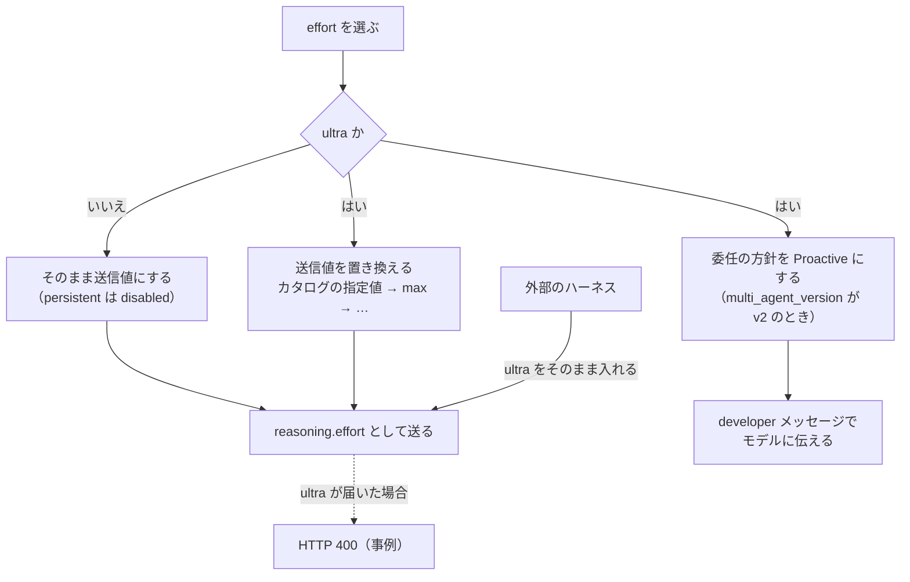

# Codex の reasoning effort「ultra」の仕様

- 調べた日: 2026-10-26
- 対象: openai/codex のデフォルトブランチ（コミット 970111f、2026-10-23）
- 書き分け: ソースで確かめた事実はそのまま書き、推測には「（推測）」、会話での検討には「（検討）」を付けています。

## 概要

ultra は Responses API の `reasoning.effort` にそのまま送る値ではなく Codex が実装しているモードです。Codex は ultra が選ばれると、送信の直前に推論の値を別の値へ置き換えます。あわせて、サブエージェントへの委任の方針を「頼まれたときだけ」から「自分の判断で」に切り替えます。

- ultra のときに送る値は、カタログでモデルごとに指定した値です。指定がないモデルでは基本的に max を送ります。同梱カタログでは、gpt-6-astra と gpt-6.1-sol が xhigh で、ほかの ultra 対応モデルは max です。
- ultra と persistent 以外の値はそのまま送ります。persistent は "disabled" に置き換えます。
- サブエージェント用のツールを出すかどうかは、effort と関係ありません。ultra が変えるのは、ツールを使うかどうかの方針です。
- 外部のハーネスから ultra を選んで送ったところ、HTTP 400 になった事例があります。

## 理解に必要な前提

### 送信値としての reasoning effort

Responses API では推論にかける量をリクエストの `reasoning.effort` で指定します。Codex はこの値を `ReasoningEffort` という型で扱い、none、minimal、low、medium、high、xhigh、max、ultra、persistent の名前を持っています。Codex が知らない名前も、モデルが定義した値（`Custom`）としてそのまま受け取ります。

### モデルのカタログ

Codex はモデルごとの情報をカタログとして持ちます。モデル管理は同梱のカタログ（`models-manager/models.json`）、キャッシュ、サーバーの `/models` を使う作りです。カタログのうち、effort に関係する項目は次のとおりです。

- `supported_reasoning_levels`: そのモデルで選べる effort の一覧。ultra に対応するモデルでは ultra も入っています。
- `multi_agent_reasoning_effort`: ultra を選んだときに、マルチエージェントの作業で使う effort。
- `multi_agent_version`: マルチエージェント機能の版（v1、v2）。

### Codex のマルチエージェント

Codex には作業をサブエージェントに任せるためのツール（`spawn_agent` など）があります。ツールを出すかどうかは `multi_agent_version` と設定で決まり、effort は条件に入っていません（`core/src/tools/spec_plan.rs` の `collab_tools_enabled`）。

ツールを使うかどうかの方針は、developer ロールのメッセージでモデルに伝えます。方針は `MultiAgentMode` で表し、既定は `ExplicitRequestOnly` です。

- `ExplicitRequestOnly`: 利用者か、AGENTS.md・スキルの指示がはっきり求めたときだけ、サブエージェントを起動するよう伝えます。
- `Proactive`: 並列にすると時間が短くなるか品質が上がるなら、ルートでもサブエージェントでも自分の判断で委任するよう伝えます。利用者の依頼はこの方針より優先されます。
- `Custom`: 設定かカタログで渡した文言をそのまま使います。

## 解説

### 送信値の置き換え

`ModelInfo::resolve_reasoning_effort`（`codex-rs/protocol/src/openai_models/reasoning_effort.rs`）が、選んだ effort を送信値に置き換えます。リクエストの `reasoning.effort` を組み立てる `build_reasoning`（`core/src/client.rs`）は、この関数を必ず通します。サブエージェントの起動、メモリ要約のリクエスト、会話に差し込む設定更新の項目でも、同じ関数を使っています。

```text
ultra      → multi_agent_reasoning_effort（ultra 以外で、そのモデルが対応する値のときだけ使う）
           → なければ max（そのモデルが対応していれば）
           → なければ supported_reasoning_levels を後ろから見て最初の ultra 以外の値
           → それもなければ medium
persistent → "disabled"
それ以外    → そのまま
```

persistent を置き換えるのは、ローカルの設定で使う名前と、Responses API での名前が違うためです。

単体テスト（`reasoning_effort_tests.rs`）では ultra について次の組み合わせを確かめています。

| モデルが対応する値 | multi_agent_reasoning_effort | 送信値 |
|---|---|---|
| high, max, ultra | high | high |
| high, max, ultra | なし | max |
| high, xhigh, ultra | なし | xhigh |
| high, xhigh, ultra | ultra | xhigh |
| high, xhigh, ultra | low（対応外） | xhigh |

### 委任の方針の切り替え

`core/src/session/multi_agents.rs` の `effective_multi_agent_mode` は、effort が ultra なら方針を `Proactive` にし、それ以外なら `ExplicitRequestOnly` にします。この切り替えは、`multi_agent_version` が v2 のときだけ働きます。

設定（`[features.multi_agent_v2]` の `multi_agent_mode_hint_text`）かカタログに方針の文言があれば、effort に関係なくそちらを使います。文言が空でもそちらが優先され、その場合は方針のメッセージを入れません。

V2 のサブエージェントを起動するとき、Codex は送信値に置き換えた effort を起動時の記録に残しますが、子の設定上の effort は変えません。コードのコメントには、ultra なら子でも Proactive の動きが続くと書かれています（`core/src/agent/api.rs`）。子がどの effort を設定として持つか（親から引き継ぐ条件）は調べていません。

### TUI での扱い

Codex の TUI は effort の選択画面で max と ultra を「More reasoning…」という項目の下にまとめています。項目の説明には使用量の上限を早く消費すると書かれています。この分け方は画面上のもので、送信値は変わりません。

effort を上げるショートカットは ultra に進まず、/model から「More reasoning…」を開くよう案内を出します。

ultra に切り替えるとき、`features.multi_agent_v2.max_concurrent_threads_per_session` が 8 以上なら警告を出す処理があります。警告では複数のエージェントを自分から使って使用量が急に増えうることを伝え、8 未満にするよう勧めます。

### 処理の流れ



### モデルごとの送信値

同梱カタログ（コミット 970111f）の主なモデルでは、ultra の扱いは次のとおりです。実行時に `/models` から届く値と同じかは確かめていません。

| モデル | 選べる effort | ultra のときの送信値 |
|---|---|---|
| gpt-6-astra | low〜max, ultra | xhigh |
| gpt-6.1-sol | low〜max, ultra | xhigh |
| gpt-6-sol | low〜max, ultra | max |
| gpt-5.6-sol | low〜max, ultra | max |
| gpt-5.6-terra | low〜max, ultra | max |
| gpt-6-luna | low〜max | ultra なし |
| gpt-5.6-luna | low〜max | ultra なし |
| gpt-5.5 | low〜xhigh | ultra なし |

## 似たものとの違い

### ultra と max

| 項目 | max | ultra |
|---|---|---|
| 送る reasoning.effort | max | カタログの指定値か max（同梱カタログでは xhigh か max） |
| 委任の方針 | ExplicitRequestOnly | Proactive（multi_agent_version が v2 のとき） |
| サブエージェント用のツール | effort と関係なく、設定しだいで出る | 同じ |

ultra を選んでも、1回のリクエストで送る推論の値は ultra 以外の既存の値です。Codex が ultra のために max より深い値を送ることはありません。ultra は1つのエージェントの推論を深くするのではなく作業を分けて並列に進める選択肢だと整理できます（検討）。

### ultra と明示的な委任の依頼

max でも、利用者がサブエージェントや並列の作業をはっきり頼めば、同じツールで委任できます。違いは委任するかをモデルが自分で決めるかどうかと、送る effort の値です。

### ultra と persistent

どちらも Codex の中の名前で、送る前に置き換わります。ultra は送信値と委任の方針を変え、persistent は "disabled" として送ります。persistent が何を変えるかは調べていません。

### ultra と multi_agent_mode_hint_text

委任の方針だけなら、設定の `multi_agent_mode_hint_text` で文言ごと指定できます。この設定は effort に関係なく使われるので、ultra を選ばずに方針だけを変えられます（`multi_agent_version` が v2 のとき）。

## 会話でわかったこと

### 外部のハーネスで起きた HTTP 400

外部のハーネスで effort を low〜ultra から直接選べるようにしたところ、max の作業は正常に完了し、ultra だけが HTTP 400 になりました。

Codex は送信の前に上の置き換えを通すので、確認した経路では "ultra" という値をリクエストに載せません。そのハーネスは置き換えを通さずに "ultra" を `reasoning.effort` に入れ、API が受け付けなかったと考えられます（推測。レスポンス本文とリクエスト本文は未確認）。

カタログの `supported_reasoning_levels` には ultra が入っているので、カタログから選択肢を作ると ultra も並びます。この一覧は Codex の画面で選べる値の一覧で、API にそのまま送れる値の一覧ではありません（検討）。

### ultra の位置づけ

「サブエージェントを使う設定に切り替えるボタン」という見方は近いものの、2点を補う必要がありました（検討）。

まず、ultra はツールを出すスイッチではありません。ツールを出すかどうかは effort に関係なく決まり、ultra はツールを使うかどうかの方針を切り替えます。次に、effort の値も一緒に切り替わります。モデルによっては max より低い xhigh になります。

このため、ultra は「推論の値のプリセット」と「自分の判断で委任する方針」を一度に切り替えるボタン、と考えるのが近いです（検討）。

### 外部のハーネスでの扱い方

この節の内容はすべて会話での検討です。

- effort の選択肢に、API にそのまま送れる値（low〜max など）だけを並べれば、ultra による HTTP 400 は起きません。
- ultra を選択肢に残すなら、送る前に Codex と同じ置き換えが要ります。「ultra なら max」と決め打ちせず、カタログの `multi_agent_reasoning_effort` から上の順で決めると、Codex と同じ値になります。
- 置き換えだけでは、中身は max か xhigh で動く1つのエージェントです。並列の委任が要るなら、ハーネス側で委任の仕組みと方針の指示を用意するか、その部分を Codex 本体に任せる方法があります。Codex に ultra のまま渡せば、置き換えも方針の切り替えも Codex の中で行われます。
- ハーネスが自前で作業者を立てる作りなら、ultra に当たるのは「オーケストレーターが自分の判断で作業者を増やすか」という設定です。作業者ごとの effort の選択肢に並べるものではありません。

## 未解決事項

- HTTP 400 のレスポンス本文と、ハーネスが送ったリクエスト本文を見ていません。レスポンス本文が `reasoning.effort` や ultra に触れているか、リクエストに `"effort": "ultra"` が入っているかを見れば、原因を確定できます。
- 実行時に `/models` から届くカタログの値（`multi_agent_reasoning_effort` など）が、同梱の `models.json` と同じかは確かめていません。
- カタログで方針の文言を上書きしているモデルがあるかは調べていません。
- サブエージェントが親から effort を引き継ぐ条件は調べていません。
- persistent（送信値は "disabled"）が何を変えるかは調べていません。
- Codex 以外の製品に ultra と同じ名前の設定があるかは調べていません。

## 参考資料

調べた日: 2026-10-26

openai/codex（GitHub）のコミット 970111f6cb62cc02fe36a82ea7d71b37a2889c97（2026-10-23）を読みました。
https://github.com/openai/codex/tree/970111f6cb62cc02fe36a82ea7d71b37a2889c97

読んだファイルは次のとおりです（いずれも `codex-rs/` の下）。

| ファイル | 読んだ内容 |
|---|---|
| protocol/src/openai_models.rs | ReasoningEffort の定義、ModelInfo の multi_agent_reasoning_effort |
| protocol/src/openai_models/reasoning_effort.rs | 送信値の置き換え（resolve_reasoning_effort） |
| protocol/src/openai_models/reasoning_effort_tests.rs | 置き換えの単体テスト |
| core/src/client.rs | build_reasoning |
| core/src/session/reasoning_effort.rs | 設定更新の項目での置き換え |
| core/src/session/multi_agents.rs | 委任の方針の切り替え |
| core/src/context/multi_agent_mode_instructions.rs | 方針を developer メッセージにする処理 |
| prompts/src/model_messages/multi_agent.rs | 方針の文言 |
| core/src/tools/spec_plan.rs | サブエージェント用ツールを出す条件 |
| core/src/agent/api.rs, core/src/agent/control/spawn.rs | サブエージェント起動時の effort |
| models-manager/models.json, models-manager/src/manager.rs | 同梱カタログとモデル管理 |
| tui/src/chatwidget/model_popups.rs, tui/src/chatwidget/reasoning_shortcuts.rs | More reasoning…、警告、ショートカット |
| features/src/feature_configs.rs | multi_agent_v2 の設定項目 |

## 更新履歴

- 2026-10-26: 初版を作成。
