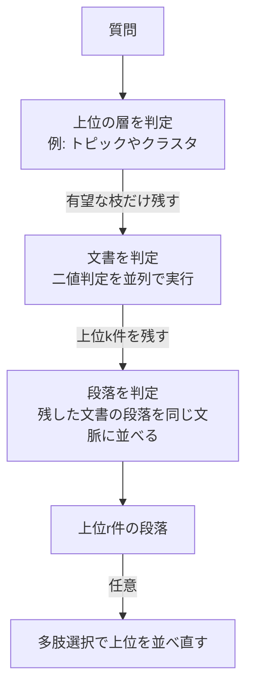
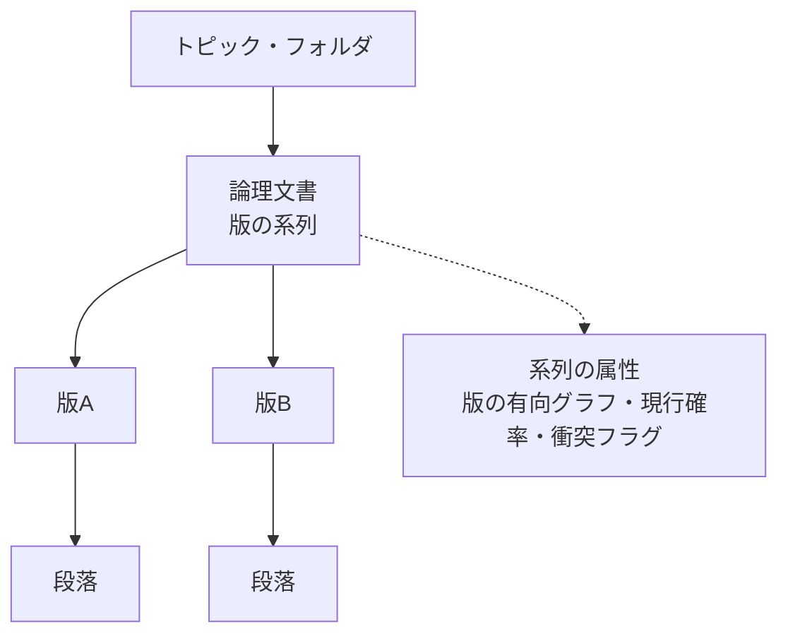

# DecisionRAGと、整備されていないファイルサーバーでの「正本」問題

- 作成日：2026年11月3日
- 情報の時点：2026年11月3日。これ以降に出た論文や製品の情報は含まない
- 位置づけ：キャッチアップの会話で分かったことの整理。確認できた事実、推測、会話での検討を書き分けている

## 1. 概要

### 何についての文書か

2026年10月に公開された検索手法「DecisionRAG」が、従来のRAGとどう違うかを整理する。あわせて、整備されていない社内ファイルサーバーに適用するときの課題と、その解決の糸口を調べた結果をまとめる。

### 要点

- DecisionRAGは、文書の階層をたどりながら、決定モデルが各階層で有望な枝を選ぶ検索手法である。ベクトル類似度による上位取得とは仕組みが違う（確認済み）。
- 論文ではベクトル検索に8Bのリランカーを組み合わせた構成より高い精度を出し、1クエリ0.7〜1.8秒で動いたと報告されている（確認済み。著者報告）。
- ただし、論文のベンチマークは整理された文書集合である。「決定版」「最終版_v2」のような版違いが乱立するファイルサーバーは評価されていない。
- 「どの版が現行か」という情報は、ファイルの中に書かれていないことが多い。関連度とは別の属性なので、RAGでもDecisionRAGでも、検索方式を変えるだけでは解決しない。
- 解決の糸口は3つある。内容とファイル内部の系譜情報から版の系列を復元すること、現行らしさを関連度とは別に推定すること、答えが版で変わるときだけ衝突を知らせることである（調査結果と、そこからの提案）。

## 2. 理解に必要な前提

### RAGの基本

RAG（Retrieval-Augmented Generation）は、質問に関係する文書を検索して取り出し、その内容を言語モデルに渡して回答を作らせる方式である。取り出せなかった情報はどれだけ強い言語モデルでも回答に使えない。

従来の検索は次のどちらかが多い。

- キーワードの出現頻度で順位をつける方式（BM25など）
- 文書をベクトルに変換し、質問のベクトルとの近さで上位を取る方式（密検索、ベクトル検索）

候補を絞ったあとに、言語モデルで順位を並べ替える「リランカー」を足すこともある。リランカーは、最初の検索が返した候補の中でしか並べ替えられない。

### 決定モデル

決定モデルは文脈と複数の質問を受け取り、各質問への答えの確率を返すモデルである。文章は生成しない。1回の計算で、複数の質問に並列で答える。

- 二値判定：「はい」の確率を質問ごとに返す。候補数に上限はなく、文脈の長さだけが制約になる
- 多肢選択：選択肢の確率を合計1で返す。論文で使われたJevでは、選択肢は255個までである

Jevは、TypeSafe AIが出した決定モデルである。解説記事では「System Oneモデル」と紹介されている。人間の速い直感的な判断になぞらえた呼び方である（解説記事による。論文本文では確認していない）。

### 階層の考え方

コーパスを木として見る。葉が段落で、その上に文書、さらに上にトピックやフォルダのような束ねる層がある。人が図書館で、分野から棚、本、ページへと絞り込むのと同じ見方である。

## 3. 解説

### DecisionRAGの仕組み

論文はCornell大学とASAPPの研究者による。2026年10月26日にarXivへ投稿された（arXiv:2610.35868）。

各階層で、決定モデルが候補をまとめて判定し、有望な枝だけを残す。残らなかった枝の下は読まない。

論文の要点は次のとおりである（確認済み。数値は著者報告）。

- 候補を同じ文脈に並べて判定すると、確率が候補同士で比べやすくなる。1件ずつ別々に判定した場合より、MultiDoc2DialのR@1が7.7ポイント高かった。
- 1回の要求に入れる候補は、50件程度で効果が頭打ちになる。大きな層は並列の要求に分ける。
- 時間は文書の量ではなく階層の深さにほぼ比例する。論文の式では、1回の要求を約0.2秒として、各層の要求を順に実行する。
- 268万段落のWikipediaでも、1クエリは約1.7秒だった。
- 精度は8B（80億パラメータ）のリランカー付き密検索と比べて、MultiDoc2DialのR@1で13.8ポイント、Natural QuestionsのHit@1で17.4ポイント高い。
- 1クエリの費用は0.2〜2.3セントである。

### 階層はいつ作るか

階層は質問を受ける前に、オフラインで一度作る。作り方は2通りある（確認済み）。

- 構造がある場合：既存の構造やメタデータを使う。ヘルプセンター→ページ→段落、HTMLの見出し、URLのパスによる製品分けなどである。
- 構造がない場合：ページのタイトルと冒頭の1文を埋め込み、k-meansで1,000グループに分ける。各グループの説明は、小型のLLMがページタイトルから1文で書く。

各ノードには短い説明文が必要である。段落は本文、文書はタイトル、クラスタは1文の要約が使われた。

「事前の索引が要らない」という論文の主張は、ベクトル索引を持たないという意味である。階層と説明文の事前準備は必要である。階層の作成にかかる時間や費用は、付録に書かれている可能性があるが、取得した本文が途中で切れていて読めていない（未確認）。

### 弱点

論文自身が次の点を限界として挙げている（確認済み）。

- 階層の構造やノードの説明が悪いと、検索の質が下がる。
- 一度外した枝には戻らない。外した枝の下に正解があれば、見つからない。
- 対策として、残す枝の数を増やす、確率のしきい値で次点も残す、従来の密検索の上位候補を最終段に混ぜる、がある。密検索の候補を混ぜると、4つのベンチマークすべてで精度が上がった。

### 版の問題が起きる理由

ファイル名で版を管理する運用では、「決定版」「最終版」「最終版_v2」「コピー」が積み重なる。人は探して見比べれば、新しい版に気づける。RAGは関連度の高い段落を取り出すだけで、「この版が現行か」を判断する材料を持たない。

根本の原因は、現行かどうかがファイルの内容に書かれていないことである。検索方式を変えても解決しない。この問題を扱うベンチマークは、公開されたものでは見つからなかった（調査による）。

## 4. 似たものとの違い

### Page Search API（VectifyAI）との違い

VectifyAIが公開しているpage-search-benchmarkのリポジトリは、Page Search APIの評価用である。READMEによると、1つの文書の全ページを質問に照らして読み、各ページに0〜1の関連度を付ける方式である（2026年11月3日時点）。

| 項目 | DecisionRAG | Page Search API |
|---|---|---|
| 判定の主体 | 決定モデル | モデルによる採点（READMEによる） |
| 探し方 | 階層を枝刈りしながら下りる | 1文書の全ページを採点 |
| 事前の構造 | 階層と説明文が必要 | ページ単位で、階層は不要 |
| 想定する対象 | 大きなコーパス | 1つの文書の中の検索 |

- どちらもベクトル類似度ではなく、モデルが質問に照らして判断する点は共通である。
- Page Searchの内部で決定モデルを使っているかは、READMEからは分からない（未確認）。
- ベンチマークの注意点がある。出したのはベンダー自身で、質問は80問、対象は1つの10-K（160ページ）である。比較相手は埋め込みモデル3種だけで、BM25との併用やリランカーなど、実運用で使う強い構成とは比べていない。

### 生成型の階層検索との違い

MemWalker、PageIndex、LATTICEのように、階層を言語モデルがたどる先行手法がある。これらは、各段階でトークンを順番に生成して判断する。DecisionRAGは同じ階層で決定モデルに置き換えると、精度は同程度で、遅延が34〜145分の1、費用が21〜25分の1になったと報告している（論文の比較実験。著者報告）。

### 従来のRAGとの違い

従来のRAGは候補を先に取ってから並べ替える。DecisionRAGは取る段階から言語モデルの判断を使う。精度の差は大きいが、論文の比較対象はベクトル検索と8Bリランカーの組み合わせとGPT-5によるリランクである。実務で使われるすべての構成との比較ではない。

## 5. 会話でわかったこと

### ファイルサーバー全体への適用

- Page Search APIは質問のたびに全ページを読む設計である。ファイルサーバー全体に同じ方式を当てると、時間も費用も文書の量に比例して増えると考えられる（推測）。READMEにも、1回の検索は1つの文書を対象にするとある。
- DecisionRAGは理屈の上では文書の量に強い。ただし、階層と説明文を事前に作る必要がある。
- 整備されていないサーバーでは、階層の質が精度を左右する。ここが導入の最大の論点になる。

### 階層を作る方針（提案。検証はしていない）

ファイルサーバーに手を入れず、検索用の仮想の木だけを別に持つ。

- 整ったフォルダはそのまま木の骨格に使う。説明文はフォルダ名、配下のファイル名、先頭数行からLLMで自動生成する。
- ソースコードはリポジトリ、ディレクトリ、ファイル、関数の構造を木にする。説明文はREADME、docstring、パス名から作る。
- 構造が当てにならない領域だけ、論文と同じく埋め込みでクラスタリングして要約をつける。
- 一度外した枝の取りこぼしは、従来検索の併用と、残す枝の数の調整で補う。
- ファイルの更新は更新日時やハッシュで検出し、影響を受けたノードの説明だけ作り直す。論文にはこの更新の記述がなく、実際に動くかは未検証である。

### 版の問題に対する考え方

- 「根拠を見せればよい」という設計は、この問題の解決にならない。提示された根拠を、人は確かめずに受け入れやすい（確証バイアス）。
- 版の問題は検索の精度の問題ではなく、現行かどうかという情報がファイルの外にあることが原因である。
- 現場ごとに「決定版を優先する」のようなルールを置く対応は、場当たり的で汎用性がない。信号から現行らしさを推定する仕組みにする必要がある。
- ファイルと使用履歴だけでは決まらないケースが必ず残る。たとえば、どちらを採用したかが口頭の決定にしか残っていない場合である。目標は間違えないことではなく、決められないときに決めたふりをしないことである。

## 6. 版の問題の解決の糸口（調査結果）

2026年11月3日に実施した調査の結果である。整備を前提にせず、既存の状態のまま使えるかという観点で探した。多くの文献は2026年の査読前プレプリントで、数値は著者報告である。

### 現状の整理

「どの版が正本か」を、関連度の延長として解く既製の手法は見つからなかった。版の衝突を扱う研究はあるが、版のメタデータがすでにあるか、人が承認したルールが入力になっている。ファイル名で版を管理するファイルサーバーをそのまま扱った研究は、見つからなかった。

### 糸口1：版の系列を復元する

- 内容の近重複と差分から、同じ文書の版を同じ系列にまとめる。GVD（arXiv:2609.17696）は、120文書・59系列で、系列構築のF1が0.97、ルール単位の整合判定のF1が0.94だった。ただし、入力は人が承認したルール単位で、生のOfficeファイルではない。
- ファイル内部の系譜情報は、ファイル名に依存しない有力な手がかりである。
  - Word（.docx）のrsidは、編集セッションごとの識別子である。コピーは元のrsidを引き継ぎ、編集で新しいrsidが加わる。rsidの共有関係から、派生の系統樹を作れる（Spennemann & Spennemann, 2023, *Publications* 11(3):35）。
  - PDFのXMPには、DocumentIDとDerivedFromがある。派生元を表す。
- 限界がある。rsidはWord以外のアプリでは付かないことがあり、PDFへの書き出しでは失われる。rsidの数値は単調に増えないので、順序は包含関係で判断する。OSでコピーしただけの同一ファイルは区別できない。
- 実務上の最初の一手は全ファイルから系譜メタデータを読み取り、どれだけ残っているかを実測することである。

### 糸口2：現行らしさを関連度とは別に推定する

- 利用行動やグラフの信号を使う製品がある。Gleanは人気度、部署との親和性、メッセージ内での文書への言及を使う。Coveoは似た検索で最も開かれた文書を押し上げる。SharePointのクラシック検索は、管理者が指定した権威ページからの距離を使う。
- 「版のどれが正か」を直接推定する機能は、確認できなかった。
- 人気度や重複の多さを、正本の証拠にしてはいけない。古い版のほうがリンクが多く残っていることは普通にある。ある設計議論にも、文書の出現頻度で権威を上げてはならないという原則がある。
- 更新日時は信頼できない。コピーや、開いて保存しただけで変わる。「新しさ」だけで決めると、古い文書が正答を誤らせる現象が報告されている（Stale-Document Poisoning, arXiv:2609.31342）。新しさは系列内の弱い事前分布にとどめる。
- 日本企業に特有の手がかりとして、稟議や会議資料への添付、PDF化、押印済みのスキャンが効く可能性がある。これは推測で、効果を確かめた研究は見つかっていない。

### 糸口3：版で答えが変わるときだけ衝突を扱う

- 決定モデルで、知識の衝突の種類を分類する研究がある（Khatri et al., arXiv:2610.36915）。11の決定モデルの正答率は50.0〜67.0%だった。決定モデルの確信度は自分の誤りの順位づけに使える（AUROC 0.64〜0.76）。
- 同じ研究で、日付は判定に測定可能な役割を果たさなかった。決定モデルに日付を読ませるだけでは、鮮度の判定は期待できない。版の情報は外部で計算した属性として明示的に渡す必要がある。
- 衝突を不確実性として残し、「直接回答」「衝突を説明して回答」「棄権」に振り分ける手法がある（EvidentialRAG, arXiv:2607.10491）。
- 版を明示的にモデル化したRAGは、正答率が大きく上がった。VersionRAG（arXiv:2510.08109）は、版を意識した質問で90%を出した。通常のRAGは58%、GraphRAGは64%だった。ただし、版番号が明示された技術文書が前提である。

### 根拠の見せ方

- 引用はランダムなものでも利用者の信頼を上げた。引用付きの回答1,976件のうち、利用者が引用を実際に確認したのは193件（9.77%）だった（Ding et al., arXiv:2501.01303。参加者303名）。
- 説明に不整合があると、誤答への過信が減った。AIの答えへの同意率が83.3%から69.7%に下がった（Kim et al., CHI 2025, arXiv:2502.08554。参加者308名）。
- AIの提案を見る前に自分で判断させるなどの認知強制関数も、過信を減らした。ただし、利用者の主観的な評価は低かった（Buçinca et al.）。
- 示唆：回答画面では、引用を並べるより、「この答えは版によって異なる」という衝突を示すほうが有効と考えられる。衝突が答えに効くときだけ出さないと、利用者が疲れる。

## 7. DecisionRAGに版の情報を載せる設計案（提案。未検証）

調査結果をもとにした設計の方向である。論文でも、他の研究でも、この構成は検証されていない。

1. 階層に「論理文書（版の系列）」の層を足す。系列は内容の近重複とファイル内部の系譜情報から、オフラインで作る。上位の層での判定は系列ノードに対して行うので、同じ文書の版が候補を占有しない。
2. 系列ノードに、版の有向グラフと現行確率を属性として持たせる。後継がない版か、会議資料やメールで参照されたか、PDF化されたかなどを特徴量にして、決定モデルの外で計算する。決定モデルには数値やカテゴリで渡す。
3. 同じ系列の版を、同じ文脈に並べて判定する。DecisionRAGは、候補を同じ文脈で判定すると確率が比べやすくなる。この性質を、版の比較に使う。
4. 葉の段階で、「この質問への答えは版によって変わるか」を判定する。変わらなければ、版に触れずに答える。変わり、現行確率の差が大きければ、現行版で答えて変更点を示す。変わり、差が小さければ、対比の提示、利用者への確認、または棄権にする。
5. 木は差分で更新する。新しいファイルは、系列への割り当てだけを実行し、影響を受けたノードの説明と現行確率を更新する。

## 8. 未解決事項

- 階層の作成にかかる時間と費用。論文の付録Fに書かれている可能性があるが、未確認である。
- ファイルの追加や更新があったときの、階層の保ち方。論文に記載が見当たらない。
- 整備されていないデータやソースコードでの、DecisionRAGの精度。
- Page Search APIの内部で、決定モデルを使っているか。
- 系譜メタデータ（rsidなど）が、実際のファイルサーバーにどれだけ残っているか。実測が必要である。
- 日本企業に特有の手がかり（稟議への添付、PDF化、押印）が、正本の推定に効くか。
- 公式コードが見つかっておらず、DecisionRAGの追試ができない。
- 判定に使うJevは外部のAPIである。社内文書を外部に送れるかを、利用前に確認する必要がある。
- 公開ベンチマークに、この問題を扱うものがない。評価には、現場のデータで作る小さな評価セット（版の系列と、正しい現行版のラベル）が必要になる。
- 本調査で一次資料を確認できていないもの：RAPTOR、MemWalker、PageIndexの詳細、Google Cloud SearchとMicrosoft Graphのランキング信号の詳細、WordのPDF書き出しが残すXMPの公式仕様。

## 9. 参考資料

調べた日は、すべて2026年11月3日である。

### DecisionRAGと決定モデル

- Wan et al., "Retriever-Free Retrieval: Navigating Documents with Decision Models", arXiv:2610.35868（2026年10月26日投稿）
- VectifyAI, page-search-benchmark（GitHub）
- Khatri et al., "Do We Need an LLM to Know Why Sources Conflict? Decision Models for Knowledge-Conflict Typing in RAG", arXiv:2610.36915
- 解説記事：What Is Jev? Inside TypeSafe AI's System One Model（getmaxim.ai）

### 版・鮮度・衝突の扱い

- VersionRAG, arXiv:2510.08109
- GVD（版系列の構築）, arXiv:2609.17696
- Stale-Document Poisoning, arXiv:2609.31342
- CONFLICTS（知識衝突の分類）, arXiv:2506.08500
- Re³：Relevance & Recency Retrieval, ACL 2026（2026.acl-long.1180）
- EvidentialRAG, arXiv:2607.10491
- EnterpriseRAG-Bench, arXiv:2605.05253

### ファイル内部の系譜情報

- Spennemann & Spennemann, 2023, *Publications* 11(3):35（Wordのrsidによる系統の推定）
- ECMA-376 §17.15.1.70/72（rsid、Microsoft Learn掲載）
- Adobe XMP仕様、xmpMM名前空間

### 企業内検索の信号

- Glean, "Why great enterprise search and generative AI requires a comprehensive knowledge graph"
- Coveo, Automatic Relevance Tuningのドキュメント
- Microsoft Learn, "Manage authoritative pages"

### 根拠の見せ方と人の判断

- Ding et al., "Citations and Trust in LLM Generated Responses", arXiv:2501.01303
- Kim et al., CHI 2025, arXiv:2502.08554
- Buçinca et al., "To Trust or to Think: Cognitive Forcing Functions Can Reduce Overreliance on AI in AI-assisted Decision-making"

## 10. 更新履歴

| 日付 | 内容 |
|---|---|
| 2026年11月3日 | 初版。DecisionRAGの仕組み、Page Search APIとの違い、ファイルサーバーへの適用と版の問題の調査結果を整理した |
