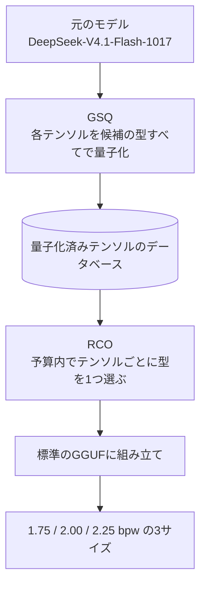
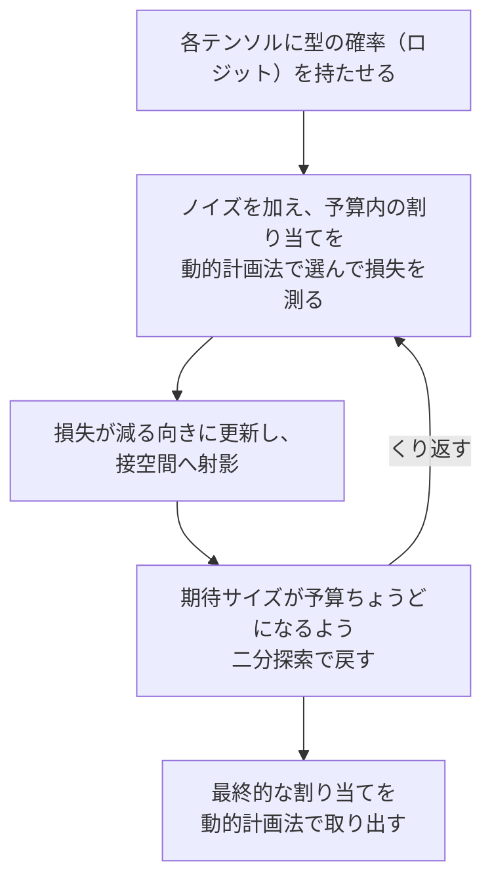
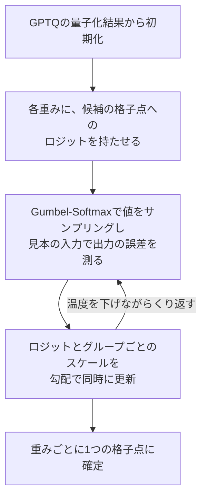
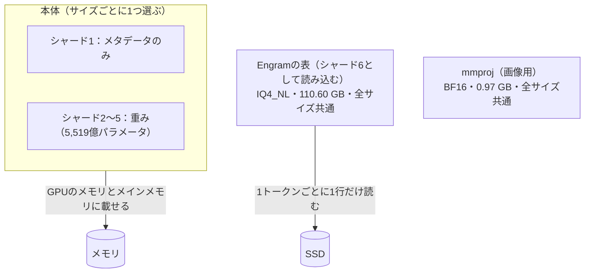

# DeepSeek-V4.1-Flash-1017 GSQ-RCO GGUF

- 対象：https://huggingface.co/ISTA-DASLab/DeepSeek-V4.1-Flash-1017-GSQ-RCO-GGUF
- 調べた時点：2026年10月24日〜11月3日（READMEは10月27日の更新を反映）

## 1. 概要

ISTA（オーストリア科学技術研究所）の研究室DASLabが公開している、DeepSeek-V4.1-Flash-1017の量子化版です。元のモデルは7,632億パラメータのMoEモデルで、これを標準のGGUF形式で1.75・2.00・2.25 bpwの3つのサイズに圧縮しています。

要点は次のとおりです。

- テンソルごとに別々の量子化の型を割り当てる、非一様な量子化です。
- 型の割り当てにはRCO、各テンソルの量子化にはGSQという、同じ研究室の2つの手法を使っています。
- 出力は標準のGGUFです。2026年10月27日の更新で、llama.cpp（b11870以降）が読み込める形式になりました。
- Engramの参照表（1,966億パラメータ）は全サイズ共通の別ファイルで、SSDに置いたまま使えます。
- 推奨の2.00 bpw版は、公開されている3つのベンチマークで、元のモデルと同じ点数でした。

## 2. 理解に必要な前提

### 量子化とbpw

モデルの重みを少ないビット数で表せるように丸めて小さくすることを、量子化と呼びます。bpw（bits per weight）は重み1つあたりの平均ビット数です。このリポジトリのbpwは、Engramの表を除いた本体の平均です。

### GGUFと量子化の型

GGUFはllama.cppなどで手元のPCからモデルを動かすときに広く使われるファイル形式で、テンソル（重みの行列）ごとに量子化の型を選べます。このリポジトリで使われている主な型は次のとおりです。bpwはllama.cppの型の公称値で、READMEには書かれていない値です。

| 型 | 公称bpw | このリポジトリでの主な用途 |
|---|---|---|
| Q8_0 | 8.5 | 密な部分の一部（注意機構の一部） |
| Q5_K | 5.5 | 密な部分の残り |
| IQ4_NL | 4.5 | Engramの表 |
| IQ2_XS | 2.31 | ルーティングされる専門家 |
| IQ2_XXS | 2.06 | ルーティングされる専門家 |
| IQ1_M | 1.75 | ルーティングされる専門家 |

### 一様な量子化と非一様な量子化

一様な量子化はすべてのテンソルに同じ型を当てます。非一様な量子化はテンソルごとに型を変えたうえで、全体の平均ビット数を目標に合わせます。このリポジトリは後者です。

### MoE（混合エキスパート）

DeepSeek-V4.1-Flash-1017は、40の層それぞれに384個のルーティングされる専門家を持ち、1トークンごとにそのうち6個だけを使うMoEモデルです。注意機構、共有の専門家、埋め込み、出力ヘッドは、毎回使われる密な部分です。パラメータの大半は、ルーティングされる専門家が占めます。GGUFでは、1つの層の384個の専門家がgate・up・downの3つのテンソルにまとめて格納されます。そのため、型は専門家ごとではなく層とテンソルの単位で決まります。

### Engram

Engramは、DeepSeekが2026年1月に論文で発表した「条件付きメモリ」の仕組みです。直前の数トークンの並び（N-gram）からハッシュで表の行を割り出し、その行のベクトルを隠れ状態に混ぜます。人名や決まった言い回しのような変わらない知識を、計算ではなく表引きで扱う狙いがあります。このモデルでは表を1トークンごとに1行しか読まないため、GPUのメモリに置く必要がありません。

### スカラー量子化とベクトル量子化

スカラー量子化は重みを1つずつ、少数の値の格子に丸めます。GPTQ、AWQ、llama.cppなどがこれに当たり、実装が簡単で、高速な計算カーネルを使えます。ただし、3〜4 bpwを下回ると精度が落ちる「誤差の壁」があります。ベクトル量子化やトレリス量子化（QTIP、AQLMなど）は、複数の重みをまとめて符号化するため、2〜3 bpwでも精度を保ちやすい一方、実装と大規模化が難しいとされます。

### Gumbel-Softmaxによる離散選択の緩和

「どれを選ぶか」という離散的な選択を、選択肢ごとの確率に置き換え、Gumbelノイズを加えてサンプリングしながら、勾配で最適化する手法です。温度を下げていくと、確率は1つの選択肢に集中します。GSQとRCOはどちらもこの考え方を使っています。GSQは重みごとの値を、RCOはテンソルごとの型を選びます。

## 3. 解説

### 3.1 全体の流れ

READMEによると、量子化は3つの段階で進みます。まず、各テンソルを候補のすべての型でGSQを使って量子化し、検索用のデータベースを作ります。次に、本体の平均ビット数が目標に合うように、RCOがテンソルごとに型を1つ選びます。最後に、選んだテンソルを標準のGGUFに組み立てます。

候補の型は、密な部分がQ5_K・Q6_K・Q8_0、ルーティングされる専門家がIQ1_SからIQ3_Sまでです。教師には公開されたチェックポイントそのもの（ルーティングされる専門家はもともとFP4）を使い、見本のデータはモデル自身に生成させています。

### 3.2 RCO：テンソルごとの型の割り当て

RCO（Riemannian Constrained Optimization）は、全体のサイズを予算内に収めながら、N個のテンソルそれぞれにK種類の型から1つを割り当てる問題を解きます。目的のタスク損失は、すべての割り当ての組み合わせで決まり、テンソルごとに分けて足し合わせることができません。

従来のやり方には、それぞれ弱点がありました。テンソルごとの感度を測って足し合わせる方法は、代わりの指標しか最適化できず、高い圧縮率でうまくいかないことが先行研究で示されています。進化的探索は実際の損失を評価できますが、勾配を使わないため、何百回もの順伝播が必要です。ペナルティ法は勾配を使えるものの、予算をおおよそしか守れず、ハイパーパラメータの調整が要ります。

RCOは型の選択をソフトマックスで緩和し、各テンソルに型の確率を持たせます。期待サイズが予算にちょうど等しい点の集まりは、ロジットの空間で滑らかなリーマン多様体になります。RCOはAdamの更新を多様体の接空間へ射影し、二分探索で多様体の上へ戻します。そのため、どの反復でも期待サイズが予算に一致し、制約のためのハイパーパラメータが要りません。順伝播では、Gumbelノイズと予算を制約にした動的計画法を組み合わせて、予算内の離散的な割り当てを選びます。

論文によると、LLMの圧縮では、評価した構成で進化的探索と同等以上の結果を、3〜16分の1の計算時間で出しています。論文は限界として、予算を満たすことは保証しても最適な割り当ては保証しないこと、保たれる能力が見本のデータの分野に従うことを挙げています。

### 3.3 GSQ：テンソルごとの量子化

GSQ（Gumbel-Softmax Quantization）は、学習を終えたモデルに適用する事後量子化の手法です。各重みに、候補の格子点ごとの学習可能なロジットを持たせ、Gumbel-Softmaxで値をサンプリングします。見本の入力に対する出力の誤差が小さくなるように、ロジットとグループごとのスケールを同時に最適化します。初期値はGPTQの量子化結果で、温度を下げていくと、重みごとに1つの格子点に確定します。

2 bpwなら格子点は4つなので、重みごとのロジットも4つで済みます。それより多いビット数では、初期値の近くの格子点だけを候補にする方式で、ロジットを5つに抑えます。出力は対称で、グループごとにスケールを持つ通常のスカラー量子化なので、既存の計算カーネルでそのまま動きます。

論文では、Llama-3.1-70B-Instructの2 bpwで、スカラー量子化の最良の従来手法より平均4.14ポイント高く、QTIPとの差は1.68ポイントでした。3 bpwでは、70BモデルでQTIPとほぼ同等です。Qwen3-8Bの公開済みのQ2_KのGGUFを初期値にした実験では、同じ形式のまま、AIME25、GPQA Diamond、MMLU-Proの平均が50.03から56.28に上がりました。1兆パラメータ級のMoEであるKimi-K2.5にも適用されています。

### 3.4 実際の割り当て（2.00 bpw版）

tensor-allocationフォルダーに、ビルドごとの割り当てが公開されています。2.00 bpw版の内訳は次のとおりです。

| 区分 | 型 | テンソル数 |
|---|---|---|
| 固定（探索の対象外） | F32 | 531 |
| 固定（探索の対象外） | BF16 | 67 |
| Engramの表 | IQ4_NL | 1 |
| 密な部分 | Q8_0 | 80 |
| 密な部分 | Q5_K | 244 |
| ルーティングされる専門家 | IQ2_XS | 18 |
| ルーティングされる専門家 | IQ2_XXS | 42 |
| ルーティングされる専門家 | IQ1_M | 60 |

全1,043テンソルのうち、RCOが型を選んだのは444テンソルです。本体の平均は、目標の2.00 bpwに対して2.0038 bpwでした。

割り当てには次の傾向があります。

- 密な部分では、全40層で注意機構の一部（attn_kvとattn_q_a）がQ8_0になり、それ以外はQ5_Kでした。Q6_Kは使われていません。
- ルーティングされる専門家では、0〜6層がgate・up・downの3つともIQ1_M、最後の39層が3つともIQ2_XSでした。
- 層を10ずつに分けて専門家の平均bpw（公称値）を比べると、0〜9層が1.77、10〜19層が1.95、20〜29層が2.00、30〜39層が2.05で、深い層ほど多くのビットが割り当てられています。
- gateとupは、全40層で同じ型でした。downは、15層でgate・upより少ないビット、20層で同じ、5層で多いビットでした。

### 3.5 ファイルの構成

各ビルドの本体は5つのシャードに分かれています。シャード1はメタデータだけ、シャード2〜5に本体の重み（5,519億パラメータ）が入っています。Engramの2つの表（1,966億パラメータ）は、IQ4_NL（4.50 bpw）で1つのファイルにまとめられ、全ビルドで共通です。llama.cppはこのファイルを各ビルドの6番目のシャードとして読み込むため、ビルドごとに6番目のシャードの名前でリンクを作ります。画像用のmmproj（BF16、0.97 GB）も全ビルドで共通です。

| ビルド | bpw | 本体 | Engram | 合計 |
|---|---|---|---|---|
| IQ1_M | 1.75 | 120.72 GB | 110.60 GB | 231.32 GB |
| IQ2_XXS（推奨） | 2.00 | 138.24 GB | 110.60 GB | 248.84 GB |
| IQ2_XS | 2.25 | 155.23 GB | 110.60 GB | 265.83 GB |

Engramの表は1トークンごとに1行しか読まれないため、ディスク上にメモリマップしたままでよく、GPUのメモリにもメインメモリにも載せる必要がありません。READMEは、ページの読み込みが遅くならないよう、SSDに置くことを勧めています。llama.cppの既定の設定（--lazy-mode auto）は、4 GiBを超えるテンソルをこの方法で扱います。

そのほかに、チャットテンプレート（chat_template.jinja）、10月27日より前にダウンロードしたファイルを今の形式に変換するスクリプト（convert_ds41_upstream.py）、画像用のルーターのバイアス（exp_probs_b_vl.f32）が置かれています。

### 3.6 評価結果

| モデル | AIME25 | GPQA-Diamond | LiveCodeBench v6 | 平均 | 元のモデルに対する割合 |
|---|---|---|---|---|---|
| 元のモデル（密な部分はFP8、専門家はFP4） | 100.00 | 90.91 | 89.71 | 93.54 | ― |
| IQ1_M（1.75 bpw） | 100.00 | 88.38 | 88.57 | 92.32 | 98.7% |
| IQ2_XXS（2.00 bpw） | 100.00 | 90.91 | 89.71 | 93.54 | 100.0% |
| IQ2_XS（2.25 bpw） | 100.00 | 90.91 | 89.14 | 93.35 | 99.8% |

条件は、推論の量の設定（reasoning effort）が50、温度1.0、top-p 1.0、最大の生成トークン数65,536、1問につき1回のサンプリングです。評価にはlm-evaluation-harnessを使い、量子化したモデルはvLLMで動かしています。READMEは、IQ2_XSがIQ2_XXSをわずかに下回った点について、実行ごとのばらつきの範囲だと説明しています。

### 3.7 必要な環境の目安

- ディスク：本体とEngramの合計で231〜266 GBです。ASCII.jpの記事は、2.00 bpw版で約265 GBの空き容量が要ると伝えています。
- メモリ：本体はGPUのメモリとメインメモリに載せ、Engramの表はSSDに置きます。READMEによると、Strataを使えば、GPUのメモリは12 GBで足り、残りはメインメモリに置けます。
- 速さ：ASCII.jpの記事によると、Strata 0.2.5で、GeForce RTX 5070（12 GB）とメインメモリ64 GBの構成で、2.00 bpw版が毎秒4〜6トークンを生成しました。
- ソフトウェア：llama.cppはb11870以降が必要です。Strataでも動きます。

## 4. 似たものとの違い

- 一様な量子化のGGUF：すべてのテンソルに同じ型を当てます。このリポジトリは、テンソルごとの型を、タスク損失を使った探索で決めます。
- 感度に基づく混合精度：テンソルごとに測った感度を足し合わせて配分します。RCOは、組み合わせ全体の損失を勾配で直接下げ、予算を厳密に守ります。
- 進化的探索による配分：実際の損失で組み合わせを比べますが、何百回もの順伝播が必要です。RCOは同等以上の結果を、3〜16分の1の時間で出しています（論文の値）。
- ベクトル量子化（QTIP、AQLMなど）：2 bpwでの精度はGSQよりやや高いものの、専用の形式とカーネルが必要で、巨大なMoEへの適用が難しいとされます。GSQは通常のスカラー形式のままです。

## 5. 会話でわかったこと

### 「感度に応じた配分」の意味

READMEは、テンソルごとの感度に応じて精度を配分すると説明しています。一方、RCOの論文は、テンソルごとの感度を足し合わせる方法が高い圧縮率でうまくいかないことを出発点にしています。会話では、ここでの「感度に応じた配分」は、組み合わせ全体の損失を直接下げた結果として、影響の大きいテンソルに多くのビットが残ることを指すと解釈しました（会話での解釈）。

### 探索の対象

READMEは「すべてのテンソルに別々の型を割り当てる」と書いていますが、割り当てのファイルを見ると、RCOが型を選んだのは1,043テンソルのうち444テンソルでした。残りの598テンソルは、F32とBF16のまま固定され、Engramの表もIQ4_NLに固定されています。

### Engramの表の扱い

Engramの表は、行列の掛け算に使う重みではなく参照するだけの表なので、型が固定され、探索の対象から外れています。評価に使ったモデルでも、表は同じように量子化されています。また、表は1トークンごとに1行しか読まれないため、手元で動かすときに、表のぶんのメモリは要りません。

### 点数差の大きさ

GPQA-Diamondは198問なので、1.75 bpw版と元のモデルの差（2.53ポイント）は5問にあたります。LiveCodeBench v6の点数は、175問と仮定すると3つとも整数の問題数になり、その場合、1.75 bpw版との差は2問、2.25 bpw版との差は1問です（175問は点数からの推測）。どの点数も1問1回のサンプリングによるため、1〜2問の差は実行ごとのばらつきと区別しにくいと考えられます（会話での検討）。

### 実行環境の変化

10月23日時点のREADMEでは、llama.cppはDeepSeek-V4.1に対応しておらず、動かせるのはStrataだけでした。10月27日の更新で、ファイルがllama.cpp独自のDeepSeek-V4.1の形式に変わり、b11870以降のllama.cppで、画像の入力も含めて読み込めるようになりました。シャードの数も、本体4つとEngramの構成から、6つのシャードの構成に変わりました。それより前にダウンロードしたファイルは、同梱のスクリプトで変換します。

## 6. 未解決事項

- 長い文脈（最大100万トークン）、画像、日本語、ツールの利用など、3つのベンチマーク以外での品質は、READMEに結果がありません。
- 見本のデータはモデル自身が生成したものですが、どの分野の文章がどれだけ含まれているかは確認できていません。見本から外れた分野で、どれだけ質が落ちるかもわかっていません。
- GSQの論文で報告されているGGUFでの適用はK-quant（Q2_K、Q3_K_M）です。このリポジトリで使われているIQ系の型に、GSQをどう適用したかの詳細は確認していません。
- 推論の量の設定を変えた場合や、1問につき複数回サンプリングした場合の差は不明です。
- LiveCodeBench v6の問題数（5章の換算の前提）は確認していません。
- llama.cppで動かすときに必要なメモリ量と速さの実測値は見つけていません。

## 7. 参考資料

- ISTA-DASLab/DeepSeek-V4.1-Flash-1017-GSQ-RCO-GGUF（Hugging Face）README：2026年10月24日と11月2日に確認
  - https://huggingface.co/ISTA-DASLab/DeepSeek-V4.1-Flash-1017-GSQ-RCO-GGUF
- 同リポジトリのtensor-allocation/DeepSeek-V4.1-Flash-1017-GSQ-RCO-IQ2_XXS.rco-allocation.txt：2026年11月2日に確認
- Model Compression with Exact Budget Constraints via Riemannian Manifolds（RCOの論文）：要旨と解説のページで2026年11月2日に確認
  - https://arxiv.org/abs/2605.00649
- GSQ: Highly-Accurate Low-Precision Scalar Quantization for LLMs via Gumbel-Softmax Sampling（GSQの論文）：2026年11月2日に確認
  - https://arxiv.org/abs/2604.18556
- Conditional Memory via Scalable Lookup: A New Axis of Sparsity for Large Language Models（Engramの論文）：原論文は読んでおらず、解説記事で2026年11月2日に確認
  - https://github.com/deepseek-ai/Engram
- ASCII.jp「えっ! メモリ64GBのPCで7630億パラメーターのDeepSeekを!? Strataがついに実現」（2026年10月26日更新）：2026年11月3日に確認
  - https://ascii.jp/elem/000/004/445/4445574/

## 8. 更新履歴

- 2026年11月3日：初版を作成
