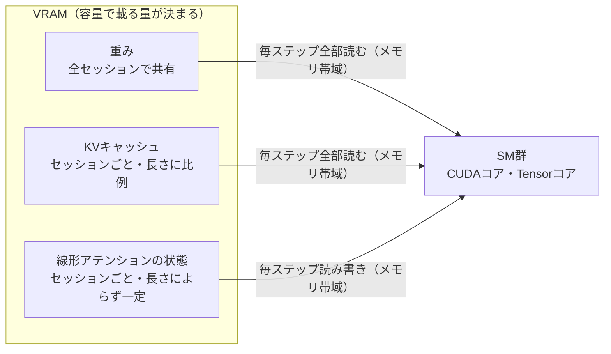
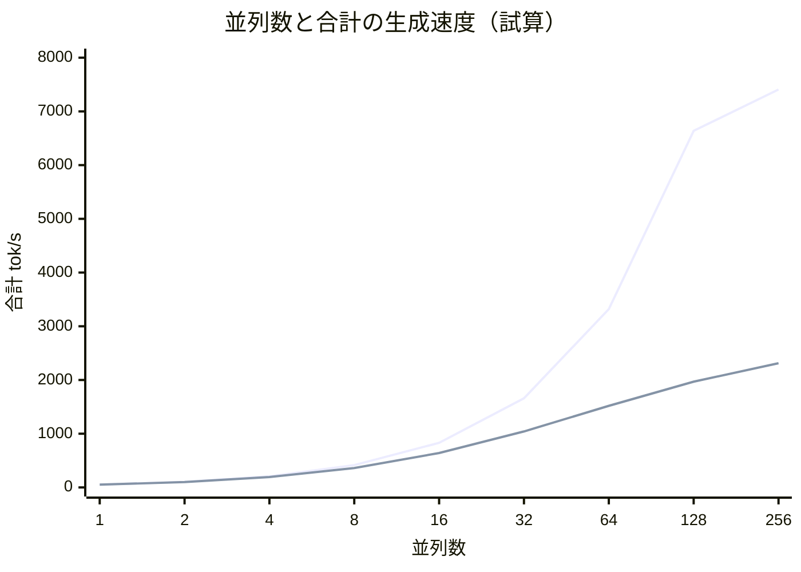

# GPUに載せるものとLLMの生成速度の関係

調べた日：2026年11月22日

## 1. 概要

ローカルLLMの生成速度はGPUのコア数ではなく、主にVRAMからデータを読み出す速さ（メモリ帯域）で決まる。1トークンを生成するたびに、モデルの重みをVRAMから全部読むためである。

複数のセッションをまとめて処理すると、1回の重みの読み出しを全セッションで使える。そのため合計の生成速度は大きく伸び、1セッションあたりの速度は少しだけ下がる。並列の伸びを止めるのは、セッションごとに読むKVキャッシュの量と演算性能で、並列できる本数の上限はVRAM容量で決まる。

- デコードの速度 ≒ 実効のメモリ帯域 ÷ 1トークンごとに読むデータ量
- 並列にすると、重みは1回の読み出しで全セッション分に使える
- 並列で得をする度合いの目安は「演算性能 ÷ メモリ帯域」
- 並列できる本数の上限は、KVキャッシュがVRAMに入るかで決まる

## 2. 理解に必要な前提

### プレフィルとデコード（prefill / decode）

LLMの生成は2つの段階に分かれる。プレフィルは入力の文章をまとめて読み込む段階で、多くのトークンを一度に計算するので、速さは演算性能で決まる。デコードは回答を1トークンずつ作る段階である。このナレッジで扱う「tok/s」は、デコードの速度を指す。

### 重み（weights）と量子化（quantization）

重みはモデルのパラメータの値で、サイズは「パラメータ数 × 1個あたりのバイト数」になる。27Bのモデルなら、BF16（2バイト）で約54GB、FP8（1バイト）で約27GB、4bit（約0.5バイト）で約14GBである。量子化はこの1個あたりのバイト数を減らすことを指す。

### KVキャッシュ（KV cache）

アテンション（attention）の計算では、過去のトークンから作ったKeyとValueを使う。KVキャッシュはこれを毎回計算し直さないようにVRAMに保存しておくものである。セッションごとに別々に持ち、会話が長くなるほど大きくなる。デコードでは1トークンごとに、そのセッションのKVキャッシュも全部読む。

1トークンあたりのサイズは次の式で求められる。

```
2（KとV）× アテンション層の数 × KVヘッドの数 × ヘッドの次元 × 1個あたりのバイト数
```

### VRAM容量とメモリ帯域（memory bandwidth）

VRAMはGPUのメモリである。容量（GB）は何をどれだけ載せられるかを、帯域（GB/sやTB/s）は1秒にどれだけ読み出せるかを表す。実際に使える帯域は仕様の値より低く、RTX PRO 6000 Blackwell では仕様の1792 GB/sに対して、メモリコピーの実測が約1467 GB/sという報告がある。

### GPUの演算器：SM、CUDAコア、Tensorコア（Streaming Multiprocessor / CUDA core / Tensor core）

NVIDIAのGPUで「コア」と呼ばれるものは、次の3段階がある。

| 名前 | 役割 | RTX PRO 6000 Blackwell の数 |
|---|---|---|
| SM | CPUの1コアに一番近い単位。中にCUDAコアとTensorコアを持つ | 188（Tensorコアの数から換算） |
| CUDAコア | SMの中の汎用の演算器。宣伝で「コア数」として出る数 | 24,064 |
| Tensorコア | 行列の計算に特化した演算器。LLMの計算は主にこれが担う | 752 |

AMDのGPUではSMにあたる単位をCompute Unit（CU）と呼ぶ。

### 演算性能（TFLOPS）

1秒あたりに何兆回の浮動小数点演算ができるかを表す。精度（FP16、FP8、FP4）ごとに値が違い、仕様表には疎行列（sparsity）を使った場合の倍の値が載っていることもある。

### バッチ処理と連続バッチ処理（batching / continuous batching）

バッチ処理は複数のリクエストを1回の計算にまとめることである。連続バッチ処理は終わったリクエストを抜き、新しいリクエストを途中から加えながらバッチを回し続けるやり方で、vLLMやSGLangはこれを前提にしている。

## 3. 解説

### 3.1 GPUに載るもの

デコードでは毎ステップ、VRAMにあるデータをSMへ運んで計算する。運ぶものは次の3種類である。



要点：毎ステップVRAMからSMへ運ぶ量が、デコードの速度を決める。

線形アテンションの状態（linear attention state）は、ハイブリッド構造のモデルにだけある。たとえばQwen3.8-27Bは64層のうち48層がGated DeltaNet（線形アテンションの一種）で、通常のアテンションでKVキャッシュを作るのは残りの16層だけである。線形アテンションの層は会話の長さによらず一定のサイズの状態を持つ。

### 3.2 デコードの速度を決めるもの

1ステップにかかる時間は、おおよそ「VRAMから読む量 ÷ 実効のメモリ帯域」になる。1並列なら1ステップで1トークンが出るので、速度は次のようになる。

```
1並列のtok/s ≒ 実効のメモリ帯域 ÷（重みのサイズ ＋ そのセッションのKVキャッシュのサイズ）
```

例として、実効帯域を1.4 TB/s、27BのモデルをFP8（重み27GB）、KVキャッシュを1トークン64KB（BF16のQwen3.8-27B）、コンテキストを8kトークン（KVキャッシュ約0.5GB）とすると、27.5GB ÷ 1.4 TB/s ≒ 19.6ms で、約51 tok/s になる（試算）。

この式から、次のことがわかる。

- 量子化で重みのサイズを半分にすると、デコードの速度はほぼ2倍になる
- コア数が増えても、メモリ帯域が同じならデコードはほとんど速くならない
- 同じGPUでも、コンテキストが長いほどKVキャッシュの分だけ遅くなる

### 3.3 並列で合計が伸びる理由

1並列のデコードでは、演算器はメモリからデータが届くのを待つ時間が長く、計算力の大半が余っている。並列にすると、一度読んだ重みを全セッションの計算に使えるので、増える読み出しはセッションごとのKVキャッシュだけになる。

3.2の例を10並列にした場合は次のとおりである（試算）。

| | 1並列 | 10並列 |
|---|---|---|
| 重みの読み出し | 27GB（1回） | 27GB（1回） |
| KVキャッシュの読み出し | 0.5GB | 5GB |
| 1ステップで読む量 | 27.5GB | 32GB |
| 1ステップの時間 | 約19.6ms | 約22.9ms |
| 1本あたりの速度 | 約51 tok/s | 約44 tok/s |
| 合計の速度 | 約51 tok/s | 約440 tok/s |

要点：1本あたりは約14%下がり、合計は約8.6倍になる。

### 3.4 並列の伸びが止まるところ

並列数をさらに増やすと、2つの理由で伸びが鈍る。1つはセッションごとのKVキャッシュの読み出しが重みの読み出しより大きくなること、もう1つは演算量がGPUの演算性能に届くことである。

次の図は3.2の例に演算性能400 TFLOPS（仮定）を加えて、並列数ごとの合計の速度を計算したものである。上の線はKVキャッシュを無視した場合、下の線はコンテキスト8kの場合である。横軸は2倍ずつ増やしている。



要点：KVキャッシュを無視すれば約140並列まで合計はほぼ比例して伸びるが、8kのコンテキストでは数十並列から伸びが鈍る。

下の線では256並列でも演算性能には届いていない。伸びを止めているのはKVキャッシュの読み出しで、合計の速度は「実効帯域 ÷ 1セッションのKVキャッシュ」（この例では約2800 tok/s）に近づいていく。コンテキストが長いほど、この上限は低くなる。

### 3.5 並列で得をする度合いの目安

「演算性能 ÷ メモリ帯域」は、1バイトを読む間にGPUが何回演算できるかを表す。デコードで1セッションが使う演算は、重み1個につき約2回（掛け算と足し算）なので、読み出し1バイトあたりではBF16で1回、FP8で2回、4bitで約4回になる。したがって、演算性能が上限になるまでにまとめて処理できるセッション数は、次の式で見積もれる。

```
演算が上限になる並列数 ≒（演算性能 ÷ メモリ帯域）÷ 重み1バイトあたりの演算回数
```

3.4の例では、400 TFLOPS ÷ 1.4 TB/s ≒ 286、FP8なので2で割って約143並列になり、図の上の線が曲がる位置と合う。演算性能には、計算に使う精度の値を使う。この式はKVキャッシュの読み出しを無視しているので、実際に得をする並列数の上限の目安として使う。

### 3.6 並列できる本数の上限：VRAM容量

並列で動かすには、次のものが全部VRAMに入る必要がある。

```
重み ＋（1トークンあたりのKVキャッシュ × コンテキスト長 ＋ 線形アテンションの状態）× 並列数 ＋ 作業領域
```

たとえば96GBのGPUで、FP8の重み（27GB）に、1トークン64KBのKVキャッシュを32kトークン×10本分（約20GB）足しても、十分に入る。

ハイブリッド構造はこの上限を大きく上げる。Qwen3.8-27Bは通常のアテンションが16層でKVヘッドが4本なので、1トークンあたり 2 × 16 × 4 × 256 × 2バイト ≒ 64KB になる。同じ形のアテンションが64層すべてにあれば4倍の約256KBになる計算で、並列できる本数とKVキャッシュの読み出し量が、どちらも約4倍違う（試算）。

## 4. 似たものとの違い

### CPUのコアとの違い

CPUでは、コアごとに別々の処理（スレッド）を動かすので、コア数がそのまま同時に動かせる処理の数の目安になる。GPUでは、1つの行列の計算をすべてのSMで分担するので、1セッションの処理でもすべての演算器を使う。そのため「GPUのコア数＝並列できるセッション数」にはならない。

### プレフィルとデコードの違い

プレフィルは入力の全トークンを一度に計算するので、1並列でも演算性能が上限になる。並列にしても、デコードほど合計の速度は伸びない。長い文書を入力するときは、デコードの速度に加えて、プレフィルにかかる時間も見積もる必要がある。

### 密なモデルとMoE（dense / Mixture of Experts）

MoEのモデルはトークンごとに一部のエキスパート（expert）の重みだけを使うので、1並列では読む量が少なく速い。並列にすると、セッションごとに使うエキスパートが違うため、並列数が増えるほど読む重みも増える。そのため、密なモデルより並列の効き目が小さい。

### 推論エンジンの違い

vLLMとSGLangは連続バッチ処理を前提にしており、並列にしたときの合計の速度がよく伸びる。Ollamaとllama.cppも並列数を設定すれば動く（`OLLAMA_NUM_PARALLEL`、`-np`）。ただしllama.cppでは指定したコンテキスト長を並列数で分け合う。

## 5. 会話でわかったこと

### 「GPUのコア数が並列数を決める」わけではない

最初は「コア数が12なら、12並列まで1本あたりの速度を保てるのではないか」と考えていた。実際には、GPUは1セッションの処理でも数千〜数万の演算器をすべて使っている。並列で得をするのは、デコード中に余っている計算力を使えるからである。

### 1本の速度と合計の速度を分けて考える

並列にすると、1本あたりの速度は少し下がり、合計の速度は大きく伸びる。10並列で1本あたりが1並列と同じ速度のままになることは、ほとんどない。並列の効果を説明するときは、2つの数を分けて示す。

### 並列の効果を説明する言い方

並列の効果は次のように説明できる。

> GPUは1本の処理だと、メモリからデータが届くのを待っていて、計算力の大半が遊んでいる。その遊んでいる計算力をほかのセッションに使えるのが並列処理である。どれだけ余っているかは「演算性能 ÷ メモリ帯域」で見積もれて、この値が大きいGPUほど並列で得をする。

あわせて、もう1つの上限としてVRAM容量を挙げると正確になる。

### 1本で1000 tok/sを超える速度が出る条件

1本で1000 tok/sを超えるような速度が出るのは、小さいモデルか、MoEで1トークンごとに使うパラメータが少ないモデルである。27Bの密なモデルを1枚のGPUで動かす場合、1本あたりの速度は数十〜百tok/s程度になる（試算）。高い数字を見たときは、プレフィルの速度ではないかも確かめる。

### 理論値と実測

ここまでの数字はメモリ帯域から出した理論の目安である。実装の効率などで、実測は1〜2割ほど下がることがある。実際の値はvLLMのベンチマーク（`vllm bench serve`など）で並列数を変えて測る。

## 6. 未解決事項

- 線形アテンション（Gated DeltaNet）の層が持つ状態のサイズと、その読み書きが速度にどれだけ影響するかは確かめていない
- RTX PRO 6000 Blackwell のFP16の演算性能は、資料によって約1000 TFLOPSと約126 TFLOPSで食い違っている。疎行列の有無や累算の精度の違いと思われるが、密な行列での値は確認できていない
- MoEのモデルで、並列数に応じて読む重みがどれだけ増えるかは数字で確かめていない
- この資料の試算は実測で確かめていない

## 7. 参考資料

すべて2026年11月22日に確認した。

- Tom's Hardware「Nvidia RTX Pro 6000 up close」：96GBのGDDR7、帯域1792 GB/s https://www.tomshardware.com/pc-components/gpus/nvidia-rtx-pro-6000-up-close-blackwell-rtx-workstation-max-q-workstation-and-server-variants-shown
- Tom's Hardware「Nvidia Blackwell RTX Pro with up to 96GB of VRAM」：FP16 1001 TFLOPSの記載 https://www.tomshardware.com/pc-components/gpus/nvidia-blackwell-rtx-pro-with-up-to-96gb-of-vram-even-more-demand-for-the-limited-supply-of-gpus
- PNY「NVIDIA RTX PRO 6000 Blackwell Max-Q Edition」データシート：CUDAコア24,064 https://www.pny.com/File%20Library/Company/Support/Product%20Brochures/NVIDIA%20RTX/English/NVIDIA-RTX-PRO-6000-Blackwell-Max-Q-Edition.pdf
- BIZON「RTX PRO 6000 Blackwell GPUs tech specs」：Tensorコア752 https://bizon-tech.com/blog/new-rtx-pro-6000-blackwell-gpus-tech-specs
- Boston Labs「RTX Pro 6000 Blackwell Edition」：メモリコピーの実測1466.75 GB/s https://boston-uk-l.azurewebsites.net/blog/2025/09/01/rtx-pro-6000-blackwell-edition-available-to-test-at-boston-labs.aspx
- Runpod「RTX Pro 6000」：FP16 Tensor 126 TFLOPSの記載 https://www.runpod.io/gpu-models/rtx-pro-6000
- kingy.ai「Qwen3.8-27B Specs and Benchmarks」：64層（Gated DeltaNet 48層、フルアテンション16層）、KVヘッド4、ヘッド次元256 https://kingy.ai/blog/qwen3-8-27b-specs-benchmarks-local-hardware/
- Hugging Face「Qwen/Qwen3.5-27B」：層の構成 https://huggingface.co/Qwen/Qwen3.5-27B

## 8. 更新履歴

- 2026年11月22日：作成
