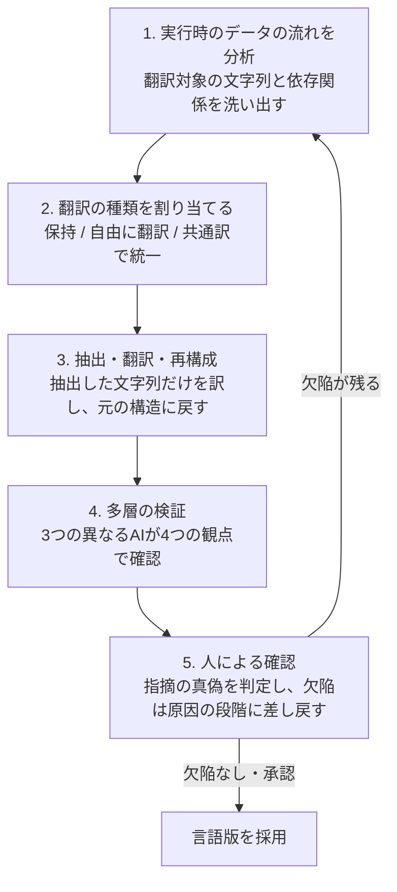

# BabelArena：多言語エージェント評価のナレッジ

作成日：2026-11-02　対象論文：arXiv:2609.23490v2（2026-10-23版）

記述の種類は、次の3つの印で区別します。

- 【確認済み】論文の本文や表に書かれていること
- 【推測】論文に書かれておらず、会話の中で読み取ったこと
- 【検討】会話で出た考えや論点

## 1. 概要

BabelArena は、LLMエージェントが英語以外の言語でも作業をこなせるかを測るテスト集です。BabelFlow という手順で、既存の4つのエージェント用テスト集を23言語に展開して作っています。【確認済み】

要点は次の4つです。

- 課題は699件、言語ごとの版を合わせて約1.6万件です。同じ課題と採点基準を全言語で固定するので、言語だけを変えた比較ができます。【確認済み】
- 5つの主要モデルのどれも、資源の少ない言語ほど成功率が下がります。【確認済み】
- 失敗の型も変わります。答えの間違いより、ツールの使い方の誤りや、同じ操作の繰り返しが増えます。【確認済み】
- 同じ課題でも、低資源言語では入力トークンが最大で約2倍かかります。【確認済み】

## 2. 理解に必要な前提

- エージェント：ツールを呼び出しながら、複数の手順で作業するLLMです。注文や旅行の手配が例です。
- エージェント用テスト集：問題と正解の組ではなく、実行できる環境です。課題文、ツールの説明、データベース、ユーザー役のAI、採点プログラムが、商品名などの同じ言葉でつながっています。
- 資源レベル：LLMがその言語をどれだけ得意とするかの区分です。論文は23言語を高・中・低の3群に分けています。
- Pass^1 と Pass^3：Pass^1 は1回あたりの平均成功率です。Pass^3 は、3回とも成功した課題の割合で、安定して解けるかを見ます。
- LC（言語一貫性）：エージェントが利用者に見せる文章が、指定した言語で書かれているかを示す指標です。1箇所でも別の言語が混ざれば0になります。ID、商品名、採点のために英語で出す必要があるラベルは対象外です。
- ソフトウェアのローカライズ：論文は、プログラムの動作を決める部分と、翻訳してよい文字列を分ける考え方を、エージェント用テスト集に当てはめています。

## 3. 解説

### 3.1 翻訳だけでは足りない理由

部品を別々に訳すと、同じ対象の表記がずれます。たとえば、課題文の商品名とデータベース上の商品名が違うと、エージェントが正しく動いても検索で何も見つからず、不正解になります。【確認済み：論文は同種の問題を一貫性の欠如として挙げている】

論文が挙げる課題は4つです。

1. 実行できる状態を保つこと
2. 共有される語の訳を揃えること
3. 採点の妥当性を保つこと（英語向けの解析処理や、LLM採点者の言語ごとの精度差）
4. 評価の費用を抑えること（課題の半分をランダムに選んで対応）

### 3.2 BabelFlow の流れ

- ステップ2の3分類：保持（ツール名、ID、日付など、変えると動かなくなる値）、自由に翻訳（指示文など）、共通訳で統一（都市名や商品名など。一度訳したら全体で同じ訳を使う）です。【確認済み】
- ステップ4の4つの観点：構造が壊れていないか、部品間の参照が合っているか、意味が保たれているか、英語版と同じ操作で同じ結果になるか、です。検証するAIは3種類で、互いの報告は見ません。【確認済み】
- 効果の確認：中国語に直した40課題で、各文字列を別々に訳すと20.0%の課題で参照が切れました。BabelFlow では2.5%（1件）でした。作成コストは約3.35倍です。【確認済み】

### 3.3 テスト集の構成

- 元のテスト集：VitaBench（出前・旅行などの対話型サービス操作）、DeepPlanning（旅行・買い物の長い計画）、τ³-Bench のテキスト部分（ユーザー役AIとの対話、規則の順守）、ClawEval（サービス連携、画像や音声の扱い）です。
- 規模：699課題、13分野、23言語、15種類の文字体系です。各課題を3回ずつ試します。
- 言語の群：高資源7、中資源8（韓国語、タイ語、ヒンディー語など）、低資源8（タミル語、テルグ語、クメール語、ビルマ語など）です。
- 訳の品質採点（5点満点）：高資源4.28、中資源4.02、低資源3.91でした。採点者は、高資源が人間の専門家2名、中・低資源がGPTです。

### 3.4 評価の結果

評価したのは、Claude-Opus-4.8、GPT-5.6-Terra、Gemini-3.1-Pro、Qwen-3.7-Max、Qwen-3.8-Max の5モデルです。【確認済み】

**分野別**：全分野で勝つモデルはありません。Pass^1 の1位は、VitaBench（42.3）と DeepPlanning（46.0）が Qwen-3.8-Max、τ³-Bench（71.4）が Gemini-3.1-Pro、ClawEval（55.8）が Claude-Opus-4.8 でした。DeepPlanning は、LC が特に低い分野です。

**言語群別（Pass^1）**：

| モデル | 高資源 | 中資源 | 低資源 |
|---|---|---|---|
| Claude-Opus-4.8 | 51.3 | 48.1 | 44.8 |
| GPT-5.6-Terra | 45.3 | 43.9 | 36.8 |
| Gemini-3.1-Pro | 45.9 | 42.4 | 36.4 |
| Qwen-3.7-Max | 45.8 | 42.9 | 40.1 |
| Qwen-3.8-Max | 51.2 | 48.0 | 44.7 |

LC も全モデルで3.7〜14.8点下がります。成功率が高いことは、指定言語で書き続けることを意味しません。Claude-Opus-4.8 は成功率で全言語群の首位ですが、LC は高資源で90.4で、GPT-5.6-Terra の98.8に及びません。

**失敗の型**：VitaBench の失敗1,600件（英語・中国語・タイ語・タミル語）を、LLMの注釈で分類しています。どの言語でも「最終的な答えの間違い」が最多です。中資源のタイ語と低資源のタミル語では、ツールの使い方の誤りと、同じ操作を繰り返して進まない失敗の割合が、英語・中国語より大きくなります。タミル語では、ツールの引数に現地語の値を渡す失敗が目立ちます。モデルによる傾向の違いもあり、GPT-5.6-Terra は必要なツールを呼ばない失敗が多く、Gemini-3.1-Pro は文脈の見落としや誤った推論が多いです。

**コスト**：同じ VitaBench 課題を英語と比べると、低資源言語では入力トークンが1.69〜2.06倍、出力が1.15〜1.66倍です。ターン数は0.97〜1.16倍で、ほぼ同じです。DeepPlanning の買い物課題では、ターン数が1.14〜1.71倍、ツール呼び出しが1.31〜1.80倍に増えます。商品検索の空振り率は、英語が6〜17%、低資源言語が54〜69%です。極端な例では、テルグ語の課題で、成功はしたものの呼び出しが201回必要でした（英語は25回）。

**言語の混入**：言語が混ざった軌跡のうち、DeepPlanning と ClawEval から無作為に選んだ2,000件に注釈をつけたところ、切り替え先の91.2%が英語でした。多くは、ツール呼び出しの前の短い前置きや、計画書の本体の前の一文で起きます。

## 4. 似たものとの違い

通常の多言語ベンチマークは、入力と出力が完結した問題を翻訳します。エージェント用では、環境の各部品が依存し合うので、翻訳の一貫性を保つ手順が必要になります。

既存の多言語エージェント評価との比較（論文の表1）は次のとおりです。

| 名称 | 訳した部品 | 課題数 | 言語数 |
|---|---|---|---|
| MAPS | 課題文 | 805 | 12 |
| GAIA-v2-LILT | プロンプト、課題文 | 165 | 6 |
| OmnilingualGAIA2 | プロンプト、課題文、環境 | 640 | 11 |
| MLCL | 課題文 | 200 | 4 |
| SEATauBench | プロンプト、課題文、ツール、環境 | 278 | 6 |
| PolyWorkBench | プロンプト、課題文、環境 | 67 | 10 |
| BabelArena | プロンプト、課題文、ツール、環境 | 699 | 23 |

## 5. 会話でわかったこと

### 5.1 人の関与は、何のために入っているか

- 人の確認は、エージェントの性能を上げるためではなく、テスト集の品質を保証するために入っています。【確認済み：手順の説明による】
- 理由は、環境全体を1行ずつ読むのが現実的でないことと、検証AIも誤判定をすることです。【確認済み】
- 人が必要なのはテスト集を作るときだけです。作ったあとの評価は自動で回せます。【確認済み：手順の構造から】
- 言語を増やすほど人手の負担は増えます。【推測】
- 人の確認とやり直しを重ねても、40課題のうち1件では参照切れが残りました。【確認済み】

### 5.2 人の確認をLLMに任せられるか

- 論文は、この点を試していません。【確認済み】
- 論文は、LLM採点者の精度と厳しさが言語で変わると述べています。【確認済み】
- 人の確認が最も必要なのは、LLMが苦手な低資源言語です。そこをLLMに任せると、苦手なモデルが苦手な言語の品質を判定する形になります。【推測】
- 現実的な進め方の案：高資源言語で人手を減らして精度を確かめ、そこから低資源言語へ広げます。確認の件数を減らして抜き取り検査にする形も考えられます。【検討】

### 5.3 BabelFlow は「中継役」か

- 会話では、言語間の性能差の原因になっている箇所を翻訳して補い、言語を超えて同程度の品質を目指す中継役というイメージが出ました。【検討】
- BabelFlow が作り直すのはテスト集で、運用中のエージェントと利用者のあいだに入る仕組みではありません。【確認済み】
- 論文が示す失敗の型（現地語の値をツールに渡す、商品検索が空振りする）は、中継層が効きそうな箇所を示しています。【推測】

## 6. 未解決事項

- 総件数の記載が食い違っています。要旨と表1は16,077件、導入の本文は16,146件です。どちらが正しいかは論文から判断できません。
- 低資源言語でトークンが増える原因を、論文は説明していません。文字列が長いトークン列に分かれることが一因だと考えましたが、これは推測です。
- 英語の前置きが混ざる原因を、著者らは訓練データに由来すると推測しています。検証はされていません。
- 失敗の分類は、VitaBench の4言語に限られ、注釈もLLMです。ほかの分野や言語で同じ傾向かは分かりません。
- 中・低資源言語の訳の品質は、LLMの採点だけです。人手の採点と比べた精度は、論文からは分かりません。
- 取得したHTMLの表は見出しが崩れていました。分野別の表の列は、本文の記述と照らして対応づけています。

## 7. 参考資料

- Kuang Peng ほか「BabelArena: A Large-Scale Multilingual Benchmark for LLM Agents」arXiv:2609.23490v2、2026-10-23（2026-11-02 に閲覧）：https://arxiv.org/html/2609.23490v2
- プロジェクト：https://github.com/QwenLM/BabelArena（論文に記載。未確認）

## 8. 更新履歴

- 2026-11-02：初版。論文の通読と、質問に基づく議論（人の関与、LLMへの置き換え、中継役の発想）を反映。
