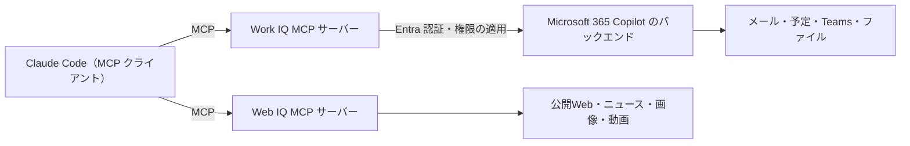

# Microsoft Web IQ と Work IQ ナレッジ（Claude Code への MCP 接続を中心に）

調べた日は2026年11月2日です。確認できた事実、推測、伝聞は、表の「区分」の列と本文中の語で区別しています。

## 1. 概要

- Web IQ と Work IQ は名前が似ていますが、別のサービスです。
- Web IQ は AIエージェントに公開Webの情報を渡すAPI群です。Web、ニュース、画像、動画を対象にします。
- Work IQ は Microsoft 365 Copilot の基盤になっている知能層です。組織内のメール、予定、Teams、ファイルなどを扱います。
- どちらも MCP の接続口を持ち、MCP クライアントである Claude Code から呼び出せる構成です。ただし、公開されている資料で接続情報を確認しただけで、実際に接続して動作を確かめてはいません。
- 「Office製品の中で動く Work IQ と、API や MCP で呼び出す Work IQ では、精度や性能が違う」という話は、Work IQ を実装した開発者から聞いたものです。この差を裏づける根拠はまだ見つけられていません。

## 2. 理解に必要な前提

- MCP（Model Context Protocol）は、AIアプリが外部のツールやデータを呼び出すための共通の規格です。Claude Code は MCP クライアントとして動き、`claude mcp add` で外部のサーバーを追加できます。
- グラウンディングとはAIの回答を外部の情報に基づかせることです。Web IQ はWebの情報で、Work IQ は組織内のデータで、それを行います。
- Microsoft Entra は Microsoft の認証基盤です。Work IQ の呼び出しはログインしたユーザーの権限で実行します（委任認証、OBO フロー）。
- Microsoft Graph は Microsoft 365 のデータを取得するための API です。Work IQ との違いは「4. 似たものとの違い」に書いています。

## 3. 解説

### 3.1 Web IQ

| 項目 | 内容 | 区分 |
|---|---|---|
| 目的 | AIエージェント向けのグラウンディング。引用に使える形で結果を返す | 確認済み（公式） |
| 対象 | Web、ニュース、画像、動画など | 確認済み（公式） |
| 基盤 | Bing の検索基盤を土台に、AI向けに作り直したと説明している | 確認済み（公式の説明） |
| 接続方法 | REST、MCP（JSON-RPC 2.0）、SDK | 確認済み（公式） |
| 提供範囲 | 一部の企業顧客向けの限定提供。利用前に、利用内容を登録して審査を受ける | 確認済み（公式の案内と利用規約） |
| 性能 | p95 で164ms、他の方式より約2.5倍速いと Microsoft が説明している | Microsoft の主張。第三者の検証は未確認 |
| MCP エンドポイント | `https://api.microsoft.ai/v3/mcp` | 確認済み（Microsoft Learn） |
| MCP ツール | Web、動画、ブラウズ、ニュース、画像のツールが載っている。使えるツールはアカウントの許可リストで決まる | 確認済み（Microsoft Learn） |

2026年6月3日付の報道は、Web IQ が Microsoft Build 2026 で発表されたと伝えています（第三者の報道）。

### 3.2 Work IQ

| 項目 | 内容 | 区分 |
|---|---|---|
| 位置づけ | Microsoft 365 Copilot とエージェントの基盤になる知能層。Data、Memory、Inference の3層でできている | 確認済み（Microsoft Learn） |
| データ源 | メール、予定、Teams、OneDrive、SharePoint、ユーザープロフィールなど | 確認済み（第三者記事が Microsoft の資料を紹介） |
| 公開の形 | MCP サーバー、A2A、REST API | 確認済み（第三者記事） |
| 認証 | 委任認証（OBO）に対応し、アプリ単独の認証は使えない。Microsoft 365 の権限、秘密度ラベル、コンプライアンスポリシーが自動で適用される | 確認済み（Microsoft 資料の転載ページ） |
| MCP のツール数 | Microsoft 365 の数百ある API 操作を、約10個の汎用ツールにまとめている | 第三者記事の記述 |
| ライセンス | MCP サーバーの利用に Microsoft 365 Copilot ライセンスが必要。課金は、資料によって書き方が異なる | 資料間で不一致 |
| 一般提供 | 2026年6月16日に Work IQ API が一般提供になったと第三者記事が書いている。プレビュー版の Microsoft Learn は、2026年5月を予定として載せている | 資料間で不一致。未確認 |
| MCP エンドポイント | `https://workiq.svc.cloud.microsoft/mcp` | 確認済み（TrueFoundry の資料） |
| 必要なスコープ | `api://workiq.svc.cloud.microsoft/WorkIQAgent.Ask` | 確認済み（TrueFoundry の資料） |
| 導入の条件 | テナントで Work IQ を有効にし、管理者が同意する | 確認済み（TrueFoundry の資料、プラグインの資料） |

### 3.3 Claude Code から見た構成



Work IQ から Copilot のバックエンドにつながる部分は、第三者のプラグインの資料にある記述をもとにしています。

### 3.4 Claude Code に接続する手順（公開資料から）

Web IQ の手順は次のとおりです。

1. アクセス権を得ます。待機リストへの申し込みか、Microsoft の担当者への相談が入口です。
2. MCP サーバーを追加します。

   ```
   claude mcp add --transport http webiq https://api.microsoft.ai/v3/mcp
   ```

3. 認証の設定を行います。ヘッダーの名前と形式は、確認できていません。
4. `claude mcp list` で接続を確かめます。

Work IQ は、第三者が公開している Claude Code 用のプラグインを使う方法が見つかりました。

1. 前提として、Microsoft 365 Copilot のライセンスと、テナント管理者の同意が必要です。
2. `/plugin marketplace add Aanerud/claude-code-workiq-plugin` でマーケットプレイスを追加し、README に沿ってプラグインを入れます。
3. Claude Code を再起動します。
4. `/workiq:setup` で設定を確かめ、認証を済ませます。

このプラグインは `npx -y @microsoft/workiq mcp` で Work IQ の MCP サーバーを起動します。公式の配布物ではなく、README に沿った手順の一部しか確認していません。

### 3.5 Claude Code から呼べる理由

呼び出し口が MCP として公開されているので、MCP クライアントならどのアプリからでも同じ形で呼べます。認証は Entra の標準の仕組みで、ユーザーの権限のまま呼べるため、組織の権限設定がそのまま効きます。Claude Code 側が `claude mcp add` で外部のサーバーを追加できる点も条件の一つです。この3点がそろっているので、Claude Code から Work IQ や Web IQ を呼ぶ構成が成り立ちます。

### 3.6 「アプリ内と API・MCP 経由で精度が違う」という話

| 区分 | 内容 |
|---|---|
| 伝聞 | Work IQ を実装した開発者から、次の趣旨の話を聞いた。API 通信にすぎない MCP の Work IQ は、Office 製品の中で常にバックグラウンドで動いている Work IQ とは、精度も性能も違う |
| 根拠 | まだ見つけられていない。Microsoft の資料に、アプリ内と API・MCP 経由を比べた記述は見つからなかった |
| 事実（反対に読める材料） | プラグインの資料は、各クエリが Entra で認証され、Microsoft 365 Copilot のバックエンドに届き、自然言語の応答が返ると書いている。つまり MCP 経由でも、データを取るだけでなく Copilot の処理系を通る |
| 事実（差を示唆する材料） | MCP のツールは約10個に絞られている。Work IQ API は、Copilot Chat API の本番向けの後継と位置づけられている |
| 推測 | アプリ内では、開いている文書や選択範囲のような文脈を使える。MCP 経由で渡るのは、質問文とツールの戻り値に限られるので、そこで差が出る可能性がある |
| 推測 | Copilot の会話の記憶を使える範囲が、アプリ内と MCP 経由で違う可能性がある |
| 推測 | MCP 経由では、呼び出し側のモデル（Claude Code のモデル）が戻り値を解釈する。その解釈の違いも結果に影響する可能性がある |
| 未確認 | 「常にバックグラウンドで動く」の意味。Work IQ が継続的にシグナルを集めると説明する資料はあるが、アプリ内だけ常時動くと読める記述は見つけられていない |

この話は、根拠が見つかるまで事実として扱いません。確かめる方法の案は次の3つです。

- 発言した開発者に、何と何を、どんな質問で比べたのかを聞く
- 同じ質問を Copilot のアプリと MCP 経由で試して、結果を比べる
- Microsoft の資料や担当者に、アプリ内と API・MCP 経由の違いを確認する

## 4. 似たものとの違い

| 項目 | Web IQ | Work IQ |
|---|---|---|
| 対象のデータ | 公開Web、ニュース、画像、動画 | 組織内の Microsoft 365 のデータ |
| MCP エンドポイント | `api.microsoft.ai/v3/mcp` | `workiq.svc.cloud.microsoft/mcp` |
| 条件 | 限定提供。利用内容の登録と審査が必要 | Entra 認証、Copilot ライセンス、テナントの有効化 |
| 提供の状態 | 限定提供 | 一般提供と書く資料がある。資料間で不一致 |

- Work IQ と Microsoft Graph は役割が違います。Graph はメールやファイルなどを取得する、生のデータへの入口です。Work IQ はそれらの情報を解釈した知能層です（第三者記事の説明）。
- Web IQ と Grounding with Bing は、用途が違います。Web IQ はAIエージェントと複数手順の処理向けで、Grounding with Bing は既存の利用者向けに残っています（公式の FAQ）。
- Work IQ API は Copilot Chat API の本番向けの後継と説明されています。既存の Copilot Chat API の連携は動き続けます（Microsoft 資料の転載ページ）。

## 5. 会話でわかったこと

### 名前の整理

- 最初は「WebIQ を Claude Code につなぐ」話として始まりました。その後、Microsoft 365 向けの Work IQ に話が移りました。
- 聞いた講演の「Office 製品上のもの」は、Work IQ を指していると解釈しました。本人への確認はしていません。

### 接続できる理由と手順

- Web IQ も Work IQ も、MCP の接続口が公開されています。
- Web IQ は限定提供なので、接続できるのはアクセス権を得てからです。認証の形式は確認できていません。
- Work IQ は、Copilot ライセンスとテナントでの有効化が前提です。

### 精度差の話の扱い

- 開発者から聞いた話であり、根拠はまだ見つけられていません。
- 事実と推測を分けて、「3.6」の表に残しました。

## 6. 未解決事項

- Web IQ の MCP の認証方式（ヘッダーの名前、トークンの取得方法）
- アプリ内と API・MCP 経由の Work IQ で、精度や性能が違うことの根拠
- Work IQ のライセンスと課金の整理（資料ごとに書き方が違う）
- Work IQ API の一般提供の時期（資料間で不一致）
- Work IQ 用のプラグインの、README の手順の全体

## 7. 参考資料

調べた日はすべて2026年11月2日です。

| 資料 | URL | 種別 |
|---|---|---|
| Microsoft Web IQ（トップ） | https://webiq.microsoft.ai/ | 公式 |
| Microsoft Web IQ（SDK のページと FAQ） | https://webiq.microsoft.ai/documentation/sdk | 公式 |
| Microsoft Web IQ（MCP のページ。設定の記述は取得できなかった） | https://webiq.microsoft.ai/documentation/mcp/ | 公式 |
| Web IQ MCP サーバーの統合（ドイツ語版） | https://learn.microsoft.com/de-de/web-iq/integrations/mcp | 公式 |
| Terms of Use for Microsoft Web IQ | https://www.microsoft.com/en-us/webiq/webiq-legal | 公式 |
| Microsoft Web IQ の解説（innFactory） | https://innfactory.de/en/cloud/azure/products/web-iq/ | 第三者 |
| Web IQ 発表の報道（17173） | https://news.17173.com/content/06032026/020231948.shtml | 第三者 |
| Work IQ in Copilot Studio | https://learn.microsoft.com/en-us/microsoft-copilot-studio/use-work-iq | 公式 |
| Microsoft Work IQ の解説（Kanerika） | https://kanerika.com/blogs/microsoft-work-iq-explained/ | 第三者 |
| Work IQ の解説（Emergent Software） | https://www.emergentsoftware.net/resources/insights/work-iq-explained-giving-ai-agents-context-for-how-work-gets-done/ | 第三者 |
| Introducing Microsoft Work IQ（Perficient） | https://blogs.perficient.com/2025/11/25/introducing-microsoft-work-iq-the-intelligence-layer-for-agents/ | 第三者 |
| Work IQ MCP Server の設定（TrueFoundry） | https://www.truefoundry.com/docs/ai-gateway/mcp/work-iq-mcp-server | 第三者 |
| Claude Code 用 Work IQ プラグイン | https://github.com/Aanerud/claude-code-workiq-plugin | 第三者 |

Work IQ API overview は、Microsoft の資料の転載ページを参照しました。原本の URL は確認できていません。

## 8. 更新履歴

| 日付 | 内容 |
|---|---|
| 2026-11-02 | 初版を作成 |
