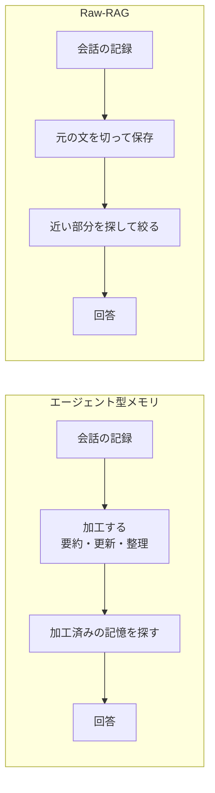
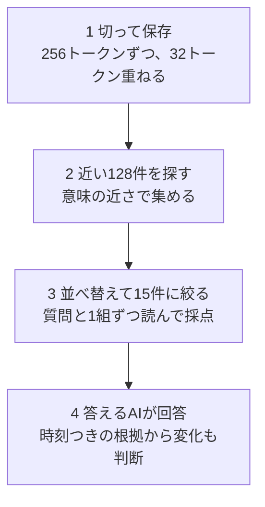
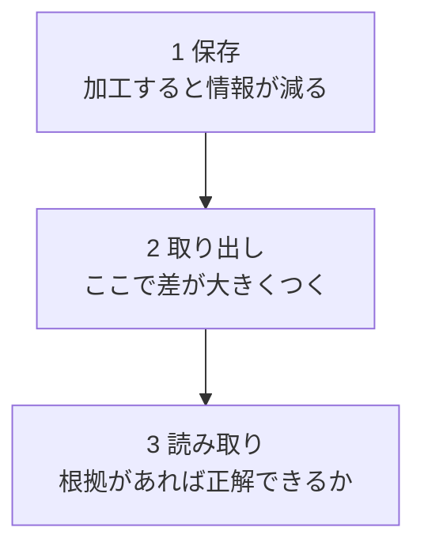

# Raw-RAGと記憶システムの比較（論文ナレッジ）

対象の論文は「Is Complex Agentic Memory Always Needed? Naive RAG Is Stronger Than We Thought」（arXiv:2610.30755v1、2026年10月22日公開）です。長期会話向けの複雑な記憶システムが、素朴なRAGに勝てているかを検証した論文です。調べた日は2026年11月2日です。

このファイルでは、確認できたことを次の印で書き分けます。

- 【確認済み】論文に書かれている内容
- 【推測】会話の中で出た、論文には書かれていない見立て
- 【検討】会話の中で考えたこと（判断や使い方の案）

## 1. 概要

AIが長く会話すると、記録が一度に読める量を超えます。そこで、必要な部分だけを思い出させる記憶システムが数多く作られてきました。多くは、AIが会話から要点を抜き出し、要約し、古い情報を書き換え、関係を整理して、加工済みの記憶を作ります。この論文はそれを「エージェント型メモリ」と呼びます。

論文は、そこまで複雑な仕組みが本当に必要かを問います。比べる相手として、会話を加工せずに切って保存し、質問に近い部分を探して答えるAIに渡す素朴な方法（Raw-RAG）を用意しました。

要点は次の4つです。

- 【確認済み】4つの試験セット・7つの条件のうち6条件で、Raw-RAGが比較した記憶システムの中で1位だった。
- 【確認済み】差は条件によって0.13〜5.53ポイントで、小さい条件も多い。1条件では負けている。
- 【確認済み】Raw-RAGの取り込みは、他のシステムよりはるかに速い。
- 【確認済み】強い理由は、必要な根拠を取り出せる割合の高さと、元の文を加工せずに残していることにあると分析されている。

## 2. 理解に必要な前提

**長期記憶の課題。** AIが一度に読める量には上限があります。過去の会話すべてを毎回渡せないので、必要な部分だけを選んで渡す仕組みが要ります。

**RAG（検索で補う生成）。** 質問に関係する文章を外部から探し、答えるAIに渡して回答させる方法です。

**埋め込み検索。** 文章を、意味の近さを測れる数字の列に変えます。質問も同じ形に変え、近い文章を拾います。

**並べ替え（クロスエンコーダ）。** 質問と候補を1組ずつ読み、関連の強さを採点するモデルです。埋め込み検索で多めに拾った候補を、少数に絞るために使います。

**トークン。** AIが文章を数える単位です。256トークンは、短い数往復の会話ぶんです。

**エージェント型メモリ。** 論文では、AIによる内容の加工、構造での整理、検索の制御を含む記憶システムの総称として使っています。比較対象は、Mem0、EverMemOS、MemOS、Memora、MemMachine、EMem、SimpleMem、MemU、A-MEM、MemoryOS、Nemori、RecMem の12種類です。

**4つの試験セット。**

| 名前 | 何を問うか |
|---|---|
| LoCoMo | 長い雑談の内容。1,540問 |
| LongMemEval | AIとの長いやり取りから情報を思い出せるか。500問 |
| MEME | 情報の更新、削除、連鎖する変更に対応できるか。1,188問 |
| MemoryAgentBench（MAB） | 長い資料からの探し出し、新しい情報への入れ替えなど。2,071問 |

**答えるAI。** GPT-4o-mini、GPT-4.1-mini、DeepSeek-V4-Flash のいずれかです。

**2つの測り方。**

- 根拠の取り出し率（論文の用語はカバレッジ）：質問に答えるのに十分な根拠を取り出せた質問の割合
- 根拠があったときの正解率（論文の用語は活用率）：十分な根拠が取り出せたとき、実際に正解した割合

## 3. 解説

### 3.1 比べている2つの流れ

### 3.2 Raw-RAGの仕組み

【確認済み】保存の際は、会話に時刻と画像の説明文を付けて1本の文章にします。LLMによる抽出、要約、グラフ構築、書き換えは行いません。

【確認済み】LoCoMo では、選んだ15件を発話ひとまとまりの単位に広げて渡します。検索モデルは、text-embedding-3-small と Cohere Rerank-v3.5 の組み合わせと、Qwen3-Embedding-4B と Qwen3-Reranker-4B の組み合わせの2通りで測っています。

### 3.3 結果

【確認済み】各条件で、Raw-RAGの点数と、最も高かった比較相手の点数（Full-context を除く）は次のとおりです。

| 条件 | Raw-RAG | 最良の比較相手 | 差 |
|---|---|---|---|
| LoCoMo（GPT-4o-mini） | 89.07 | MemMachine 88.12 | +0.95 |
| LoCoMo（GPT-4.1-mini） | 93.70 | EverMemOS 93.05 | +0.65 |
| LongMemEval（GPT-4.1-mini） | 87.53 | Memora 87.40 | +0.13 |
| MEME（GPT-4o-mini） | 39.30 | MemMachine 37.06 | +2.24 |
| MEME（DeepSeek-V4-Flash） | 43.19 | MemMachine 44.71 | -1.52 |
| MAB（GPT-4o-mini） | 48.32 | Memora 43.84 | +4.48 |
| MAB（DeepSeek-V4-Flash） | 53.41 | Memora 47.88 | +5.53 |

MEME の DeepSeek 設定では、会話を丸ごと渡す方法（Full-context）が63.17で、Raw-RAGを19.98ポイント上回ります。MAB では、長さの制限で Full-context を測れていません。

LoCoMo と LongMemEval の比較相手の点数は、他の論文の公表値です。著者らは、同じ設定に合わせて Raw-RAG を測り直しています。MEME と MAB は、全システムを同じ手順で評価しています。

### 3.4 設計の各部分の効き方

【確認済み】MAB での実験です。

| 変更 | 総合点の変化 |
|---|---|
| 並べ替えをなくす | -3.92 |
| 絞る件数を1件にする | -11.73 |
| 絞る件数を5〜60件にする | 差は1.3ポイント以内 |
| 絞る件数を120件にする | -14.57 |
| 切る長さを128〜1,024トークンにする | 有意な差なし |
| 同じ発話の重複を除く | -2.39 |

多く渡せば良いわけではありません。ほどよく絞ることが効いています。

### 3.5 なぜ強いか

**根拠の取り出しで差がつく。** 【確認済み】MAB では、取り出し率が19.07〜45.29%と大きくばらつきました。根拠があったときの正解率は80.00〜89.71%で、差は小さいです。Raw-RAGの取り出し率は45.29%で最高、正解率は84.43%でした。MEME でも、取り出し率は35.69〜76.35%、正解率は65.51〜86.55%で、同じ傾向です。Raw-RAGの取り出し率は76.35%で最高、正解率は73.76%でした。

**答えの値だけでなく、筋道も取れている。** 【確認済み】MEME の追跡・連鎖問題で、答えの値を取れたもののうち、順序や依存関係まで取れた割合は、Raw-RAGが62.34%、MemMachine が56.70%、MemU が9.62%でした。

**加工で失った情報は戻せない。** 【確認済み】各システムの保存内容をすべて使え、正解を知っている側が必要な部分を選んで渡す条件で、MEME（GPT-4o-mini）を測りました。全システムで点は上がりましたが、元の会話を残すRaw-RAGと MemMachine は約57.5%、元の根拠そのものを渡した場合は61.60%でした。加工して保存するシステムは、差が大きく残りました。件数の上限を外しても、全システムが元の根拠より7.58〜29.38ポイント低いままでした。

ただしRaw-RAGでも61.60%に届きません。並べ方や「長い文の途中が抜けやすい」影響もあり、差のすべてが保存時の情報の損失とは言えません。

**加工を足すと悪化する。** 【確認済み】MAB で、Raw-RAGに次を足すと総合点が下がりました。

| 足したもの | 総合点の変化 |
|---|---|
| 事実の抜き出し | -19.62 |
| 要約 | -5.81 |
| グラフでの検索の拡張 | -5.78 |

**書き換えは実際にはあまり起きない。** 【確認済み】Mem0 を調べると、更新と削除の判断は、LoCoMo で書き込み判断の4.39%、LongMemEval で2.46%でした。実際に内容が変わった書き換えは、それぞれ1.90%と1.34%です。更新と削除を止めると、LoCoMo の正解率は67.36%から69.42%に上がりました。

**答えるAIが状態の変化を読み取れる。** 【確認済み】MEME で、正解を知っている側が時系列順に根拠を渡す条件でも、答えるAIによって大きく変わりました。変更が連鎖する問題の正解率は、GPT-4o-mini で1.83%、DeepSeek-V4-Flash で82.32%でした。

### 3.6 費用と時間

【確認済み】MEME の10エピソード・110問で、保存して使える状態にするまでと検索の合計時間は、Raw-RAGが約306秒でした。EMem は約1,562秒、EverMemOS は約9,301秒です。100万トークンに近い会話を順に取り込む実験では、Raw-RAGが約0.33時間、Memora が約27時間でした。取り込み後の回答生成と評価の時間は、この測定に含まれていません。

【確認済み】MAB で、事実の抜き出し、要約、グラフ拡張を足すと、LLMのトークンを2,160万〜1億930万、時間を2.9〜8.8時間使いました。Raw-RAGは12分です。

## 4. 似たものとの違い

| 方式 | 保存の仕方 | 探し方 | 論文から分かる特徴 |
|---|---|---|---|
| Raw-RAG | 元の会話を256トークンで切る | 128件拾い、15件に絞る | 情報が減らず、取り込みが速い。集計や連鎖する更新が弱い |
| エージェント型メモリ | 抽出、要約、更新、グラフ化 | システムごとに異なる | 状態の変化を保存時に反映する設計。取り込みに時間がかかり、加工で情報が減る |
| Full-context | 加工なし | 探さずに全部渡す | MEME の DeepSeek 設定では最高。長い資料は入りきらない |
| ReFind（同時期の研究） | 生のチャット記録を残す | エージェントが語句検索を繰り返す | 論文は直接比較せず、探し方の工夫を除いて評価している |
| 先行研究の素朴なRAG | 大きな単位など | 件数が少ない、並べ替えがない例がある | 論文は、14件の先行研究のうち複数で、比較用のRAGの条件が弱かった可能性を指摘している |

## 5. 限界と使いどころ

### 限界

- 【確認済み】試したのは公開された会話の試験セットだけです。実際の対話、画像を含む場面、実サービスでの運用は確かめていません。
- 【確認済み】100万トークン級では、取り込みの時間だけを測っています。正解率は測っていません。
- 【確認済み】答えるAIの性能に左右されます。弱いAIでは、保存時の整理が役立つ可能性が残ります。
- 【確認済み】MEME で、複数の情報を集めて数える問題の正解率は19〜21%、変更が連鎖する問題は4%前後と低いです。
- 【確認済み】元の会話をすべて残すので、保存量、個人情報、削除の要望への対応が課題です。

### 使いどころ

【検討】論文の結果を踏まえた整理です。

- 新しい記憶の仕組みを選んだり作ったりするときの比較の基準線にする。複雑な仕組みを足す前に、まずこれで測る。
- 長期会話のエージェントの最初の実装にする。元の記録を捨てず、探す段と絞る段を整える。足りない問題が見えたら、その部分にだけ整理や探し直しを足し、効果をRaw-RAGと比べる。
- 削除や個人情報の制約が強いデータ、答えるAIが弱い構成、集計や連鎖する更新が中心の用途では慎重に使う。

## 6. 会話でわかったこと

### 従来のRAGの弱点は解消されたか

論文の説明は、よく言われるRAGの弱点を2つ含みます。1つ目は、指定した件数を見つけた時点で探すのをやめ、その情報だけで答えること。2つ目は、時系列の変化や、関連する情報をすべて取れないことです。

- 【確認済み】Raw-RAGは新しい仕組みではなく、標準的なRAGの構成です。違いは、多め（128件）に拾ってから並べ替えで15件に絞る点です。
- 【検討】多めに拾って絞ることで、少数で探すのをやめる弱点は、いくらか和らぐ。ただし件数の上限は残るので、関係する情報をすべて集めることはできない。
- 【確認済み】根拠の取り出し率は、MAB で45.29%、MEME で76.35%でした。集計の正解率は19〜21%で、DeepSeek 設定の Full-context（59%）に大きく及びません。
- 【確認済み】時系列は、時刻を付けて保存し、新旧の両方が入れば答えるAIが読み分ける方式です。答えの値を取れたもののうち、筋道まで取れた割合は62.34%でした。変更が連鎖する問題の正解率は4%前後です。
- 【検討】結論として、弱点は一部和らいでいるが、解決はできていない。

### 会話が対象であることの意味

- 【推測】会話は、文書や表計算のファイルよりずっと小さいので、探す範囲を絞りやすく、素朴な方法でも通用しやすい。
- 【確認済み】論文は一般化を主張しておらず、公開された会話の試験セットだけでの結果だと明記している。

### 採用の判断

- 【検討】論文が示したのは「これを使え」ではなく、複雑な仕組みを提案するなら、まずこの素朴な方法に勝つべきだという比較の基準である。
- 【検討】変更が連鎖する問題などは、会話を丸ごと渡す方法に大きく負けている。実サービスで使う前には、自分たちのデータで測る必要がある。

### 検索結果の適合性を判定するモデルを足す案

質問に合う根拠かを判定する小さなモデルで、RAGの精度を上げる方式があります。

- 【推測】この方式は、Self-RAG や CRAG などの系統に当たる。
- 【確認済み】論文はこの方式を試していません。Self-RAG は関連研究として名前が出るだけです。
- 【確認済み】Raw-RAGの並べ替えの段が、すでに質問と根拠の関連を採点する判定役の働きをしています。これを外すと3.92ポイント下がります。
- 【検討】判定を強めれば、さらに良くなる余地はある。
- 【検討】ただし判定が助けるのは、関係のない根拠を除く場面である。根拠が最初から入っていない場合は、探し直しと組み合わせて初めて効く。変化の筋道の読み違いは、探す側ではなく答える側の問題である。
- 【検討】どちらが主な原因かは、この論文のデータだけでは分からない。

### 強さの理由と、RAG以外の選択肢

- 【確認済み】著者らの見立てでは、強さの中心は元の文を加工せずに残し、答えるAIが判断できる材料を渡している点にあります。
- 【確認済み】渡しているのは15件だけです。120件に増やすと14.57ポイント下がりました。会話を丸ごと渡す方法は、MEME の DeepSeek 設定でRaw-RAGを約20ポイント上回りました。ただし長い資料は入りきらず、MAB では試せていません。
- 【検討】エージェントに探させる方式（ReFind など）も有望である。論文はRaw-RAGを固定の手順にして比べているので、工夫なしでもここまで出るという最低ラインの意味を持つ。
- 【検討】長期セッションのエージェントに応用するなら、元の記録を捨てることなく土台にし、探し方や整理を足し、足した効果をRaw-RAGと比べる使い方が堅実である。

## 7. 未解決事項

- 実際の対話、画像を含む場面、実サービスでの性能
- 100万トークン級の長さでの正解率
- 弱い答えるAIでの、保存時の整理の効果
- 判定モデル、探し直し、エージェント検索を足した場合の差（ReFind との直接比較を含む）
- 失敗の原因が、検索の側か読み取りの側かの切り分け
- 削除要望と個人情報への対応方法
- 集計と連鎖する更新の改善方法
- この調査では、論文の付録の途中（A.1.3 以降）を取得できていない。付録B〜G（実装の詳細、診断の手順、プロンプト）は未確認

## 8. 参考資料

- Zhengye Bao ほか「Is Complex Agentic Memory Always Needed? Naive RAG Is Stronger Than We Thought」arXiv:2610.30755v1、2026年10月22日。https://arxiv.org/html/2610.30755v1（2026年11月2日に確認。プレプリントで、本文と付録Aの途中まで）

## 9. 更新履歴

| 日付 | 内容 |
|---|---|
| 2026-11-02 | 初版 |
