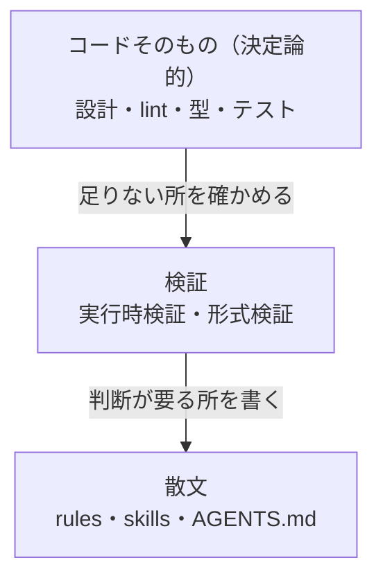
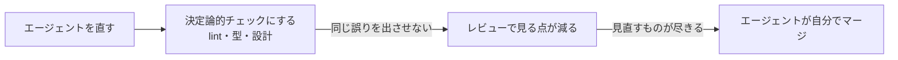

# AIエージェントでコード品質を保つ環境づくり：講演の解説

## 1. 概要

エージェントに大量のコードを書かせながら品質を保つ方法を話した、17分の英語講演の解説です。話者は、先月3,000件のプルリクエスト（pull request、PR）を本番に出したと話しています。チームでは先月11,000件を本番に出したそうです。

話者は、ソフトウェアエンジニアの仕事が「生産性を大きく上げながらコードの品質を保つ方法を見つけること」に変わったと述べています。そのために、エージェントの環境に投資して、エージェントを信頼できる状態にすることを重視しています。ここまでに話者は6か月かかったそうです。

要点は3つです。

1. エージェントを直すときは、lint・型・アーキテクチャなどの決定論的（deterministic）なチェックに変えて、問題そのものをなくします。コードのチェックのほうが再現性が高く、信頼しやすいと話者は述べています。
2. レビューの中心を、動画・スクリーンショット・図・形式検証などの検証成果物に移します。エージェントに自分で動かして確かめさせることが、信頼の根拠になります。
3. 自動化は、コードベースと検証を整えてから行います。内側のコーディングのループが雑なものを作るなら、自動化は雑なものを増やし、トークンの費用もかさみます。

この文書の書き分けは次のとおりです。断りのない文は話者の発言です。「補足」は理解のために会話で足した一般的な説明、「推測」は発言から読み取った私の解釈を指します。

## 2. 理解に必要な前提

補足：この節の説明は講演の発言ではなく、講演を読むために足した一般的な説明です。

- 決定論的（deterministic）と確率的（probabilistic）：同じ入力なら必ず同じ結果になるチェックが決定論的です。AIの判断のように、毎回結果が変わりうるものが確率的です。
- lint（リント）：コードを実行せずに、書き方や禁止事項を機械的に検査する仕組みです。ルールに反するとエラーになります。
- 構文木（abstract syntax tree、AST）：lintがコードを調べるときに使う、コードの構造を木にしたものです。木の中に「この形があればエラー」という条件を書けるので、命名規則だけでなく「このコードを書いてはいけない」というルールも作れます。
- lintの表現を広げる方法：標準ルールの設定（特定のimportの禁止、特定の構文の禁止）、既製のプラグイン、自作ルール、フォルダ間の依存関係を調べる専用ツールがあります。エラーメッセージも自由に書けます。
- 型システム（type system）とコンパイラ（compiler）：コードの誤りを実行前に見つける仕組みです。
- プルリクエスト（pull request、PR）：コードの変更を取り込んでもらうための依頼です。差し戻し（revert）は、取り込んだ変更を取り消すことです。
- slop：雑で質の低い生成物を指す言葉です。講演では、質の低いコードに使われています。
- useEffect：React（Webの画面を作るライブラリ）で、画面の描画後に処理を走らせる仕組みです。誤用しやすいとされ、講演では「使いこなしに細かな判断が要る道具」の例として出ます。
- Electron：Web技術でデスクトップアプリを作る枠組みです。メイン側の処理と、画面を描く側の処理が分かれています。
- 実行時検証（runtime verification）：実際にプログラムを動かして確かめることです。
- 形式検証（formal verification）：仕様を数学的に書き、性質が成り立つことを機械で調べることです。講演に出るTLA+は、状態の移り変わりを網羅的に調べるモデル検査（model checking）の言語です。Leanは、アルゴリズムの性質を証明する証明支援系（proof assistant）です。
- プロパティベーステスト（property-based testing）：個別の入力例ではなく「常に成り立つべき性質」を書き、ツールが入力を大量に作って確かめるテストです。
- Chrome DevToolsプロトコル（Chrome DevTools Protocol）：ブラウザを外部のプログラムから操作し、調べるための仕組みです。

## 3. 解説

### 3.1 信頼を積む3つのまとまり

話者は、エージェントの環境のどこに時間を使うかを、逆ピラミッドで示しています。

- コードそのもの：最初の2層で、決定論的です。API設計、アーキテクチャ、リファクタリング、lintルール、型システム、コンパイラ、各種のテストが入ります。この2層で、エージェントができることを絞り、既定の動作を正しいものにします。
- 検証：実行時検証と形式検証です。バグを見つけ、システムで常に成り立たせたい性質（不変条件、invariant）を確かめます。エージェントが目的と意図を理解したかの確認にもなります。
- 散文：rules、skills、AGENTS.mdなど、判断が要るものです。話者は「少し」重ねるものと位置づけています。

推測：逆ピラミッドは上が広いので、上の層ほど多く時間をかける意図と読めます。

### 3.2 コードベースが最大の入力

エージェントは入力から出力を作ります。コードベースは、その入力の中でも最大級です。そのため、回避策、アンチパターン、使われていないコード、技術的負債は、確立したパターンとして次のエージェントにコピーされます。話者は、これを庭の雑草にたとえています。

- 以前は、コードが数件のPRずつ届いていました。話者は2024年に、同僚の3件のPRをレビューしていたと話しています。今は、その数が300件ほどです。
- 1人のエンジニアが、数百から数千のエージェントのチームを持つ状態です。コードが絶え間なく届き、生き物のように見えます。
- 課した制約とガードレールは、建物の基礎のように働きます。新しいコードは、その周りに育ちます。
- そのため、エンジニアの仕事は庭仕事に近くなります。エージェントが良いものをコピーするように、コードベースを清潔に保ちます。

### 3.3 具体例

話者のチームは、Electronアプリ向けのクライアントフレームワークを作り、そこに学びをlintルールとして入れています。話者は、Next.jsに近いものと説明しています。

- useEffectの禁止：細かな判断が要る道具は、エージェントが苦手です。そこで製品コードでは禁止し、フレームワークのAPI内部だけで許可しました。この問題は根本からなくなり、レビューで拾う必要もなくなったそうです。
- ディレクトリ構造で文脈を伝える：エージェントがメイン側のコードを描画側に読み込み、長い処理と画面の引っかかりを起こしていました。そこで、描画側用とメイン側用の2つのトップレベルディレクトリを置き、両者の間のimportを依存関係の分析ツールとlintで禁止しました。ルールは簡単でも、レビューで考える点が1つ減ります。
- Markdownに書かれる言い訳：エージェントは、文書、コードコメント、rules、skillsに、正しいことをしない理由を書きます。小さな訂正を、二度と破れない規則のように受け取ることもあります。
- 命令的なタイマー：エージェントは、setTimeout、requestAnimationFrame、requestIdleCallbackを応急処置に使いました。これは、VS Codeの命令的なスタイルとReactの宣言的なスタイルの食い違いを覆い隠すものでした。タイマーの作成と破棄が大量に続くと、ガベージコレクションが増えて遅延が出ます。エージェントは、この応急処置を正当化するコメントも書き、タイマーが広がって性能が落ちました。話者は、アーキテクチャの選び方が、クライアントとエージェントの両方の性能を悪くしたと述べています。
- コメントの99%を禁止：人はコメントを読まず、エージェントには「難しいから正しくやらない」と言い訳する逃げ道になるためです。コメントは強制できないので、「次のエージェントにこうさせない」という善意の注意書きも、信頼できるものになりません。代わりに、lintルールと、根本原因を直させるエラーメッセージを使います。

### 3.4 訂正を決定論的チェックに変えるループ

話者の原則は、エージェントを訂正するたびに、決定論的なチェックに変えることです。API設計やアーキテクチャを改めて問題を根本からなくす方法もあり、これを繰り返すとレビューで見る点が減ります。ある時点で、見直すものがなくなり、エージェントが自分のPRの大半をマージできるようになると話者は述べています。

### 3.5 検証

レビューは、検証成果物を見る作業に縮まりました。成果物は、動画、スクリーンショット、図、形式検証の結果です。

- 実行時検証：エージェントが自分でコードを動かし、人間の開発者と同じデバッグツール（Chrome DevToolsプロトコルなど）を使います。実行時検証のskillには、feature mapがあります。利用者の視点で、アプリの機能を一覧にしたものです。「左サイドバーのあれ」のような曖昧な指示を避け、共有の語彙になります。専用のCLIとドライバも用意し、毎回使い回します。トークンの消費が減り、テストもできるためです。
- 形式検証：TLA+で、複数のデバイスやプラットフォームをまたぐ通知のような、主要な利用者の流れをモデル検査しています。Leanでは、アルゴリズムの証明をしています。自作の仮想化ライブラリで、ちらつきやぶれが起きないことを確かめるためです。すでに複数のバグが見つかりましたが、万能ではないと話者は述べています。環境の層の1つとして試している段階です。
- プロパティベーステスト：UI向けに始めたところです。すでにUIのバグがいくつか見つかっています。
- 状態機械の図：話者は、状態機械を図にするskillを作りました。動画やスクリーンショットと並べると、レビューしやすいそうです。
- トークンの使い道：話者が紹介した別の開発者は、6か月前には、微妙なバグが混ざって信頼できないと話していました。今は、日々のトークンの70%を検証に使うそうです。話者も、自分のトークンの大半が検証に向かうと述べています。

話者は、これらが新しい技法ではないと述べています。理解、記述、保守が難しくて高価だった手法が、エージェントで安くなったという見方です。以前は経済的に難しかった広さまでテストでき、「テストと検証の黄金期」に入ったと話しています。形式検証は、プロダクトの動作をよく考える助けにもなり、エージェントが意図と目標を理解したかの確認にも役立つそうです。

### 3.6 成果

次の数値は、話者の自己申告です。

| 項目 | 話者の発言 |
|---|---|
| 話者個人のPR | 先月3,000件を本番に出した |
| チームのPR | 先月11,000件を本番に出した |
| 安定版のリリース | 約1日に1回 |
| 10月に1件以上のPRを出した人 | 約227人（コアチームと、文脈の少ない貢献者を含む） |
| 差し戻しの割合 | 相対的に減り、約0.5%で安定 |
| アプリの性能 | 公開時より複数の面で向上 |

話者は、Electronアプリなので性能には上限があるが、すでに他のどのエージェントUIよりずっと速いと述べています。

### 3.7 自動化の前にすること

話者は、ソフトウェアファクトリーを作って何でも自動化する前に、次の2つを勧めています。

1. エージェントを訂正するときは、まずコードベースを直します。lintルールで新たな発生を防ぎ、古いパターンも掃除します。
2. 検証の仕組みを強くします。

これらは自動化の前提でもあります。内側のコーディングのループが雑なものを作るなら、自動化は雑なものを増やすだけです。その分、多くのトークンが要り、費用もかさみます。コードベースと検証が整えば、自分のファクトリーを組みやすくなります。

話者のチームの例では、新しいリリースを切るたびに、アプリ全体とビルドをfuzzするプロジェクトが自動で立ち上がります。実際の利用者のようにアプリを動かして不具合を探し、不具合ごとに修正PRを出して、自動でマージする流れです。話者は、コードベースが十分によく、PRが既定で良いものになるため、製品コードの多くには深い人のレビューが要らなくなったと述べています。話者のチームの製品には、多数のコネクタと、クラウドエージェントやプロジェクトを起動するルーティンがあり、数百から数千のエージェントを調整できるそうです。

## 4. 似たものとの違い

講演の中で対比されている考え方を並べます。

| 比べるもの | 従来のやり方 | 講演の立場 |
|---|---|---|
| エージェントの直し方 | rulesやAGENTS.mdに1行足す | lint・型・設計などのコードで強制する |
| 注意の伝え方 | コードコメントに注意書きを残す | lintルールと、根本原因を直させるエラーメッセージを使う（コメントは強制できない） |
| レビューの対象 | 人がコードを読む | 動画、スクリーンショット、図、形式検証の結果を見る |
| 自動化の進め方 | 先にファクトリーを作って自動化する | 先にコードベースと検証を整える（雑なループの自動化は雑なものを増やす） |
| 形式検証の位置づけ | 万能の手段 | 層の1つ（銀の弾丸ではない） |
| 高い生産性の担い手 | 一部の突出した個人（話者は「コーディングマシン」と呼ぶ） | エージェントを使えば誰でもなれる |

## 5. 会話でわかったこと

核心を3行にすると、次のとおりです。

1. エージェントの訂正は、決定論的なチェックにして問題をなくします。ルールの文を足すより、コードで確かめるほうが再現性が高いためです。
2. レビューの中心を、検証成果物に移します。エージェントに自分で動かして確かめさせます。
3. 自動化は、コードベースと検証を整えてから行います。雑なまま自動化しても、雑なものが増えるだけです。

講演で話されていないことも確認しました。この講演は、CIの所要時間そのものには触れていません。リリースごとにエージェントがアプリを動かして不具合を探す仕組みは紹介されていますが、その実行時間への言及はありません。

## 6. 未解決事項

- 製品名、フレームワーク名、ツール名、話者名、別の開発者の名前は、音声認識で崩れていて確定できません。元の動画で確認が必要です。
- 最初の2層（決定論的な層）が、設計とチェックのどこで分かれるかは、聞き取りでは確認できませんでした。
- 11,000件、227人、約0.5%の数値について、何をPRと数えるかや集計の期間は、講演の中では確認できませんでした。
- TLA+とLeanをどこまで広げているか、プロパティベーステストのツール名は、講演では概要だけです。
- 性能の改善が、どの指標でどれだけかは、聞き取りでは確認できませんでした。

## 7. 参考資料

- 講演の動画ファイル：X経由で入手した17分18秒の英語の動画です。元の投稿のURLは確認していません。調べた日は2026-11-19です。
- 文字起こし：音声認識モデル（SenseVoice）で英語の音声を文字にし、手作業で整えずに読んでいます。誤認識があります。

## 8. 更新履歴

- 2026-11-19：初版を作成しました。
