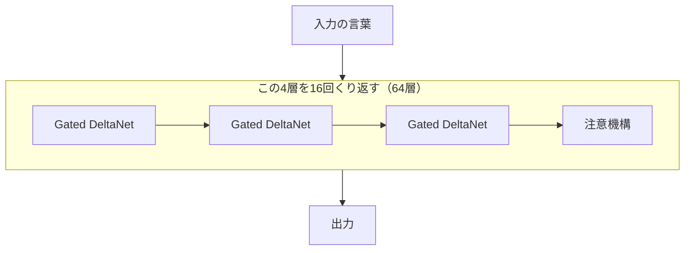
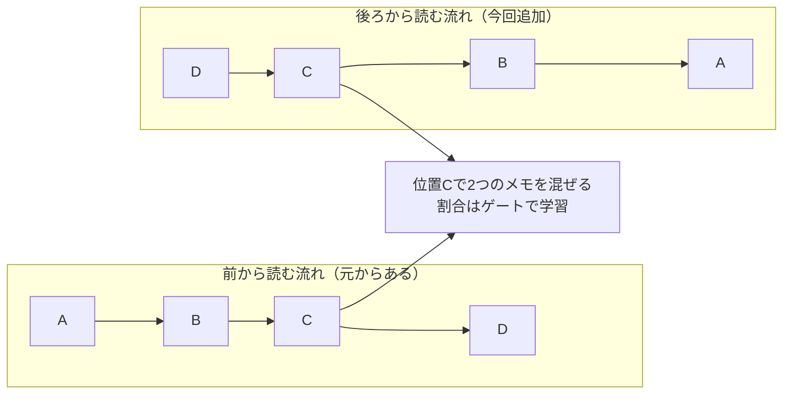

# Diffusion-Qwen3.8-27B

作成日：2026-11-19

## 1. 概要

Diffusion-Qwen3.8-27B は、Qwen3.8-27B をマスク拡散（masked diffusion）で文章を作るモデルに作り替えた、研究用のモデル（research checkpoint）です。重み、コード、生成例が公開されています。

新しい点は、Gated DeltaNet の層まで、後ろからも読めるようにしたことです。同じ系統のモデルを作り替えた先行例は、注意機構（attention）の層だけを両方向にしていました。

ただし、精度や速度を元のモデルとまだ比べていません。設計は新しいものの、効果は確認されていない段階です。

## 2. 理解に必要な前提

マスク拡散そのものの仕組みは、別のナレッジ（Text-Diffusion-LM-Knowledge-20261119.md）にまとめています。ここでは、元のモデルの構造を説明します。

### 2種類の層

LLM は、言葉を何十もの層に通し、層ごとに言葉どうしの情報を混ぜる処理を重ねる作りです。混ぜ方には次の2種類があります。

| 層 | 混ぜ方 | 長所 | 短所 |
|---|---|---|---|
| 注意機構（attention） | 各語がほかの全部の語を直接見る | 正確 | 計算量が文の長さの2乗で増える |
| Gated DeltaNet（線形アテンション, linear attention の一種） | 文を前から順に読み、決まった大きさのメモ（状態, state）を書き換えて進む | 長い文でも軽い | 細かい情報を取りこぼしやすい |

### 混成構造（ハイブリッド, hybrid）

Qwen3.5 以降のモデルは、この2種類を組み合わせています。Qwen3.8-27B は64層のうち16層が注意機構で、残りの48層が Gated DeltaNet です。軽さと正確さの両方を得るための設計です。



### 両方向が必要な理由

元のモデルは、前から1語ずつ作る自己回帰（autoregressive）のモデルです。どの層も、自分より後ろの語を使いません。マスク拡散では、答えの途中にある穴を、前後両方の文脈から埋めます。そのため、どの位置からも後ろの語を使えるように作り替える必要があります。

## 3. 解説

### 生成の流れ（投稿の説明）

質問の文は固定し、答えを全部穴にした状態から始めます。毎回すべての穴を同時に予想し、信頼度のしきい値（confidence threshold）を超えた語だけを確定させます。確定した語は、次の回で残りの穴を埋める手がかりです。

### 注意機構の層：因果マスクを外す

注意機構は、順番に計算する仕組みではありません。各位置とほかの全位置との関係を、表にして一度に計算します。「後ろを見ない」制限は、この表の後ろの欄を塗りつぶす因果マスク（causal mask）で実現しています。今回は、この因果マスクを外しました。

```
因果マスクあり        外した後
    A B C D             A B C D
A   ○ × × ×         A   ○ ○ ○ ○
B   ○ ○ × ×         B   ○ ○ ○ ○
C   ○ ○ ○ ×         C   ○ ○ ○ ○
D   ○ ○ ○ ○         D   ○ ○ ○ ○
（○＝見る、×＝見ない）
```

### Gated DeltaNet の層：後ろから読む流れを足す

Gated DeltaNet は、文を本当に前から順に読む作りです。因果マスクを外すだけでは、後ろの語を使えるようになりません。

そこで今回は、前から読む流れとは別に、末尾から先頭へ読む流れを1本足しました。各位置では、前からのメモと後ろからのメモを混ぜて使います。後ろからのメモをどれだけ混ぜるかは、学習で決まる割合（ゲート, gate）で調整します。2本の流れは互いに独立しており、同時に計算できる作りです。前を読み終えてから引き返すわけではありません。



### 何が新しいのか

注意機構の層を両方向にするのは、因果マスクを外すだけなので難しくありません。新しいのは、一方向にしか進めない Gated DeltaNet の層にまで、後ろから読む流れを足した点です。

## 4. 似たものとの違い

| | 同じ系統の先行例（dQwen3.5 など） | 今回 |
|---|---|---|
| 注意機構の層（全体の4分の1） | 両方向 | 両方向 |
| Gated DeltaNet の層（全体の4分の3） | 前からだけ（手を付けない） | 前から＋後ろから（ゲートで混ぜる） |
| 性能の評価 | あり | まだない |

2026年9月に出た dQwen3.5 の論文では、Gated DeltaNet の層を前から読むまま残し、注意機構の層だけを両方向にしています。そのため、モデルの4分の3は一方向のままでした。

なお、注意機構だけでできたモデル（Transformer）を拡散型に作り替えた例は、以前からあります。その場合は、因果マスクを外すだけで全層が両方向になります。

## 5. 会話でわかったこと

### 「後ろを見ない」の中身は層によって違う

注意機構では、「後ろを見ない」は計算の順番の話ではありません。表の欄を隠しているかどうかの話です。Gated DeltaNet では、本当に前から順に計算しています。両方向にする手間が違うのは、このためです。

### 弱点

投稿者自身が挙げている弱点は、早い段階で自信を持って間違えることです。このモデルは、一度確定させた語をあとから書き直しません。最初のほうで間違った語を確定させると、その後の回はその語を正しい前提として扱い、周りを埋めます。その結果、文としては自然なのに、中身が間違った答えができあがります。

```
1回目  [__][__][__][__][__]
        ↓ 自信のある語だけ確定（ここで1語ミス）
2回目  [__][東京][__][__][__]
        ↓ 「東京」を前提に周りを埋める
完成   滑らかだが中身が違う答え
```

しきい値を下げると速くなる一方で、この失敗も起きやすくなります。

### 速さについての注意（会話での検討）

- 回ごとに文全体を計算し直すので、KVキャッシュ（KV cache）による計算の使い回しが、そのままでは効かない
- Gated DeltaNet の層は2本読みになるので、その層の計算はおよそ倍になる（推測）
- 繰り返す回数をかなり減らせないと、元のモデルより遅くなるおそれがある（推測）

## 6. 未解決事項

- 元のモデルと比べた精度と速度（投稿の時点で未評価）
- Gated DeltaNet の層まで両方向にしたことが、先行例と比べて実際に効くか
- 早い段階の確定ミスが、どれくらいの頻度で起きるか

## 7. 参考資料

調べた日：2026-11-19

- Diffusion-Qwen3.8-27B の公開の投稿（利用者が会話に貼った本文。URLは未確認）
- dQwen3.5: Hybrid-Attention Diffusion Language Models（arXiv, 2026年9月）：https://arxiv.org/pdf/2609.20751
- Qwen3.8-27B の構成（NVIDIA Megatron Bridge のドキュメント）：https://docs.nvidia.com/nemo/megatron-bridge/nightly/models/qwen/qwen3.8-27b.html
- マスク拡散の基礎：Text-Diffusion-LM-Knowledge-20261119.md

## 8. 更新履歴

- 2026-11-19：作成
