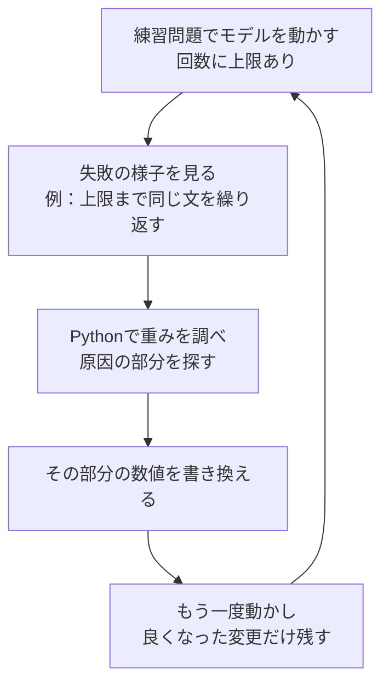

# 重み空間プログラミング（Weight-Space Programming, WSP）

## 1. 概要

重み空間プログラミングは最先端のLLMに別のニューラルネットワークの重み（weights）を読ませ、学習（training）なしで重みを直接書き換えさせる方法です。MIT CSAILの研究者が2026年11月2日にブログ記事で発表しました。査読前の段階です。

要点は次の3つです。

- 実験は「読む・直す・書く」の3種類で、いずれも小さなネットワークか1B未満のモデルが対象
- 最も知られた成果はQwen3.5-0.8Bの重みの0.016%を変えて、数学のテストの正答率を7.9%から48.1%に上げた例
- この成果は、モデルが持っていた力をふさぐ癖を取り除いたもので、新しい能力を足したものではない

## 2. 理解に必要な前提

### 重みと学習

ニューラルネットワークの動きは重みと呼ばれる大量の数値で決まります。これまで重みは学習で決めてきました。データを流し、誤りが減る向きへ数値を自動で少しずつ動かす方法です。人もLLMも、重みを手で書くことはできないと考えられてきました。

### 順伝播の回数

順伝播（forward pass）は、ネットワークに入力を与えて出力を得る1回の実行です。WSPの実験では、編集役のLLMが順伝播を使える回数に上限があります。編集役はこの限られた実行で自分の書き換えを確かめます。

### 方向の打ち消し

モデルの中間の計算結果は多数の数値の組（ベクトル）です。特定の振る舞いと結びつく向きを見つけて、その向きの成分を差し引く手法を、方向の打ち消し（directional ablation）と呼びます。WSP以前から研究者や愛好家が使ってきた手法です。

## 3. 解説

### 編集役が重みに触れる2つのやり方

ネットワークの大きさで、やり方が分かれます。

- 小さなネットワーク：重みの数値を文章としてプロンプトに貼る。道具は使わせない
- プロンプトに入らない大きさ：重みを読み込んだPythonの作業環境を渡す。学習のコードは書かせず、決められた回数だけ練習問題で順伝播を実行させる

### 読む

約1万7千個の重みをプロンプトに貼り、どのゲーム用に学習されたネットワークかを当てさせました。編集役は、入力に近い層のどこに大きな値が集まっているかなどの形から推論しました。

### 直す

Qwen3.5-0.8Bには考えている途中で同じ文を繰り返し、答えに届かない癖がありました。編集役のGPT-6 Astraは繰り返しの原因になっている向きを15層目と19層目のMLPの中から見つけ、その向きを差し引きました。その結果、数学のテストに加えて、指示に従う力を測るテストの点も上がっています。

順伝播の上限を10回、25回、50回と変えた比較では、10回と25回では癖がほとんど直らず、50回で正答率が大きく上がりました。

### 書く

編集役はネットワークにさせたい処理をプログラムのように考え、それを重みの数値に置き換えます。ブロック崩しでは、1層目でボールが落ちる位置を計算し、2層目でパドルをその位置へ動かす構成にしました。囲碁では、約150万個の重みを持つネットワークをゼロから書き、学習で作ったものより高い成績を出しました。

### 規模の現状

| 対象の重みの数 | したこと | 実施者 |
|---|---|---|
| 約1.7万 | 読む | MIT（GPT-6 Astra） |
| 約150万 | ゼロから書く | MIT（GPT-6 Astra） |
| 約8億 | 直す | MIT（GPT-6 Astra） |
| 約90億 | 直す | 上海AI研究所 |
| 約270億 | 直す | ReBatch（第三者） |

27Bの話は2種類あり、混同しやすいので分けて扱います。

- 読む側として27Bを使った例：Simon WillisonがノートPCで動かしたQwen 3.8 27Bに、元の記事の小さな重みを読ませた。Breakoutを88%の確信度で当てたが、52分かかり、Freewayは外した
- 編集される側が27Bの例：ReBatchがQwen3.8-27Bの1つの層の1つの部品で、全体の約0.071%を変えた。中国共産党寄りの答え方を測るテスト（CCPBench）の点が2.714から1.518に下がり、指示に従う力とコーディングの点は少し下がった

ReBatchの例には注意点があります。編集に使った問題が評価の問題にも含まれていると本人たちが書いており、新しい問題でも効くかは確かめられていません。モデルカードの本文には、どのLLMが編集を考えたかも書かれていません。

## 4. 似たものとの違い

| 方法 | 重みの決め方 | WSPとの違い |
|---|---|---|
| 学習・微調整（fine-tuning） | データと誤りの向きから自動で調整 | WSPはデータで調整せず、LLMが推論で書き換える |
| 方向の打ち消し（directional ablation） | 人が特定の向きを見つけて差し引く | Qwenの編集は同じ種類の操作。違いは、どこを直すかをLLMが自分で突き止めた点 |
| 蒸留（distillation） | 大きいモデルを手本に小さいモデルを学習させる | 縮小の手段としてすでにある。WSPで縮小ができるようになっても、比べる相手はこの方法 |
| 検索拡張生成（RAG） | 重みは変えず、資料を検索して入力に渡す | WSPで知識を重みに入れる方法は実証されていない |

## 5. 会話でわかったこと

### 何が新しいのか

数学の改善は力を足したのではなく、邪魔を取り除いたものです。著者はもともと繰り返しの少ないGemma 3 270Mでも試し、数学の点がほとんど上がらなかったと報告しています。著者自身も、隠れていた力をふさぐ障害は取り除けても、もともとない能力は足せなかったとまとめています。

手法そのものも新しくありません。新しいのは、どこを打ち消せばよいかをLLMが重みを読んで突き止めた点です。

### 大きな改変やモデルの縮小はできるか

会話では、「調整の手法を分析して体系化が進めば、大きなモデルから別のモデルや小さなモデルへの縮小もできるようになる」という見通しを検討しました。検討の結論は次のとおりです。

- 大きなモデルを丸ごと作り替える段階にはない（確認できた事実）
- 今の課題は手法の体系化より、LLMが重みを読み解く力をどこまで信頼できるかの確認にある（会話での検討）
- 回路を構造の違う別のモデルへ学習なしで移す構想は、元の記事に今後の見通しとして書かれている。実験の結果はない（確認できた事実）

### よく見かける3つの主張の確かさ

| 主張 | 判定 | 根拠 |
|---|---|---|
| 最先端モデルで小さいモデルの重みを作る・直せる | 確認できた | MITの実験 |
| 27Bでも編集できる | 条件付き | ReBatchの例はあるが、評価の問題が編集に使われている |
| 性格や振る舞いを変えられる | 近い例がある | ReBatchの政治的な偏りの編集。MITの迎合（sycophancy）の実験は変えたのではなく見分けた実験で、重みだけでは見分けられず、注意（attention）の向き先を見せて初めて当てた |
| 知識を埋め込める | 実証例なし | 元の記事では将来の可能性。もともとない能力は足せなかった結果もある |
| 新しいタスクに合わせられる | 小さなネットワークでは確認 | ゲームや囲碁のネットワークをゼロから書いた。大きな言語モデルに新しいタスクを足した例は、調べた範囲では見つからなかった |

### 限界

- 読む力への疑い：別の検証論文は、道具なしで読めたのは重みの流れを追ったからではなく、局所的な計算とデータセットの事前知識によると考えるほうがよいと結論づけている
- 効果が安定しない：上海AI研究所の検証では、タスクをまたいだ汎化（generalization）は見込みがあるが不均一で、効く編集を見つけるのは難しく、結果もばらつく
- 副作用：同じ種類の編集を試した人は、狙った指標が30ポイント上がった一方で、答えられるはずの質問17件を拒否するようになったと報告している
- 条件の偏り：Qwenのモデルカード自体が思考モード（thinking mode）でループしやすいと警告しており、論文はそのモードで、推奨より低い温度（temperature）で試していたという指摘がある

### 社内資料をモデルに覚えさせる用途

社内資料をモデルの重みに直接入れる方法は実証されていません。資料を使う仕組みとしては、当面はRAGが前提になります（会話での検討）。

## 6. 未解決事項

- 編集に使っていない新しい問題でも、編集の効果が保たれるか
- ほかの能力を落とさずに編集できるか
- 知識や新しい能力を重みに足せるか
- ReBatchの27Bの編集を、どのLLMが考えたか
- 読む力が事前知識によるものか、重みの読解によるものか

## 7. 参考資料

調べた時点：2026年11月9日〜10日

- MIT CSAIL（Rikiya Takehi ほか）「Sparks of Weight-Space Programming: LLMs can natively read & write neural network weights」 https://rikiyat.github.io/blog/weight-space-programming/
- 実験ログ（GitHub）：RikiyaT/lm_understand-logs
- 上海AI研究所ほか「Exploring Weight-Space Programming: Capabilities, Generalization, and Limitations」 https://arxiv.org/abs/2611.09382 （プロジェクトページ https://wsp-scope.github.io/）
- 「Can an LLM Actually Reason and Program about Neural Network's Weights or is it just memorization on steroids?」 https://arxiv.org/html/2611.08070v1
- 「WeightLoop: Weight-Space Programming with Experimental Feedback」 https://arxiv.org/abs/2611.07319
- Simon Willison「Qwen 3.8 27B on my laptop can interpret model weights, too」 https://simonwillison.net/2026/Nov/3/qwen-can-interpret-model-weights/
- ReBatch「Qwen3.8-27B-Weight-Space-Programming」 https://huggingface.co/ReBatch/Qwen3.8-27B-Weight-Space-Programming
- Tyler Folkman「The Trending Weight Edit Worked on My Test. Then It Refused 17 Answerable Questions.」 https://tylerfolkman.substack.com/p/the-trending-weight-edit-worked-on
- MindStudio「Can AI Edit Another Model's Weights? Inside the MIT Experiment」 https://www.mindstudio.ai/blog/gpt-5-astra-weight-space-programming

### 今後の動向を見る場所

- MITのチームが作っているWSP向けのベンチマーク（benchmark）とハーネス（harness）。著者はこの技術を再現できる工学の分野にすることを目標に挙げている
- 運用中のモデルを直し続ける応用研究（WeightLoopなど）
- 知識や振る舞いを足した結果が出たときは、新しい問題で効くかと、ほかの能力が落ちていないかを確かめる

## 8. 更新履歴

- 2026-11-22：新規作成
