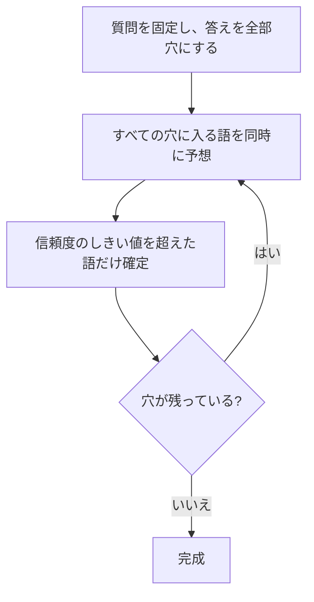

# テキスト拡散モデル（マスク拡散）の基礎

作成日：2026-11-19

## 1. 概要

テキスト拡散モデル（diffusion language model）は、穴だらけの答えを何回かに分けて埋め、文章を仕上げる言語モデルです。前から1語ずつ作る方式とは作り方が違います。画像生成で使われている拡散モデル（diffusion model）の考え方を、文章に持ち込んだものです。文章では、語を穴（マスク, mask）で隠す方式のマスク拡散（masked diffusion）が中心です。

要点は次の3つです。

- 1回の計算で何か所もまとめて埋められるので、繰り返す回数を減らせれば速くなる可能性がある
- 精度は、1語ずつ作る方式にまだ届いていない分野がある
- 一度確定した語を後から直さない作りでは、早い段階の間違いが最後まで残る

## 2. 理解に必要な前提

### 自己回帰（autoregressive）

今の多くの大規模言語モデル（LLM）の作り方です。前の語だけを見て次の1語を予想し、その語を末尾に付けて、また次の1語を予想します。

### 因果マスク（causal mask）

自己回帰のモデルでは、各位置が自分より後ろの語を見ないようにしています。注意機構（attention）は、各位置とほかの全位置との関係の強さを表にして一度に計算します。その表のうち、後ろの位置の欄を塗りつぶして使えなくするのが因果マスクです。

### 誤差逆伝播（backpropagation）

モデルを学習させる方法です。文章をどう作るか（自己回帰か拡散か）とは別の話で、どちらの方式でも学習に使います。

### KVキャッシュ（KV cache）

自己回帰では、前の語についての計算結果があとから変わりません。そのため結果を保存して、次の語を作るときに使い回せます。この使い回しがあるので、1語ずつでも速く作れます。

## 3. 解説

### 生成の流れ

質問の文はそのまま置き、答えの部分を全部穴にした状態から始めます。



確定させる基準を、信頼度のしきい値（confidence threshold）と呼びます。2回目以降は、確定した語を手がかりにして、残った穴を予想し直します。

```
1回目  [__][__][__][__][__]   ← 全部穴
2回目  [__][東京][__][は][__] ← 自信のある語だけ確定
3回目  [日本][東京][__][は][__]
 …     穴がなくなるまで繰り返す
```

### 自己回帰との違い

| 項目 | 自己回帰 | マスク拡散 |
|---|---|---|
| 各位置が見る範囲 | 自分より前だけ | 文全体（前と後ろ） |
| 1回で決まる語 | 1語 | 何語でも |
| 確定のしかた | 前から順に | 自信のある語から |
| 計算の使い回し | KVキャッシュが効く | そのままでは効かない |

### 速さの条件

マスク拡散は、回ごとに文全体を計算し直します。1回あたりの計算は重く、KVキャッシュもそのままでは効きません。速くなるのは、繰り返す回数を十分に減らせたときだけです。

しきい値を下げると、1回で埋まる穴が増えて速くなります。その代わり、間違った語を確定させやすくなります。速さと正確さは、しきい値を挟んで引っ張り合う関係です。

## 4. 似たものとの違い

- 画像の拡散モデル：ノイズを加えた画像から、ノイズを少しずつ取り除いて仕上げる。マスク拡散は、ノイズの代わりに穴を使い、穴を少しずつ埋める。発想は同じ
- 自己回帰：上の表のとおり。見る範囲と、1回で決まる語の数が違う
- 一度に全部を出す方式：マスク拡散は、1回で全部を確定させるわけではない。自信のある語から何回かに分けて確定させる

## 5. 会話でわかったこと

### よくある思い違い

- 拡散モデルは、前後の近くの語だけを局所的に計算するわけではない。各位置は文全体を見る
- 一度に全部の語を出すわけでもない。自信のある語から、何回かに分けて確定させる
- 誤差逆伝播は学習の方法で、文章の作り方とは別。拡散モデルで変わるのは文章の作り方のほう

### 速さと精度の見通し

会話の中では、「精度が追いつけば速さで有利になり、主流になりうる」という見立てが出ました。これに対して、速さは確定ではないという補足をしました。1回あたりが重いことと、KVキャッシュが効きにくいことが理由です。

精度については、ゼロから学習した8Bの拡散モデルが、数学やコードではまだ自己回帰に劣るものの、差は縮んでいるという報告があります（参考資料）。主流になるかどうかは、精度と速さをどこまで両立できるか次第、というのが会話での結論です。

## 6. 未解決事項

- 自己回帰と比べて、実際に何倍速くなるか。繰り返す回数をどこまで減らせるか
- 精度の差が、どの分野でいつ埋まるか
- 早い段階で間違った語を確定させる失敗を、どう防ぐか

## 7. 参考資料

調べた日：2026-11-19

- ゼロから学習した8Bの拡散モデルの論文紹介（hyper.ai）：https://hyper.ai/ja/papers/2606.25331
- 具体例として、Diffusion-Qwen3.8-27B のナレッジ（Diffusion-Qwen3.8-27B-Knowledge-20261119.md）

## 8. 更新履歴

- 2026-11-19：作成
