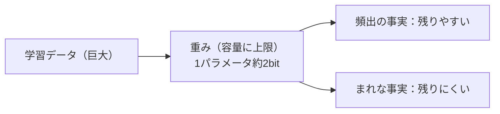
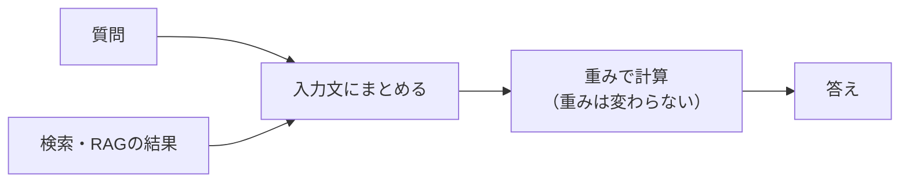

# ローカルLLMはなぜ検索なしで答えられるのか

調べた時点：2026年10月23日

## 1. 概要

ウェブ検索機能のないローカルLLMが答えられるのは、学習で重みに残った傾向をもとに、次に来るトークンを計算しているからです。出力するときに、外部のデータベースやインターネットは参照しません。

重みに入る知識の量には上限があるため、学習データを集めた日（カットオフ）より後の話題や、まれな話題には弱くなります。足りない知識は検索やRAGで文章を入力に足して補います。

この仕組みを4つの段階に分けて説明します。途中で使うMoE、パラメータ数、量子化の読み方も、前提としてまとめています。

## 2. 理解に必要な前提

### 重み（パラメータ）とトークン

重みはモデル内部にある数値です。「8B」は80億個の重みを持つという意味です。トークンは文章を区切った語や文字の断片で、モデルはトークンを数値にして計算します。

### DenseとMoE

Denseは1トークンを処理するたびにすべての重みを使う作りです。MoE（Mixture of Experts）は、知識をためる部分を小さな部品（エキスパート）に分け、トークンごとに数個だけを使う作りです。部品を選ぶ役をルーターと呼びます。

MoEのモデルには、パラメータ数が2種類あります。Denseでは、この2つは同じ数になります。

| 数字 | 意味 | 決めるもの |
| --- | --- | --- |
| 総パラメータ数 | 全部品を合わせた重みの数 | 必要なメモリ、知識の容量の目安 |
| アクティブパラメータ数 | 1トークンの計算に使う重みの数 | 計算量、生成の速さの目安 |

名前の読み方の例です。Qwen3.6-35B-A3Bでは、35Bが総パラメータ数を表し、A3BのAはactive（使われる）の頭文字で、アクティブパラメータ数は3Bです。

### 量子化

量子化は重み1個あたりの保存の細かさを下げる作業です。16bitなら65,536通り、4bitなら16通りの値で重みを表します。重みの個数は変わらず、ファイルが小さくなります。メモリの目安は総パラメータ数に1個あたりのバイト数（16bitで2、8bitで1、4bitで0.5）をかけた値です。実行中の作業領域は別に必要です。

## 3. 解説

### 3.1 学習で重みに知識が入る（作る側）

学習では大量の文章を使って「次に来る語を当てる」練習を繰り返します。予想が外れるたびに、重みを少しずつ書き換えます。たとえば「日本の首都は」のあとに「東京」が来る文章で、「東京」の確率が低く予想されたら、高く出る方向に重みを動かす、という調整です。

繰り返すうちに、「首都」と「東京」が一緒に出やすいという関係が、たくさんの重みの組み合わせとして残ります。知識は重み全体に混ざって保存されます。辞書のように1項目ずつ書かれた場所はありません。配られるファイルに入っているのは数値の並びだけで、文章そのものは含まれません。

### 3.2 推論時に起きていること（使う側）

学習が終わったモデルに質問すると、重みを使った計算だけで答えが作られます。質問をトークンに区切って数値にし、重みで何層も計算して、次に来るトークンの確率をすべての候補について出します。出た確率をもとに1つを選んで末尾に足し、同じ計算を繰り返す流れです。確率で選ぶので、同じ質問でも答えが毎回少し変わることがあります。

モデルは知識を検索して取り出しているわけではありません。学習で重みに残った傾向から、もっともらしい続きを作っています。MoEで部品を選ぶ処理も、この計算の途中で、トークンごとに行われます。

### 3.3 重みに入る量と限界（作る側で決まり、使う側で現れる）

研究では、言語モデルが保存できる知識は1パラメータあたり約2bitと報告されています。この値は8bitに量子化しても変わりませんでした。7Bモデルなら約140億bitで、論文の推定では英語版Wikipediaと教科書を合わせた分を上回ります。

ただし、2bitは同じ知識を約1000回見るまで十分に学習した場合の値です。実際の学習データには雑音や重複が多く、数回しか出てこない話題も大量にあります。出てくる回数が少ない知識ほど、重みに残りにくいと考えられます（推測）。有名な事実に強く、マイナーな話題に弱くなる理由です。

残っていない事実を聞かれると、モデルは正確な関係がないまま、もっともらしい形の答えを作ることがあります。これがハルシネーションです。モデル自身が「知らない」と気づけるとは限りません。容量は重みの数に比例するので、大きいモデルほど拾える話題が増えます。MoEでは、総パラメータ数が容量の目安になります。

### 3.4 古さと補い方（古さは作る側、補い方は使う側）

重みに入っている知識はカットオフまでのものです。学習データの収集から公開までには時間がかかるので、配られた時点で、すでに世の中より古くなっています。カットオフより後に出たモデルについて聞くと、存在を知らないまま、もっともらしい別の答えが出ることがあります。

補い方は重みを書き換えずに、答えに必要な文章を入力へ足す方法です。ウェブ検索で見つけた記事や、手元の文書から探した該当部分を、質問と一緒に渡します。手元の文書から探して渡す仕組みがRAGです。モデルは渡された文章もトークンにして同じ計算に入れるので、内容を踏まえた続きを作れます。新しく覚えたわけではなく、会話が終われば消えます。

限界もあります。1回に渡せる文章の長さには上限があり、探した文章が的外れなら答えも的外れです。ローカルLLMでも、検索ツールや文書検索をつなげば同じ補い方が使えます。

### 3.5 作る側と使う側の分担

| 段階 | どちらの側か | 内容 |
| --- | --- | --- |
| 学習で重みに知識が入る | 作る側 | 次の語を当てる練習で重みを調整する |
| 推論時に起きていること | 使う側 | 配られた重みで計算して出力する |
| 重みに入る量と限界 | 作る側で決まり、使う側で現れる | 容量の上限が、ハルシネーションとして出力に現れる |
| 古さと補い方 | 古さは作る側、補い方は使う側 | カットオフは学習で決まり、検索やRAGは入力に足す |

## 4. 似たものとの違い

| 比べるもの | 違い |
| --- | --- |
| 重みに入った知識と、入力で渡した文章 | 前者は学習で決まり、配布後は変わらない。後者はその場の計算にだけ使われ、会話が終われば消える |
| 量子化と枝刈り（プルーニング） | 量子化は、重みの個数を保ったまま、1個あたりの細かさを下げる。枝刈りは、影響の小さい重みを取り除く。ローカルLLMでは量子化のほうが広く使われている |
| DenseとMoE | Denseは毎回すべての重みを使う。MoEは総パラメータ数ぶんの知識を持ち、1トークンでは一部の部品だけを使う。メモリは総数ぶん必要で、速さはアクティブ数に近づく |
| 総パラメータ数とアクティブパラメータ数 | 前者はメモリと知識の容量の目安、後者は計算量と速さの目安 |

## 5. 会話でわかったこと

確認できた事実と、推測や検討は、本文中で書き分けています。推測には「（推測）」を付けています。

### 5.1 MoEの数字の読み方と、最新の最大モデル

「GLMはQwenの3倍」と聞いたときは、どの数字を、どの世代同士で比べているかを確かめる必要があります。

| モデル | 総パラメータ数 | アクティブパラメータ数 | 備考 |
| --- | --- | --- | --- |
| GLM-5.3 | 約744B | 約40B | 公開ファイルの数え上げでは約753B。数え方の違いとみられるが、正式な照合は確認できていない |
| Qwen3.8-Max（重みはQwen3.8-2.4T-A95B） | 2.4T | 約95B | 重みは2026年8月12日に公開 |
| GLM-5 | 744B | 40B | |
| Qwen3-235B-A22B | 235B | 22B | |
| Qwen3.5-397B-A17B | 397B | 17B | |
| Qwen3.6-35B-A3B | 35B | 3B | |

最新の最大モデル同士では、総パラメータ数はQwenが約3.2倍、アクティブパラメータ数は約2.4倍です。GLM-5とQwen3-235B-A22Bを比べると、GLMの総パラメータ数が約3.2倍になります。「3倍」という話は、世代の違うモデルを比べたものかもしれません（推測）。

### 5.2 ローカルで動かすときの見方

載るかどうかは総パラメータ数で、速さはアクティブパラメータ数で見ます。4bitで保存した場合の重みサイズは、総パラメータ数に0.5をかけた値が目安です。

| モデル | 4bitの重みサイズの目安 |
| --- | --- |
| Qwen3.6-35B-A3B | 約18GB（作業領域を含めて20GB前後） |
| GLM-5.3-Flash（総約320B） | 約160GB |
| GLM-5.3 | 約370GB |
| Qwen3.8-2.4T-A95B | 約1.2TB |

GLM-5.3の公開ファイルは8bit（FP8）で756GB、16bit（BF16）で約1.5TBです。個人のPC1台には載らず、GPUを複数並べる前提の規模です。

MoEでは、どの部品が選ばれるかが語ごとに変わるので、全部の部品をすぐ読める場所に置く必要があります。GPUのメモリに収まらず、メインメモリに置くと速さは落ちます。ただ、使う部品が少ないMoEは、Denseより落ち方が小さいと考えられます（推測）。

### 5.3 パラメータ数だけでは賢さを測れない

Alibabaの発表では、27BのDenseモデルQwen3.6-27Bが、前の世代のQwen3.5-397B-A17Bを、コーディング系のほぼすべての指標で上回りました。SWE-bench Verifiedでは77.2対76.2、Terminal-Bench 2.0では59.3対52.5です。総パラメータ数が約15分の1のモデルが、上回ったことになります。

理由として、データの質、合成データ、蒸留、学習後の調整が、世代を重ねて良くなっていることが考えられます（推測）。これらはパラメータ数には表れません。同じ世代で作り方が近いモデル同士なら、総パラメータ数が大きいほど知識の量は多くなりやすいと考えられます（推測）。コードや数学のように推論力が要る用途では、新しい世代の小さなモデルが古い大きなモデルに勝つことがあります。

### 5.4 量子化は圧縮に近く、削除とは別物

量子化は不要なデータを削除する作業ではなく、1つひとつの数値を粗く丸めて保存する作業です。丸める分だけ精度は少し落ちます。8bitならほとんど差が出ず、4bitでも実用上の問題は小さいことが多いようです。それより粗くすると、劣化が目立ちやすくなります。

### 5.5 学習量と知識の関係

学習データを増やしても、モデルの容量には上限があるので、覚えきれない分が増えるだけになります（推測を含む）。有名な事実は何度も出てくるので残りやすく、まれな話題は落ちやすくなります。最近の精度向上には知識量の増加のほかに、データの質、合成データ、蒸留、学習後の調整、アーキテクチャの改良も効いていると考えられます（推測）。

## 6. 未解決事項

- GLM-5.3より新しいモデルは10月中旬時点の調べでは見つからなかった。Qwen3.8より新しい世代は確かめられていない。
- GLM-5.3の744Bと約753Bの差について、公式の照合は確認できていない。
- 世代ごとの学習データ量（トークン数）は、会話の中で具体値を挙げたが、今回の調査では裏づけを取っていない。
- 4bit以下の量子化が知識の保持量にどれだけ影響するかは確認していない。論文が確認したのは、8bitで約2bit/パラメータが保たれる点まで。
- 「出てくる回数が少ない知識ほど残りにくい」は、論文の条件（約1000回）からの推測で、実際のモデルでの定量的な確認はしていない。
- Qwen3.6-27Bのベンチマーク値は、メーカーの発表に基づく。独立した検証は確認していない。

## 7. 参考資料

調べた時点：2026年10月23日

- Physics of Language Models: Part 3.3, Knowledge Capacity Scaling Laws（1パラメータあたり約2bit、8bitでも維持、7Bで約140億bit）：https://arxiv.org/abs/2404.05405
- Qwen3.8-Max（2.4T、アクティブ約95B）：https://qwen.ai/blog?id=qwen3.8
- Qwen3.8-Maxの重みの公開（2026年8月12日）：https://llm-stats.com/blog/research/qwen3-8-max-open-weights
- Qwen3.5（397B、アクティブ17B）：https://qwen.ai/blog?id=qwen3.5
- Qwen3.6-35B-A3B：https://qwen.ai/blog?id=qwen3.6-35b-a3b
- Qwen3.6-27Bが397Bのモデルを上回る結果：https://the-decoder.com/qwen3-6-27b-beats-much-larger-predecessor-on-most-coding-benchmarks/
- GLM-5.3（744B、アクティブ約40B、FP8で756GB、BF16で約1.5TB）：https://kingy.ai/blog/glm-5-3-specs-benchmarks-api-how-to-use/
- GLM-5（744B、アクティブ40B）：https://artificialanalysis.ai/articles/glm-5-everything-you-need-to-know
- MoEの総数と知識容量、アクティブ数の関係：https://www.mindstudio.ai/blog/mixture-of-experts-architecture-glm-5-2-active-parameters
- Qwen3 MoEのモデル説明（Qwen3-235B-A22B）：https://huggingface.co/docs/transformers/en/model_doc/qwen3_moe

## 8. 更新履歴

- 2026年10月23日：初版
