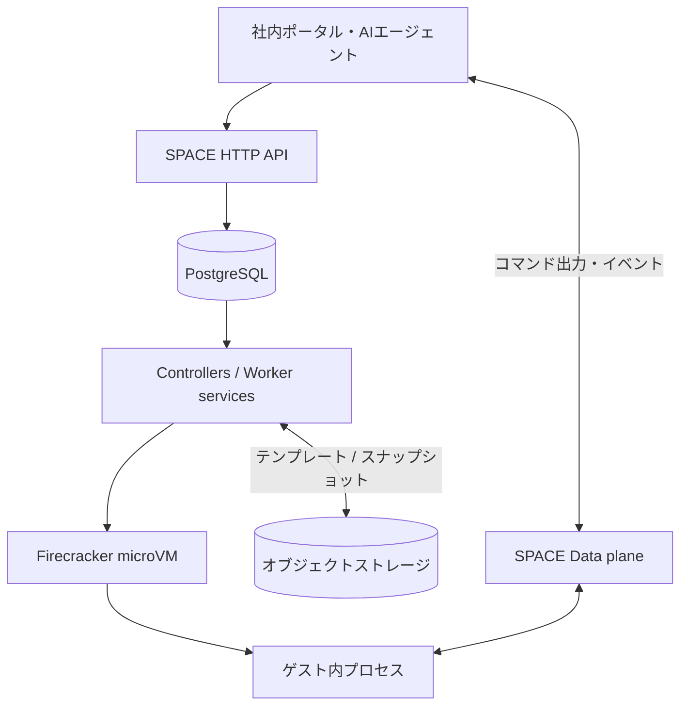
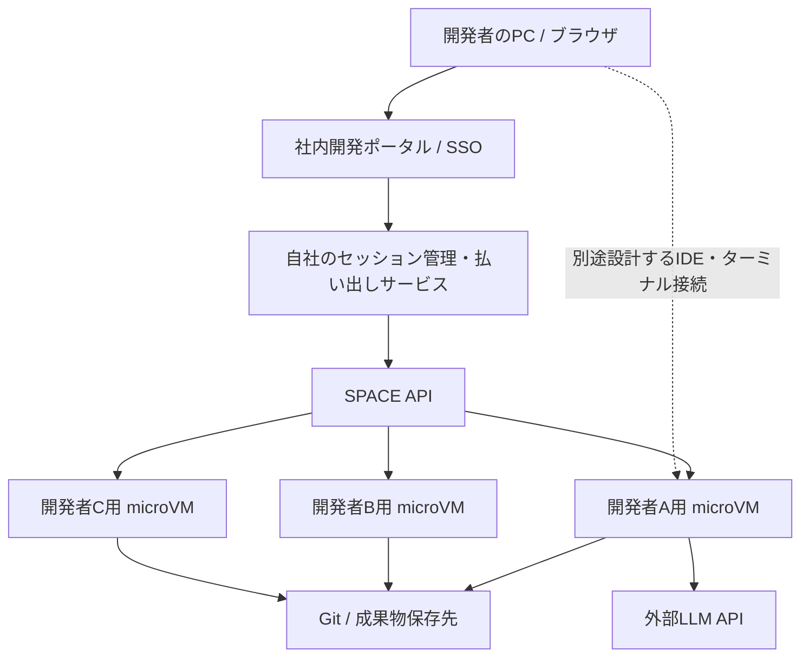

# Perplexity SPACEの技術調査と自社ホスト型AI開発環境への適用

- **初版作成日**：2026年10月16日
- **最終更新・仕様確認日**：2026年10月19日
- **対象**：Perplexity SPACE（Sandboxed Platform for Agentic Code Execution）
- **起点となったURL**：https://github.com/perplexityai/SPACE?tab=Apache-2.0-1-ov-file
- **関連技術**：Firecracker、KVM、Docker Sandboxes、E2B、Kubernetes、Proxmox VE
- **主な検討テーマ**：自社管理サーバー（Proxmox等）を使い、複数の社員へAI開発環境を配布・遠隔利用させる方法。Docker Local / Docker Cloud SandboxesとSPACEの運用・SSH・権限管理を比較する

> **情報の読み方**
>
> - **【確認】**：公式リポジトリ、公式ドキュメント、公式ブログで確認した事実。
> - **【構成案・判断】**：本会話で検討した利用方法、設計上の判断。標準搭載機能や公式動作保証を意味しない。
> - **【試算】**：容量見積もりのための仮定。ベンチマーク、保証値、公式推奨要件ではない。
> - **【未確認】**：公式資料で保証を確認できていないこと、または実機検証や追加調査が必要な点。
>
> 仕様、提供条件、APIの互換性は更新される可能性がある。特にSPACEは1.0以前の公開段階であり、後日導入する際には参照先を再確認すること。

## 概要

**【確認】SPACEはOSでもLLMでもなく、AIエージェントやユーザーのコードを隔離して実行するためのサンドボックス管理プラットフォーム**である。Perplexity AIが開発し、2026年10月15日にApache License 2.0のもとでソースコードを公開した。Linux上のFirecracker microVMを実行単位として、テンプレートからの環境作成、コマンド実行、出力の取得、一時停止、状態保存と復元、削除などをHTTP APIで操作する。[S1] [S2] [S3]

SPACE自体の技術的発表とオープンソース化は別の出来事である。Perplexityは2026年7月15日にSPACEの設計とComputerへの採用を公表し、同年10月15日にその実装をオープンソース化した。[S2] [S4]

今回の検討では、SPACEを**自社管理のクラウド開発環境を作るための実行基盤**として捉えた。ただし、ブラウザIDE、VS Code接続、開発者ポータル、Gitリポジトリ連携などが完成品として一式提供されるわけではない。

2026年10月19日の追加調査で、**「社内のどのPCからもアクセスできる」ことと「社員ごとに環境を安全かつ自動で払い出す」ことは別**だと整理した。前者はDocker Local Sandboxesでも社内サーバーへのSSH等を組み合わせて構成可能であり、SPACE独自の利点ではない。Docker Localの`.sbx` SSHはローカルのSandboxデーモンが中継する接続、Docker CloudのSSHはDocker管理クラウドへの専用接続、SPACEの`space-ssh`は管理者向けのホスト側ツールで、いずれも同じSSH接続方式ではない。[D9] [D10] [S13]

## 調査のきっかけ・目的

GitHubの`perplexityai/SPACE`を起点に、次の疑問を順に検討した。

1. SPACEは何を実現する技術なのか。
2. Docker Sandboxesと何が異なり、その違いが何を可能にするのか。
3. クラウド型AI開発環境のようなものを自社サーバーで作り、複数の開発者へ配布できるのか。
4. 外部LLM APIを利用する場合にGPUは不要か。CPU、RAM、ストレージはどの程度必要か。
5. SPACEはOSなのか。既存のProxmox VE上に設置できるのか。
6. Docker SandboxesもVMを動かすなら、社内の別PCからSSHで接続できるのではないか。共有の容易さは実際にどう違うのか。

最終的な関心は、SPACEの内部仕様そのものよりも、**自社管理インフラで開発者ごとのAI実行環境を払い出す構成が現実的か、Docker Sandboxesの方が手軽ではないか**という点にある。

## 結論・重要ポイント

1. **【確認】SPACEはLinux上で動かすサービス群**であり、独立したOSではない。サンドボックス内部ではmicroVMごとに独自のLinuxゲスト環境が動く。[S1] [S5]
2. **【構成案・判断】自社サーバーにSPACEを構築して開発者ごとの環境を配布する構成は可能**。ただし、環境の払い出しを行う社内ポータル、ユーザー認証、リモートIDE接続、Git連携などは別途設計・実装する。[S3] [S5]
3. **【確認】Docker SandboxesもmicroVM、クラウドAPI、スナップショットなどを備える**。SPACEだけがAPIから隔離環境を作れるわけではない。SPACEの差は、Apache 2.0のソースコードを自社で改変・配置し、実行基盤の実装と運用を管理できることにある。[S1] [D1] [D2]
4. **【構成案・判断】Proxmox VE内のUbuntu VMにSPACEを構築する構成は技術的に考えられる**。しかしFirecrackerをさらにVM内で動かすためNested Virtualizationが必要。SPACEのProxmox上での動作を公式検証済みと確認したわけではない。[S5] [P1]
5. **【構成案・判断】外部LLM APIだけを使うなら、LLM推論用GPUは通常不要**。ただし、実行中のmicroVMのRAM、ビルド・テスト用CPU、作業ファイルやスナップショットのためのSSDは必要。GPUを使うコード実行タスクでは別途GPUが必要になる可能性がある。
6. **【確認】SPACEには停止中に実行資源を解放する`Suspended`状態がある**。全利用者が同時実行しない運用は可能だが、起動済み環境を待機させるWarm Poolはその分の資源を使う。[S6] [S7]
7. **【確認】公開版0.8.0が互換性の基準**。0.9.0には破壊的変更が予定され、安定したAPI契約の目標は1.0.0。現時点で完成済みの安定版基盤と見なして全面導入するのは早い。[S8]
8. **【追加検討の結論】社内のどのPCからでも利用できるようにすることは、SPACEの独占的機能ではない**。少人数ならDocker Localを社内Ubuntuホスト上で動かし、社員のSSHログインと利用者分離を整える方法を先に検証する価値が高い。一方、複数ノード、ライフサイクル、ユーザー別払い出しを中央APIで製品化するならSPACEが候補になる。ただしDocker Localの`.sbx` SSHは他PCからの直接TCP SSHではない。[D9] [D15] [S6] [S13]

## 技術・サービスの概要

### SPACEが担当する範囲

**【確認】** SPACEが提供する中心機能は、アプリケーションから要求されたLinux実行環境を隔離状態で立ち上げ、その実行状態を管理することである。プログラムの内容やAIエージェントの意思決定は呼び出し元の責務であり、SPACE自身がLLM推論を提供するわけではない。[S1]

基本概念は次のとおり。[S6]

| 概念 | 内容 |
| --- | --- |
| Template | 起動時のファイルシステムとランタイム構成。複数のサンドボックスで再利用する。 |
| Sandbox | 個別のmicroVMと書き込み可能なファイルシステムを持つ実行環境。 |
| Process | サンドボックス内で動くプログラム。 |
| Command session | コマンド開始と出力の受信に使用するセッション。 |
| Operation | 作成、停止、復元、削除など、非同期処理の進行を追跡するもの。 |

### アーキテクチャ

**【確認】** 公式Kind構成では、アプリケーションがHTTP APIにリクエストし、PostgreSQLが望ましい実行状態を保持し、コントローラーとワーカーがFirecrackerを操作する。コマンド出力は管理APIとは別のデータプレーンを経由する。[S6]



Kubernetesは**公式のローカルKind導入手順で使用されるが、SPACEそのものの必須構成要素ではない**。ワーカーを直接管理するアダプターもある。ただし、Kubernetesなしの構成は、同じKind導入手順でそのまま再現できるという意味ではない。[S5] [S6]

### コマンド実行とライフサイクル

**【確認】** 基本のAPIフローは、サンドボックス作成要求、非同期Operation完了待ち、準備完了確認、Command session作成、出力ストリームへの接続、終了コード確認、環境の維持または削除、という順序になる。コマンドセッションを作っただけではプロセスを開始せず、アタッチによって実行が開始する。[S9]

| 状態 | 実行可能か | 保持する状態 | 運用上の意味 |
| --- | --- | --- | --- |
| Running | 可能 | 実行中VMのメモリとファイルシステム | 作業中。RAMやCPU等を使用する。 |
| Paused | 不可 | VMメモリをワーカー内に保持 | 実行は止まるが、メモリ解放策にはならない。 |
| Suspended | 不可 | メモリ、実行状態、ルートFS等のスナップショット | アクティブなVM資源を解放し、後で復元できる。 |
| Deleted | 不可 | API経由で利用不能 | 環境を終了して削除する。 |

**【確認】** Native SPACE APIで作成したサンドボックスは、標準ではアクセスまたはコマンド活動が6時間ないと自動的にSuspendされる。これは「最大存続期間が6時間」という意味ではない。Pauseは耐障害性のある保存ではなく、書き込み完了したファイルでも障害時の永続化保証はライフサイクル境界の扱いに依存する。[S6]

### 起動時間とストレージ

**【確認】** SPACEはbtrfsのCopy-on-Writeを使い、テンプレートや分岐に伴う全量コピーを抑える。また、スナップショットやWarm Poolを使い、環境作成の待ち時間を短縮する。[S4] [S7]

Perplexityが自社の本番トラフィックで以前のサンドボックスプロバイダーと比較した値は次のとおり。[S4]

| 指標 | 以前のプロバイダー | SPACE | 改善幅 |
| --- | ---: | ---: | ---: |
| 作成レイテンシ中央値 | 185ms | 60ms | 約3.1倍 |
| 90パーセンタイル | 447ms | 89ms | 約5.0倍 |

**【注意】** これはPerplexityの運用条件での実測値であり、一般的なLinuxサーバーやProxmox内のNested Virtualization構成における保証値ではない。サンドボックスの起動待ち時間や復元時間は、自社構成で測定する必要がある。

## 今回の発表・変更点

| 日付 | 出来事 | 意味 |
| --- | --- | --- |
| 2026-07-15 | SPACEのアーキテクチャとPerplexity Computerでの利用を公式発表 | SPACEという実行基盤自体は、オープンソース化以前から稼働していた。[S4] |
| 2026-09-23 | AIモデルによる脱出・ネットワーク制限回避のレッドチーム報告を公開 | セキュリティ設計と限界を検討する一次資料が得られた。[S10] |
| 2026-10-15 | SPACEをApache 2.0でオープンソース化 | 自社でソースコードを取得、変更、再配布できるようになった。[S1] [S2] |
| 2026-10-16 | 本会話でDocker Sandboxes、社内開発環境、Proxmox構成と比較 | 自社ホスト型の利用シナリオを整理した。 |
| 2026-10-19 | Docker Sandboxesとの社内共有・SSH接続方式を追加検証 | Docker Localのローカルデーモン中継、Docker Cloudの専用SSH、SPACEのホスト管理用SSHを区別し、社内配布の推奨検証順を更新した。 |

「2026年10月15日にSPACEそのものが初登場した」と理解すると誤りになる。7月の技術発表と10月のソースコード公開は分けて記録する。

## 主な機能

### APIとSDK

**【確認】** SPACE本体はHTTP APIを提供し、コマンドの出力にはServer-Sent Eventsを利用する。Rustで実装されているが、利用アプリケーションがRustである必要はない。公式の初回チュートリアルはPython標準ライブラリのみを使う。OpenAPI形式の参照資料は`/openapi-m1.json`で取得できる。[S1] [S9]

### E2B互換レイヤー

**【確認】** E2B Compatibility Wrapper（ECW）は、既存のE2BクライアントからSPACEを呼べるよう、E2B風のHTTPリクエストをSPACEに変換するレイヤーである。Native APIとは別のAPIであり、互換性には範囲がある。[S11]

- 検証済みのPythonパッケージは`e2b==2.21.1`、`e2b-code-interpreter==2.6.2`。
- JavaScript SDKや別バージョンは、動く可能性があっても同じ互換性検証の対象ではない。
- ECWの`pause`はSPACEの`Suspend`、ECWの`resume`はSPACEのスナップショット復元に対応する。SPACEのresident-memory pause/resumeそのものを露出しない。
- 一部の高度なE2B機能やパラメータは未サポートで拒否される。

既存E2Bアプリのバックエンド移行候補ではあるが、「E2B完全互換」と扱わない。

### Warm Poolと状態保存

**【確認】** KubernetesでのWarm Poolは、特定テンプレートとVMサイズに一致する起動済みサンドボックスを一定数待機させる。待機VMを使えばコールドブートを省ける一方、待機中はリソースを消費する。空きがなければ通常起動にフォールバックする。[S7]

- ECW経由の作成は、対応するWarm Poolを利用できる。
- Kubernetes上のNative API作成では、`SPACE_NATIVE_CREATE_POOL_CLAIM_ENABLED=true`だけでなく、フィーチャーフラグ側の有効化も必要。標準状態では自動的に使われない。
- カスタムの`disk_mib`やファイル変更追跡を指定する作成は、Warm Pool利用対象外となる。
- 単一ノードの非Kubernetes構成向けにはBase SnapshotやノードWarm Poolの方法が別途記載されている。[S12]

## Docker Sandboxesとの違い（2026年10月19日更新）

今回の用途では、少なくとも三つの選択肢を分ける必要がある。
**Docker Local Sandboxes**は自社で用意した対応ホストにもインストールでき、**Docker Cloud Sandboxes**はDockerが管理するクラウドで実行する。
**Perplexity SPACE**は自社がLinux/KVM環境に配備して運用する基盤である。[D1] [D3] [D15] [S1]

### まず「共有」の意味を分ける

同じ「社内共有」でも必要な機能は異なる。

1. **設定の配布**：全社員が同じPython、Node.js、Claude Code、社内ツールを使えるようにする。同じ*実行中VM*を共有することは意味しない。
2. **計算資源の共用**：各社員のPCはクライアントとし、社内サーバー上に社員ごとの独立した実行環境を置く。どのPCから使うかに依存しない。
3. **環境の中央払い出し・統制**：社員IDとVMを紐付け、作成、停止、課金配賦、削除、監査などを管理する。複数ノードへの配置やリソース割当も含む。
4. **同一の稼働VMへの複数人同時参加**：同一環境に二人以上が入り共同編集する。上の三つとは別の権限・競合制御の問題で、三製品の標準サポート範囲は今回確認しきれていない。

**【検討結果】設定配布だけならDocker SandboxesのKitsと`sbxenv.yaml`が扱いやすい**。
Kitsは必要なツールと設定をOCIイメージやGit等で配布できる。
`sbxenv.yaml`はエージェント、ワークスペース、ツール、リソースなどの環境宣言を共有できる。
ただし2026年10月19日時点でKits v3はEarly Access、`sbx env`はExperimentalであり、バージョン間の互換性と運用前の動作確認が必要である。[D11] [D12]

### 社内サーバーでの導入とアクセス

| 比較項目 | Docker Local Sandboxes | Docker Cloud Sandboxes | Perplexity SPACE |
| --- | --- | --- | --- |
| 実行場所 | 自社の対応Linuxホストにも配置可能 | Docker管理クラウド | 自社管理Linux/KVMホスト、複数ワーカー構成も可能 |
| Proxmox上のUbuntu VM | Nested Virtualizationが使えれば候補 | 自社Proxmox上では稼働しない | Nested Virtualizationが使えれば候補（公式Proxmox検証は未確認） |
| 社員PCからの遠隔利用 | ホストへのSSH等の入口を追加して実現可能 | 専用のCloud SSH手順がある | 自社でSSH/IDEゲートウェイを構築。APIからコマンド実行は可能 |
| `.sbx`の接続方法 | クライアントPCの`sbx`→**そのPCのデーモンのローカルソケット** | クラウド用に別の接続先と認証 | 該当しない。`space-ssh`はホスト側管理ツール |
| 共通環境の配布 | Kits、`sbxenv.yaml`、Git等 | Kits、Cloud対応`sbxenv.yaml`等 | テンプレートのビルド・公開と選択 |
| 社員別VMの自動作成 | ホスト側CLIを利用した自前の払い出し処理を設計 | REST API、TypeScript SDK | Native HTTP API、コントローラー、ワーカー |
| 社員別のアクセス権 | Linuxアカウント、デーモン、ワークスペースの境界を設計 | Dockerアカウントと権限に依存（他社員との共有仕様は検証が必要） | APIに認証があるが、社内SSOとVM所有者、リモートIDE権限の結合は別途設計 |
| 組織共通ポリシー | Docker Governanceを利用可能（別途有料契約が必要） | 別のクラウドアカウント／サンドボックスポリシー | 自社のAPI、ポリシー、基盤ソースを管理可能 |
| 複数サーバーの一元配置 | 自社で外側のスケジューラー等を設計 | Dockerが配置・運用 | 中央APIとワーカー管理を中心に設計されている |
| ソース改変・独自運用 | `sbx`実行基盤の変更を前提にしない | Docker管理側は変更不可 | Apache 2.0の実装を変更できる |
| 導入の初期負担（評価） | 小規模利用では相対的に小さい | 比較的小さいが契約・クラウド利用が必要 | 比較的大きい（サーバー群、DB、ストレージ、運用設計） |

「遠隔利用可能」「APIがある」は、複数の社員に安全に同一環境を見せるための権限機能が完成している、という意味ではない。[D2] [D9] [D10] [D13] [D14] [S6] [S13]

### Docker Localの`ssh 名前.sbx`は普通のSSHとは異なる

Docker Localでは、次の操作でローカル開発ツールを接続できる。[D9]

```bash
sbx setup ssh
ssh demo.sbx
```

ただし、この接続の`ProxyCommand`は**実行したPCの`sbx`デーモンへローカルソケットでSSHストリームを渡す**。
サンドボックス内のSSHサーバーが通常のTCP/22で待っている方式ではない。
SSH接続には有効なDockerログインが必要であり、認証はローカルデーモンとログインに結び付く。[D9]

したがって、社内サーバーで`sbx`を動かしても、別PCからサンドボックスのIPへ`ssh user@IP`するだけでは同じ接続は成立しない。
**【構成案】社員PC→社内UbuntuホストのSSHログイン→そのホスト上で`sbx`操作または`ssh demo.sbx`**という段階的な接続は検討できる。
しかし、VS Code Remote-SSHでPCから個別サンドボックスへ直接接続したいなら、認証付きのプロキシ／踏み台やIDE接続方式を追加検証する必要がある。
`sbx`デーモンのローカルソケットを社員全員へ直接公開する設計は避ける。

Docker公式はローカル`.sbx`接続によるVS CodeやCursorの統合を提供するが、その説明を**社内サーバー上の他ユーザーのサンドボックスへ自動的に到達できる保証**と読み替えてはいけない。
Linuxアカウントと`sbx`デーモン、Dockerログイン、ローカルワークスペースを社員ごとにどう分離するかが検証対象となる。[D9] [D15] [D16]

### Docker CloudにはリモートSSHが用意される

Docker Cloudは管理サービス側にサンドボックスを作り、次のように接続する。[D10]

```bash
sbx --cloud setup ssh
ssh sbx_01abc123@sbx_cloud
```

CloudのSSHはDocker Localの`名前.sbx`とは接続先・認証の仕組みが異なる。
Cloud Sandboxを使うにはDocker Agentic Platformの契約が必要で、利用料と既定クォータがある。[D5] [D6] [D10]

**【未確認】別社員のDockerアカウントから、ある社員が作った同一の稼働Cloud Sandboxにアクセスできる条件**は、今回の資料からは確定できない。
Cloud APIがアカウント認証と操作別権限を扱うことは確認できるが、「組織に所属していれば全員がすべての既存VMにSSHできる」とは断定できない。[D14]

### SPACEにもSSHツールはあるが社員向けの接続製品ではない

SPACEはNative HTTP APIから作成、実行、出力取得、休止、復元を行える。
GitHubには`space-ssh` CLIも存在するが、この実装はホスト側の`sandbox-manager`に問い合わせ、ネットワーク名前空間を取得して`sudo nsenter --net=... ssh ...`に相当する操作をする。
これは管理者の手元から動かすホスト側ユーティリティであり、**社員PCから認証付きで直接アクセスできる汎用SSHエンドポイントの提供とは区別**する必要がある。[S6] [S9] [S13]

**【構成案】SPACEを使って社内クラウドIDEを作るなら**、社員のSSOログイン、社員とサンドボックスIDの対応、開始・復元、対話ターミナルまたはIDEへの安全な中継、切断・終了時のリソース処理を行うサービスを自前で構成する。
SPACE APIのBearerトークンやデータプレーンのattachment tokenを、そのまま全社員に共通配布する方式は適切でない。

### Dockerの社内配布に使える仕組み

- **Kits**：プロジェクト共通のツールチェーンやエージェント設定をパッケージ化して配布。Kits v3はEarly Access。[D11]
- **`sbxenv.yaml`**：同じ初期環境を宣言して共有。`sbx env`はExperimental。秘密情報の扱い、宣言ファイルの配置、ホスト上で動くライフサイクルコマンドには注意が必要。[D12]
- **Governance**：ローカルSandboxesへネットワーク、ファイルシステム、MCPポリシーを組織やチーム単位で強制できる。ただし別の有料サブスクリプションが必要であり、**ポリシー配布は社員別VMの払い出しと同義ではない**。[D13] [D17]
- **Cloud API**：REST APIとTypeScript SDKでDocker管理環境の作成、コマンド実行、ファイル転送などに対応する。API v1はExperimental。[D2] [D14]

### この用途での選び方

**【検討結果】Proxmoxの自社サーバーを数人〜十数人で共有したいだけなら、まずDocker Localを評価する**。
各人が同じ開発設定を使えるようにし、個別の作業環境を持ち、別PCからホストへSSHして使えるようにする方式は、SPACEほど大きな中央管理基盤を構築しなくても実現できる可能性がある。
ただし**複数ユーザー向けの分離・遠隔IDEをDocker Localが標準で一括提供することは確認できない**ため、PoCではユーザー別ログインを必ず試す。

**【検討結果】部署横断で社員ごとの環境を自動配布し、複数ホストに配置し、長時間ジョブのSuspend/Restoreや運用ポリシーを一元管理する**ならSPACEを評価する理由が強くなる。
ただしSPACEに「すぐ使える社内Codespaces」が同梱されるわけではなく、アクセスゲートウェイや社内ポータルの実装費を含めて比較する。

**【判断】サーバーを社内に置かなくてよい場合はDocker Cloudも別候補**。
リモートSSHとAPI管理の一部はDocker側が提供するため初期構築負担を減らせるが、費用、データ所在、CloudのExperimental状態、社員間権限を確認する必要がある。

## クラウド開発環境として何が作れるか

### 会話中のイメージ

**【構成案・判断】** Claude CodeのWeb利用、Codex Cloud、GitHub Codespacesなどのクラウド開発環境を連想すると理解しやすい。ただし、これらの完成済み製品とSPACEが同じ機能を提供するという意味ではない。

自社で構築する場合、例えば次のフローを想定できる。

1. 管理者がPython、Node.js、Git、Claude Code等を組み込んだLinuxテンプレートを作成する。
2. 開発者が社内ポータルにログインし、「開発環境を作成」を指示する。
3. ポータルのバックエンドがSPACE APIを呼び、その開発者専用のmicroVMを作成する。
4. ユーザーは別途用意したブラウザIDE、ターミナル、SSH/VS Code接続機構などから作業する。
5. 承認待ちや長時間の非使用時はSuspendし、利用を再開するときにRestoreする。
6. 作業成果をGitや社内ストレージに残し、不要なVMを削除する。



ここでSPACEの標準責務は、主に**VM生成、管理、コマンド実行、状態保存**である。図中の社内SSO、開発者ポータル、IDE接続、Git連携、利用者への払い出しルールは、SPACEを使用する側が作り込む必要がある。上図は製品の公式構成図ではなく今回の検討案である。

### 自社で作ることで得られる具体的な自由度

**【構成案・判断】** 次のような運用方針を実装・検討できる。

ここに列挙する自由度は、Docker Local上で手動構築するだけでも実現できる部分と、SPACEの中央APIやワーカー管理によって構築しやすくなる部分が混ざる。特に「社内の別PCからSSHで利用する」だけをSPACE固有の機能として数えない。

- 部署やプロジェクトに応じて、環境を置くワーカーノードやテンプレートを分ける。
- 起動済み環境の待機数を管理し、必要な応答速度とRAM消費を調整する。
- 外部通信先を限定し、認証情報をサンドボックス内に直接置かない設計にする。
- ビルド、テスト、長時間のエージェント作業を各ユーザー専用環境で実行する。
- 基盤ソースを改変して独自のメトリクス、運用、管理機能を追加する。

これらは「SPACEを採用すれば自動的に完成する」機能ではない。特に部署ごとのノード配置、SSO、監査ログ、運用ポリシーの結合は実装・設定・検証が必要となる。

## GPU、CPU、RAM、ストレージの考え方

### GPUが必要か

**【構成案・判断】** Claude、GPT、Geminiなどの外部APIにLLM推論を委ねる場合、SPACEを動かすサーバー自身で大規模モデルの推論を行う必要はない。そのため**LLM推論のためのGPUは原則不要**である。一方、AIエージェントがCUDAによる計算、GPUテスト、画像・動画処理などをサンドボックス内で実行する設計なら別途GPU要件が発生する。SPACEでのGPUパススルーの対応範囲は今回未検証。

外部APIを利用すれば計算資源の一部を外部へ移せるが、プロンプト、実行結果、リポジトリ断片などがモデル事業者に送信されうる。サンドボックスがオンプレミスでも、**モデル推論までオンプレミスとは限らない**。

### メモリ試算

**【試算】** まず1環境に4GiBを設定したと仮定する。次の表は単純な設定メモリの合計であり、ホストの実RSS、最大同時負荷、SPACE制御コンポーネントの消費量を表さない。

| 同時Running・待機環境数 | 各VMの設定量 | 設定メモリの単純合計 |
| --- | ---: | ---: |
| 5環境 | 4GiB | 20GiB |
| 10環境 | 4GiB | 40GiB |
| 20環境 | 4GiB | 80GiB |
| 稼働10環境＋Warm Pool 5環境 | 4GiB | 60GiB |

より現実的な概算では、次の内訳を見る。

```text
必要RAMの検討量
  = 同時稼働VMの実消費量
  + Warm Pool等で待機するVMの実消費量
  + Linuxホスト / SPACEサービス / PostgreSQLなどの消費量
  + キャッシュ、バッファ、運用上の余裕
```

OSキャッシュの再利用、割当と実消費の差、VMごとの負荷分布によって実RAM使用量は変化する。逆に、コンパイルや言語サーバーが一斉に走るとピークが急増する可能性もある。

**【試算】** 初期仮説としては軽作業用に2〜4GiB、本格的な言語サーバー・ビルド・テスト込みの環境に4〜8GiB以上を置いて測る。これは公式SPACE推奨値ではない。例えば「8 vCPU、32GiB RAM、100GiB以上の仮想ディスク」は小規模試験用の**一案**にすぎず、動作を保証する最小構成ではない。

### Suspendの効果と限界

**【確認】** SPACEのSuspendは、実行中VMのメモリや状態をスナップショットにしてアクティブなVM資源を解放する。PauseはRAMをワーカーに残す。[S6]

**【構成案・判断】** 社員100人に環境を割り当てても、同時利用が10〜15人程度なら全員のVMを常時Runningにする必要はない。非使用時のSuspendと利用時のRestoreを組み合わせることで、常駐RAMの要求を下げられる。ただし、復元待ち時間やスナップショット用ディスク容量とのトレードオフがある。

**【注意】** Proxmox上のUbuntu VM内部でFirecrackerをSuspendしたからといって、Proxmoxホストに確保済みのUbuntu VMメモリが必ず直ちに返却されるわけではない。Proxmoxのバルーニング、ゲスト側メモリ再利用、物理ホストの余裕を別途検討する。

### RAM以外の性能要因

- **CPU**：LLMへのリクエスト自体は軽くても、依存解決、静的解析、テスト、ビルドはCPUを消費する。
- **ディスクI/O**：同時起動、Git clone、パッケージ導入、btrfsのスナップショット、復元時に効く。
- **SSD容量**：テンプレート、差分ファイル、スナップショット、ログ、保持期間で増える。
- **ネットワーク**：Git、パッケージレジストリ、外部LLM API、IDEアクセスの通信が必要。
- **運用余力**：バックアップ、障害復旧、監視、メンテナンス用の追加容量が必要。

## OSではないこととProxmox VEへの構築

### 実行層の整理

**【確認】** SPACEはインフラソフトウェアであり、Ubuntu等のLinux上で動作する。各Firecracker microVMには独自のゲストOS環境がある。[S1] [S5]

**【構成案・判断】** 既存のProxmox VEを使う場合は次の階層を想定する。

```text
物理サーバー
└── Proxmox VE（L0：仮想化ホスト）
    └── Ubuntu Server VM（L1：SPACEホスト）
        ├── SPACE API / Controllers / PostgreSQL 等
        └── Firecracker microVM（L2）
            ├── 開発者A用 Linux環境
            ├── 開発者B用 Linux環境
            └── 開発者C用 Linux環境
```

### 必要な前提

**【確認】** SPACE公式のKind導入ガイドは、apt系Linux x86_64、KVM、`/dev/kvm`、`/dev/net/tun`、loopデバイス、btrfs、特権コンテナを利用できるDockerを前提とする。macOSへの直接インストールは公式手順の対象外。VMの中に入れる場合はNested Virtualizationと必要なデバイスの露出が必要である。[S5]

**【構成案・判断】** Proxmoxでは、物理CPUの仮想化拡張を有効にし、Nested Virtualizationが利用できることを確認して、Ubuntu VMのCPUタイプを`host`にする構成が候補。CPUタイプを`host`にするとホストCPU固有のフラグが見える一方、異なるCPU間でのライブマイグレーションには制約が出る。Proxmox公式のCPUモデル資料では、`nested-virt`フラグの概念も確認できる。[P1]

VM内の初期確認例：

```bash
# Ubuntu VM 内で確認
uname -m
ls -l /dev/kvm /dev/net/tun
grep -E 'vmx|svm' /proc/cpuinfo | head
```

Proxmoxホスト側ではCPUに応じて`kvm_intel`または`kvm_amd`のNested Virtualization設定を確認する。設定手順はProxmoxのバージョンとCPUにより異なるため、現物を確認せず一律の変更コマンドを適用しない。

### 実行可否についての確度

- **【確認】** SPACEが必要とするLinux/KVMの要件は公式文書で明示されている。
- **【構成案・判断】** ProxmoxはKVMの仮想化ホストなので、必要な拡張をUbuntu VMへ渡せればSPACEの実行を試せる。
- **【未確認】** Proxmox上のNested Virtualization構成がSPACE公式によって検証・サポートされているかは、確認できていない。今回、実機でのSPACE起動・復元・性能・可用性は検証していない。
- **【構成案・判断】** 検証時にはUbuntu VMを使う方が、Privileged LXCコンテナにFirecrackerを直接入れる方式より公式手順に沿いやすい。
- **【構成案・判断】** 本番時には、Nested Virtualizationの性能と障害範囲を検証し、必要に応じて専用Linux物理ホストへの直接配置も比較する。

## セキュリティ、認証、Business / Enterprise利用

### セキュリティモデル

**【確認】** SPACEはVM分離、ホスト側サービスによる制御、ネットワークゲートウェイ、資格情報の分離を組み合わせる。管理APIはユーザーセッションまたはサービスBearerトークンを用い、コマンド接続にはセッション単位のattachment tokenを用いる。2種類のトークンは交換できない。[S4] [S6]

ただし、隔離したmicroVMであることと、安全性が絶対的に保証されることは異なる。

2026年9月23日のPerplexityのレッドチーム報告では、9種類のAIモデルを用いた実験において、VMからホストへの脱出は108試行中0件。一方、ネットワークへの一部アクセスを許した条件では、修正前に54試行中11件のネットワークポリシー回避が観測された。これは**VM脱出とは異なる境界の問題**であり、「脱出0件だから通信制御まで完全」という意味にはならない。報告では問題への修正と再検証も扱われている。[S10]

### 企業利用時の注意

**【確認】** Apache 2.0によりSPACEコードの商用利用、改変、再配布が可能である。ただし、ライセンスやNOTICE等、該当する表示条件を守る必要がある。[S3]

**【構成案・判断】** 社内で使うには、少なくとも次の運用統制を設計する。

- ユーザー認証（SSO等）と開発環境の所有者・アクセス権。
- サンドボックス同士の通信隔離と、アクセス先の許可制御。
- モデルAPIキー、Git認証情報、社内システム認証情報の保管と失効。
- Git成果物、永続データ、スナップショットの暗号化、保存期間、削除、バックアップ。
- 監査ログ、メトリクス、課金配賦、リソースクォータ。
- 外部LLM APIに送信するデータの取り扱いと利用規約への適合。

**【注意】** Perplexity Computerで提供される法人向けSSOや管理機能が、オープンソースのSPACEへそのまま付属するという確認は取れていない。SPACEのソフトウェアの機能と、Perplexityのマネージド製品の契約・保証を混同しないこと。

**【2026-10-19追記】** Docker Localの組織共通Governanceは存在するが、別の有料契約が必要となる。組織ポリシーはネットワーク、ファイルシステム、MCP等を統制する仕組みであり、開発者ごとのVM作成や共同編集を自動提供する機能ではない。[D13] [D17]

## 料金・ライセンス・対応環境

| 項目 | SPACE | Docker Sandboxes |
| --- | --- | --- |
| ソフトウェア | Apache 2.0で公開 | `sbx`のローカル利用は商用用途を含め無料。実行基盤の内部改変自由度は別の問題。 |
| 実行費 | 自社サーバー、電力、ストレージ、運用人件費 | Localはホスト資源を利用。Cloudは従量課金。 |
| LLM推論費 | 外部モデルを使うなら別料金 | モデル事業者の利用料は別料金。 |
| 主な実行環境 | 公式Kind導入手順はapt系Linux x86_64 + KVM | LocalはサポートされるmacOS、Windows、Ubuntu等。CloudはDocker管理。 |
| 法人での導入 | 自社統制機能の実装・評価が必要 | ローカルの組織Governanceは別途有料契約。CloudはAgentic Platform契約とアカウント権限の確認が必要。 |

Dockerの料金やサポート条件は変更されやすい。最新条件は公式料金ページを確認する。[D1] [D5] [D8]

## 制限事項・既知の問題・注意点

- **【確認】SPACE APIの契約安定性**：0.8.0を公開ベースラインとし、0.9.0で最後の予定された破壊的変更、1.0.0で安定したサービス契約を目指す。[S8]
- **【確認】E2B互換性**：限定されたSDKバージョンと機能範囲で検証。アプリケーションを移行する前に自前の結合テストが必要。[S11]
- **【確認】Warm Pool**：KubernetesのNative APIで標準オンではない。待機数を増やすとメモリ消費も増える。[S7]
- **【確認】保存と復元**：Pauseは耐久性のある保存ではない。Suspend後の復元時間と状態整合性を測定する。[S6]
- **【未確認】Proxmoxの公式サポート**：NestしたFirecrackerの本番適合性は実機検証が必要。
- **【未確認】IDE連携**：SPACE単独に、社内開発者向けWeb IDE、VS Code Server、SSH接続まで統合した完成品があるとは確認していない。
- **【確認】Docker Cloudの仕様**：API v1やCloud SandboxesはExperimentalであり、ローカルの高度な機能の一部はクラウド側では使用できない。[D2] [D3]
- **【確認】Docker LocalのSSH接続**：`ssh 名前.sbx`はローカルソケットを経由したデーモンへの接続。通常のTCP SSHサーバーをサンドボックスごとに公開する方式ではない。[D9]
- **【確認】SPACEのSSHツール**：`space-ssh`はホスト側からネットワーク名前空間に入って接続する実装であり、社員PCからの直接SSHやVS Code連携を一括提供するものとは区別する。[S13]
- **【確認】Dockerの共有設定**：Kits v3はEarly Access、`sbx env`はExperimental。共有設定を配ることと、実行中の同じVMを複数人に共有することは異なる。[D11] [D12]
- **【未確認】Cloudの共同利用**：別アカウントの社員間で同一サンドボックスを共有する操作・権限の条件。APIのアカウント権限と同一VMの共同操作は同一ではない。[D14]
- **【判断】自社運用費**：Apache 2.0でソフトウェアが無料でも、認証、ネットワーク、障害復旧、監視、アップグレード、セキュリティパッチ適用などの運用負担が発生する。

## 質疑応答から判明したこと

### SPACEはOSなのか

**OSではない。** Linuxホストで動くサンドボックス管理基盤であり、各microVMの中に別のゲストOS環境を作る。[S1] [S5]

### 各PCではなくサーバーに建てて配布できるのか

**構成として可能。** APIでVMを払い出し、社内の複数ユーザーへ割り当てるシステムを作れる。ただし、開発者ポータルとIDE、認証、リモート接続を実装する必要がある。SPACEをインストールしただけでGitHub Codespaces相当のUIが出てくるわけではない。

### Docker Sandboxesではできなかったことができるのか

**実行機能には重複が多い。** Docker Cloudにもサンドボックス作成API、ファイル、コマンド、テンプレートなどがある。SPACEの主要な価値は、基盤を自社に設置し、そのソースコードと運用方式を変更できること。[D2] [S1]

### 外部LLMならGPUはいらないのか

**推論用GPUは基本的に不要。** ただし、ビルドとテストにはCPU、同時RunningのmicroVMにはRAM、状態保存にはSSDが必要。GPUが必要なアプリケーションテストや画像処理等は別の話となる。

### RAMは多く必要か

**同時稼働VM数と1VMあたりのメモリに大きく依存する。** 非使用時のSuspendでメモリを節約する構成を考えられるが、Warm Poolは待機用にRAMを使う。実際の容量は同時利用率とピーク負荷を測って決定する。[S6] [S7]

### Proxmox VEで動くのか

**Linux/KVMの要件を満たすProxmox上のUbuntu VMで試す設計が妥当。** Nested Virtualizationが必要で、公式のProxmox動作保証と実機検証は未確認。Proxmoxホスト→Ubuntu VM→Firecracker VMという二重の仮想化構造になる。[S5] [P1]

### Docker Sandboxesでも各PCからSSH接続できるのではないか

**【確認＋判断】社内サーバーをSSHで操作する構成なら可能性がある。ただし`ssh demo.sbx`が直接リモートVMに接続するわけではない。** Docker Localの標準SSHは、クライアントを実行したOSユーザーのローカルデーモンへ`ProxyCommand`で中継する。社内サーバーのホストSSH、ユーザー分離、接続中継を別に設計する必要がある。[D9]

### Docker SandboxesとSPACEの社内共有の決定的な違いは何か

**【検討結果】少人数で「同じサーバーを借りて開発する」だけならDocker Localが先行候補。** 環境定義の共有にはKitsと`sbxenv.yaml`を使える。**社員別サンドボックスの作成・停止・復元・ノード配置を社内サービスとして中央管理したい**段階ではSPACEのAPIやワーカー制御を評価する理由が増える。Docker CloudもAPIと遠隔SSHを持つため、必ずしもSPACE固有の機能ではない。[D2] [D9] [D10] [D11] [D12] [S6]

## 検討した内容と現時点の判断

会話全体を通じ、社内利用について三つの実装方向を区別した。

**方向A：自社Proxmox上のUbuntuにDocker Localを導入し、社員がホストへSSHして利用する**

- 同じ環境設定を配るならKitsと`sbxenv.yaml`の共有が候補。[D11] [D12]
- 対応するUbuntuホストとKVMが必要。Proxmox上のゲストならNested Virtualizationを検証する。[D15]
- 別PCから`ssh 社員@ホスト`し、ホスト側の各自の`sbx`を利用する構成案。ローカル`.sbx`接続を直接LANに公開する仕様ではない。[D9]
- **【未確認】** OSユーザーごとのデーモン、Dockerログイン、所有VM、ファイル、接続中断時の挙動、VS Code接続の作り込み。公式がマルチテナント運用を保証していると見なさない。

**方向B：Docker Cloudで社員の実行環境をリモート化する**

- Docker管理のサーバー、Cloud SSH、API/SDKを利用できる。[D2] [D10]
- 自社Proxmoxの運用が不要な代わりに、Docker Agentic Platform契約、利用量課金、Cloudの提供条件、データ配置を検討する。[D5] [D6]
- **【未確認】** 異なる社員アカウントで同じ実行中VMを共有する権限、操作・監査の範囲。[D14]

**方向C：SPACEを導入し、社内の開発環境払い出しサービスを作る**

- Native APIとワーカー管理を利用し、ユーザーごとのVMとその生存期間を中央制御する。[S1] [S6]
- 社内SSO、アクセスゲートウェイ、IDE/ターミナル接続、利用者別権限、監査・リソース配賦は別途構築する。
- サーバー群の配置・制御、独自ポリシー、基盤コードの改変が必要な場合に価値が増す。

**最終的な判断（2026-10-19）**：自社Proxmox上に「社員が好きなPCから接続する開発環境」を置くことだけが目的なら、**Docker Localを先にPoCする**。VMへのアクセス方法とユーザー分離で課題が出たら、SSHの中継・社内ポータル等を作る必要性を判断する。多数の社員へ自動払い出しし、複数ホストを中央制御する要求が明確になった時点でSPACEと比べ直す。

## 誤解しやすいポイントと理解の修正

| 誤解・以前の単純化 | 正しい理解 |
| --- | --- |
| SPACEは2026年10月15日に初めて登場した | SPACEの公式技術発表は2026年7月15日、オープンソース化は10月15日。 |
| SPACEがあれば社内版Codespacesが完成する | SPACEはVM管理とコマンド実行の基盤。IDE、ポータル、ユーザー管理は別途必要。 |
| Docker Sandboxesは各PC専用 | Docker Localは自社Ubuntuサーバーにも配置でき、Docker CloudはDocker管理の環境をAPI経由で操作できる。 |
| Docker Localで`ssh 名前.sbx`できるなら別PCからも直接SSHできる | `.sbx`は`ProxyCommand`でそのPCのローカルデーモンへ接続する。遠隔PCからのアクセスは別途ホストSSHや中継機構を設計する必要がある。[D9] |
| DockerのKitsを配れば社員が同じ稼働VMを共有できる | Kitsや`sbxenv.yaml`は初期設定や構成を共有する仕組み。稼働中のVMや所有権を共有する意味ではない。[D11] [D12] |
| SPACEに`space-ssh`があるので社員PCからSSHできる | ソース上の`space-ssh`はホスト側で`sudo nsenter`を利用する管理用CLI。対外的なリモートSSH接続サービスとは別。[S13] |
| Docker組織ポリシーがあればマルチユーザー配布が完成する | 組織Governanceは主に許可・拒否ポリシーの適用機能（別途有料契約）。環境の自動払い出しや同一VM共同利用は別課題。[D13] [D17] |
| SPACEだけが状態保存・分岐・ネットワーク制御をできる | Docker Sandboxesにも対応機能がある。比較すべき主な差はホスティング方式、ソース改変自由度、運用モデル。 |
| サンドボックスをSuspendすればProxmoxの物理RAMも必ず減る | SPACE内のVM資源解放と、外側のProxmoxが割り当てたUbuntu VMのメモリ回収は別。 |
| 4GiB設定の10VMは常に実RAMを40GiB消費する | 設定容量の合計は40GiBだが、実際のホスト使用量は負荷、実装、追加サービスで変化する。 |
| 外部LLMを使うなら計算資源がほぼ不要 | LLM推論用GPUは不要でも、ビルド・テスト用CPU、RAM、SSD、API利用費は必要。 |
| 60msで起動するからProxmox上でも高速 | 60msはPerplexity本番での測定値。Nested Virtualization環境での性能は未検証。 |
| 0.8.0は安定した1.0相当のAPI契約 | 0.9.0での破壊的変更を予定し、1.0.0のAPI安定化を目指している。 |
| Perplexity Computerの法人セキュリティ機能はSPACE OSSに付属する | マネージド製品の契約・機能とOSS基盤は分けて評価する。 |

## 未解決事項

1. **Proxmox互換性**：Proxmoxのどのバージョン、CPU、カーネル、ストレージ構成なら安定するか。公式サポートの有無。
2. **サンドボックスへの対話接続**：Web IDE、SSH、VS Code Server等をどう安全に接続するか。Docker Localの社内ホスト上で別PCからどこまで接続できるか。SPACE API/データプレーンでどこまで利用できるか。
3. **永続化と復元**：Suspend後の復元時間、スナップショット消費量、障害時のデータ保持、Proxmoxホストの再起動との整合。
4. **実リソース消費**：1VMあたりのRSS、CPUピーク、SSD I/O、同時起動制限。外側のVMメモリバルーニングへの影響。
5. **マルチユーザー運用**：SSO、所属組織、テナント隔離、リソースクォータ、課金配賦、監査をどの層で実装するか。Docker Localでは社員ごとのOSユーザー・`sbx`デーモン・ログイン・ディスク権限の分離が成立するか。
6. **セキュリティ適合性**：社内API接続、資格情報管理、外部LLMへのデータ送信、バックアップ暗号化、ネットワークの既定ルール。
7. **更新・運用**：0.9.0以降の破壊的変更、1.0.0の時期、互換性、ローリングアップデートとロールバック。
8. **GPUが必要なジョブ**：必要になった場合のSPACEランタイムでの対応可否、別実行基盤との振り分け方。
9. **Docker Cloudの社員間アクセス**：ある社員が作ったCloud Sandboxに別社員が接続するための組織権限、SSH共有、操作ログ。
10. **Docker LocalとSPACEの運用責任差**：バックアップ、ワーカー故障時の状態復元、ユーザー退職時のVM・秘密情報削除、接続中断からの回復。

## 今後確認したいこと・PoC案

**【構成案・判断】** 自社Proxmox上の社内共有が今回の焦点なので、最初からSPACEの大規模構成を作るより、遠隔アクセスと利用者分離を小さく検証してから基盤を選ぶ。

### Phase 1：Docker Localで社内共有が成立するか

1. **Ubuntu VMを用意**：ProxmoxでNested VirtualizationとKVMを有効にした検証用Ubuntu VMを用意する。Docker公式のLinux要件はUbuntu 24.04以降、KVM等。[D15]
2. **各社員を別Linuxユーザーにする**：検証用の2アカウントでSSHログインし、`sbx`デーモン、Dockerアカウント、ワークスペースがどこまで分離されるか確認する。検証前に共有ログインや共有ソケットを本番に使わない。
3. **ホスト上でサンドボックス作成**：各OSユーザーで`sbx login`後、独立したサンドボックスを作り、`sbx setup ssh`と`ssh 名前.sbx`をホスト側で検証する。[D9] [D16]
4. **別PCでのアクセス**：社員PC→UbuntuホストのSSHログインが可能か、ホスト上で各自のサンドボックスにアクセスできるか、接続中断後に復旧できるか測る。**直接`ssh 社員@サンドボックスIP`できることを前提としない。**
5. **VS Code接続の確認**：SSHでホストへ接続する方式と、認証付きプロキシを通じてサンドボックスまで到達させる方式を比較する。ホスト権限を過剰に与えない。
6. **設定の横展開**：Kitsと`sbxenv.yaml`で同じ開発ツール一式を二人に配り、環境の再作成可能性を検証する。[D11] [D12]
7. **リソース計測**：2、5、10環境でCPU、RAM、SSD、ビルド時間、接続・再接続時間を測る。実機リソースに応じて上限を調整する。

### Phase 2：中央管理が必要ならSPACEを比較する

1. 公式Kind手順でSPACEを用意し、`seed:latest`からsandboxを作成する。[S5] [S9]
2. 作成、コマンド実行、Pause、Suspend、Wake、削除をAPIから再現する。
3. 社員IDとサンドボックスIDを結びつける試験用ポータル／ゲートウェイを検討する。
4. `space-ssh`の特権処理を社員が直接触れない構成にし、対話IDE/端末への中継と権限制御を設計する。[S13]
5. 複数ワーカーやWarm Poolを実際に必要とするか、運用負担がDocker Local方式を上回るだけの理由があるかを判断する。[S6] [S7]

### 比較に使う判定指標

| 指標 | 確認すべき点 |
| --- | --- |
| 初期利用 | 新入社員が専用VMを初めて使えるまでの設定手順と時間 |
| PC切り替え | PC-Aで作業しPC-Bで続けるとき、環境や認証が維持されるか |
| 利用者分離 | Aのファイル、SSH接続、秘密情報、VM管理をBが誤操作できないか |
| 配布容易性 | 共通ツールのバージョン更新と再作成が何人に反映できるか |
| 運用 | 休止、復元、障害復旧、ログ、監査、アカウント廃止が管理できるか |
| 性能 | 同時使用時のRAM、CPU、SSD、SSH/IDE応答とビルド所要時間 |
| コスト | サーバー、ソフトウェア、運用工数、Cloud使用料、LLM API料金の合計 |

**判断基準**：少人数のチームにリモート開発環境を提供するだけなら、SPACE特有の管理層が必ずしも必要とは限らない。ユーザー単位の払い出し自動化、マルチノード、企業独自のセキュリティ境界が実際の要求になったとき、SPACEを再評価する。

## 参考資料

### Perplexity / SPACE公式

- **[S1] GitHub / README**：https://github.com/perplexityai/SPACE
- **[S2] Open-sourcing SPACE（2026-10-15）**：https://www.perplexity.ai/hub/blog/open-sourcing-space
- **[S3] Apache License 2.0 / LICENSE**：https://github.com/perplexityai/SPACE/blob/main/LICENSE
- **[S4] Making SPACE（2026-07-15）**：https://www.perplexity.ai/hub/blog/making-space-secure-and-efficient-runtimes-for-long-running-agents
- **[S5] Installation and configuration**：https://space.docs.perplexity.ai/guide/installation.html
- **[S6] Architecture / Lifecycle**：https://space.docs.perplexity.ai/guide/architecture.html
- **[S7] Warm pools**：https://space.docs.perplexity.ai/guide/warm-pools.html
- **[S8] Versioning and compatibility**：https://space.docs.perplexity.ai/guide/versioning.html
- **[S9] Your first sandbox**：https://space.docs.perplexity.ai/guide/first-sandbox.html
- **[S10] Escaping SPACE: Part I（2026-09-23）**：https://www.perplexity.ai/hub/blog/escaping-space-part-i
- **[S11] E2B Compatibility Wrapper**：https://space.docs.perplexity.ai/guide/ecw.html
- **[S12] Base snapshots**：https://space.docs.perplexity.ai/guide/base-snapshots.html
- **公式APIリファレンス**：https://space.docs.perplexity.ai/api/index.html
- **SECURITY.md**：https://github.com/perplexityai/SPACE/blob/main/SECURITY.md （脆弱性の非公開報告方法、セキュリティ修正の対象範囲）
- **[S13] `space-ssh` CLIソース（ホスト側のSSH実装）**：https://github.com/perplexityai/SPACE/blob/main/crates/apps/ssh/cli/src/main.rs

### Docker公式

- **[D1] Docker Sandboxes概要**：https://docs.docker.com/ai/sandboxes/
- **[D2] Docker Sandboxes API / SDK**：https://docs.docker.com/ai/sandboxes-api/
- **[D3] LocalとCloudの比較**：https://docs.docker.com/ai/sandboxes/cloud/local-vs-cloud/
- **[D4] Docker Sandboxのセキュリティモデル**：https://docs.docker.com/ai/sandboxes/security/
- **[D5] Docker Cloud Sandboxes**：https://docs.docker.com/ai/sandboxes/cloud/
- **[D6] Docker API Compute sizes and limits**：https://docs.docker.com/ai/sandboxes-api/limits/
- **[D7] Docker Sandboxesのインストール**：https://docs.docker.com/ai/sandboxes/install/
- **[D8] Docker Agentic Platform料金**：https://docs.docker.com/subscription-billing/plans/docker-agentic-platform/
- **[D9] Docker LocalのSSH / エディタ連携（接続の仕組み）**：https://docs.docker.com/ai/sandboxes/integrations/
- **[D10] Docker Cloud Sandboxesの使用方法 / SSH**：https://docs.docker.com/ai/sandboxes/cloud/usage/
- **[D11] Docker Kits（共通環境のパッケージ）**：https://docs.docker.com/ai/sandboxes/customize/
- **[D12] `sbxenv.yaml`（共通環境設定）**：https://docs.docker.com/ai/sandboxes/configuration/environment-files/
- **[D13] Docker Localの組織Governance / 契約要件**：https://docs.docker.com/ai/sandboxes/governance/access-controls/organization/
- **[D14] Docker Cloud APIの認証と権限**：https://docs.docker.com/ai/sandboxes-api/authentication/
- **[D15] Docker SandboxesのUbuntu / KVMインストール要件**：https://docs.docker.com/ai/sandboxes/install/
- **[D16] Docker Localのサンドボックス利用手順**：https://docs.docker.com/ai/sandboxes/usage/
- **[D17] Docker Governanceの全体像**：https://docs.docker.com/ai/sandboxes/governance/

### Proxmox公式

- **[P1] Proxmox VE CPU model flags（nested-virt）**：https://github.com/proxmox/pve-docs/blob/master/generated/cpu-models.conf.5-opts.adoc
- **Proxmox公式ドキュメント一覧**：https://pve.proxmox.com/pve-docs/

## 更新履歴

- **2026-10-16 初版**：SPACEのオープンソース化、Docker Sandboxes比較、社内クラウド開発環境の設計可能性、GPUとRAMの見積もり、Proxmox構成、未検証事項を会話全体から統合。7月の技術発表と10月のオープンソース公開を区別し、SPACE標準機能と自社実装が必要な機能を切り分けた。
- **2026-10-19 更新**：社内共有の追加調査を反映。Docker Localの`.sbx` SSHがローカルデーモン中継であること、Docker Cloudの別方式SSH、SPACEのホスト管理用`space-ssh`、Kitsと`sbxenv.yaml`での設定共有、有料Governanceの位置づけを明確化。**「SPACEのほうが社内共有しやすい」という初期の単純化を修正**し、Docker Localでの少人数PoCを先行する判断へ更新。複数ユーザーの同一稼働VM共有は未確認事項として残した。

<!-- 本文中の [S1] などをクリック可能な参照リンクとして扱うための定義 -->
[S1]: https://github.com/perplexityai/SPACE
[S2]: https://www.perplexity.ai/hub/blog/open-sourcing-space
[S3]: https://github.com/perplexityai/SPACE/blob/main/LICENSE
[S4]: https://www.perplexity.ai/hub/blog/making-space-secure-and-efficient-runtimes-for-long-running-agents
[S5]: https://space.docs.perplexity.ai/guide/installation.html
[S6]: https://space.docs.perplexity.ai/guide/architecture.html
[S7]: https://space.docs.perplexity.ai/guide/warm-pools.html
[S8]: https://space.docs.perplexity.ai/guide/versioning.html
[S9]: https://space.docs.perplexity.ai/guide/first-sandbox.html
[S10]: https://www.perplexity.ai/hub/blog/escaping-space-part-i
[S11]: https://space.docs.perplexity.ai/guide/ecw.html
[S12]: https://space.docs.perplexity.ai/guide/base-snapshots.html
[D1]: https://docs.docker.com/ai/sandboxes/
[D2]: https://docs.docker.com/ai/sandboxes-api/
[D3]: https://docs.docker.com/ai/sandboxes/cloud/local-vs-cloud/
[D4]: https://docs.docker.com/ai/sandboxes/security/
[D5]: https://docs.docker.com/ai/sandboxes/cloud/
[D6]: https://docs.docker.com/ai/sandboxes-api/limits/
[D7]: https://docs.docker.com/ai/sandboxes/install/
[D8]: https://docs.docker.com/subscription-billing/plans/docker-agentic-platform/
[D9]: https://docs.docker.com/ai/sandboxes/integrations/
[D10]: https://docs.docker.com/ai/sandboxes/cloud/usage/
[D11]: https://docs.docker.com/ai/sandboxes/customize/
[D12]: https://docs.docker.com/ai/sandboxes/configuration/environment-files/
[D13]: https://docs.docker.com/ai/sandboxes/governance/access-controls/organization/
[D14]: https://docs.docker.com/ai/sandboxes-api/authentication/
[D15]: https://docs.docker.com/ai/sandboxes/install/
[D16]: https://docs.docker.com/ai/sandboxes/usage/
[D17]: https://docs.docker.com/ai/sandboxes/governance/
[S13]: https://github.com/perplexityai/SPACE/blob/main/crates/apps/ssh/cli/src/main.rs
[P1]: https://github.com/proxmox/pve-docs/blob/master/generated/cpu-models.conf.5-opts.adoc
