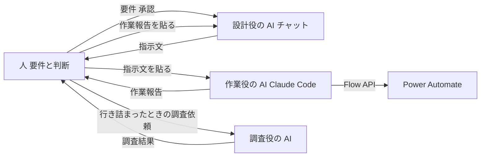
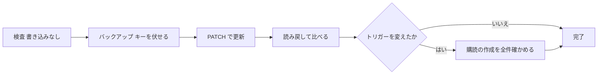

# AI に Power Automate のフローを作らせる方法

| 項目 | 内容 |
|---|---|
| 対象 | Claude Code に Power Automate のクラウドフローを作らせ、修正し、検証させる方法 |
| 読み手 | AI でフローを作りたい人 |
| 調べた時点 | 2026-11-09〜2026-11-11 |

## 1. 概要

Claude Code に Power Automate の API を直接操作させると、フローの作成から本番化までを AI に任せられる。人は画面でフローを組み立てなくてよい。実際に、Teams のチャネルから Claude を呼ぶボット（60アクション前後）を、この方法で作った。

ただし、要件と方式は人が決める必要がある。AI には段階ごとに承認してから作業させる。

| AI に任せられたこと | 人が持つこと |
|---|---|
| フローの定義の作成と修正 | 要件、制約、方式の決定 |
| 実行履歴を読んで原因を調べること | 方式を変える判断 |
| 読み取り専用の検証フローでの実測 | Teams での投稿などの操作とテスト |
| バックアップ、更新、読み戻しの確認 | API キーの入力 |
| 作業記録からのナレッジの下書き | 削除、オン・オフ、本番の向き先の変更の承認 |

## 2. 理解に必要な前提

### Flow API

Power Automate には、フローを操作する管理 API がある。この文書では Flow API と呼ぶ。フローの一覧、定義の取得、作成、更新、オン・オフ、削除、実行履歴の取得ができる。

### Azure CLI のトークン

Flow API を呼ぶには、職場アカウントのトークンが必要である。Azure CLI（`az`）でサインインすると、トークンを取り出せる。Azure のサブスクリプションは要らない。

### Claude Code と MCP

Claude Code はPC 上で動く AI の作業ツールである。外部のサービスとはMCP サーバーやプラグインを通してつなげる。Microsoft はPower Automate 用のプラグインを公開している。このプラグインはMCP サーバーを通して Power Automate を操作する。

### フローの定義

フローはJSON の定義で表される。トリガー、アクション、実行の順序（`runAfter`）、接続の参照が入っている。AI はこの JSON を書き換えて、Flow API で送る。

## 3. 解説

### 役割分担



| 役 | 担当 | やること |
|---|---|---|
| 人 | 運用者 | 要件と制約を決める。方式を選ぶ。Teams での操作、テスト、API キーの入力をする。指示文を承認して渡す |
| 設計役の AI | Claude（チャット） | 設計、方式の比較、指示文の作成、作業報告のレビューをする |
| 作業役の AI | Claude Code | Flow API で作成、修正、検証、実行履歴の調査をする |
| 調査役の AI | ChatGPT（調べものの機能） | 行き詰まったときに、別の視点で調べる |

人が AI の間で文章を受け渡す。そのため、指示文と報告は、そのまま貼れる形で書かせる。

### 環境の準備

必要なものは Node.js（18以上）、Azure CLI、Claude Code の3つである。

Windows では、Azure CLI を次のコマンドで入れる。

```
winget install --exact --id Microsoft.AzureCLI
```

入れたあとに PowerShell を開き直す。開き直さないと、`az` が見つからない。次に、サインインしてトークンを確かめる。

```
az login --allow-no-subscriptions
az account get-access-token --resource https://service.flow.microsoft.com --query expiresOn --output tsv
```

2つ目のコマンドで日時が出れば、トークンを取れている。サインイン後に「N/A(tenant level account)」と出るのは正常である。

### プラグインが使えない環境

プラグインは次のコマンドで入れる。入れると、`/setup` や `/build-flow` で、自然言語からフローを作れる。

```
/plugin marketplace add microsoft/power-platform-skills
/plugin install power-automate@power-platform-skills
```

会社の管理設定で MCP サーバーが止められていると、プラグインは動かない。次のどちらかが当てはまれば、止められている。

- `~/.claude/remote-settings.json` に `"allowManagedMcpServersOnly": true` と `"allowedMcpServers": []` がある。
- プラグインを入れて再起動しても、プラグインのツールが出てこない。

この場合は、入れ直しても直らない。Flow API を直接呼ぶ。MCP の仕組みを手で動かして、制限を回り込むことはしない。今回は、Microsoft の API が制限の対象外であることを、IT 部門に確かめてから進めた。

### Flow API での操作

- ベース URL：`https://api.flow.microsoft.com/providers/Microsoft.ProcessSimple`
- 末尾に必ず `?api-version=2016-11-01` を付ける。
- ヘッダー：`Authorization: Bearer <トークン>`

| やりたいこと | メソッドとパス |
|---|---|
| 環境の一覧 | `GET /environments` |
| フローの一覧 | `GET /environments/{環境}/flows` |
| 定義を読む | `GET /environments/{環境}/flows/{フロー}` |
| 作る | `POST /environments/{環境}/flows` |
| 更新する | `PATCH /environments/{環境}/flows/{フロー}` |
| オン、オフ | `POST …/flows/{フロー}/start`、`POST …/flows/{フロー}/stop` |
| 削除する | `DELETE …/flows/{フロー}` |
| 実行履歴 | `GET …/flows/{フロー}/runs`、`…/runs/{実行}/actions` |
| トリガーの履歴 | `GET …/flows/{フロー}/triggers/{名前}/histories` |

アクションの入出力の本文は`inputsLink` と `outputsLink` の URL から取る。この URL には署名が付いているので、トークンは付けずに取る。取る前に、ホストが Microsoft のドメインであることを確かめる。

トークンの扱いは次のとおり。

- トークンはパスワードと同じに扱う。スクリプトの中で `az` から取り出し、画面にもファイルにも出さない。
- トークンを付けて送る先は、Microsoft の API のホストに限る。
- 有効期限は1時間ほどである。切れたら取り直す。
- `curl` や `wget` が禁止されている環境では、Node.js か PowerShell の `Invoke-RestMethod` を使う。

Microsoft Graph も同じ Azure CLI のトークンで呼べる。ただし読めたのは、チームとチャネルの一覧までだった（実測）。メッセージの本文は読めないので、フローの実行履歴から読む。

### 更新の標準手順



1. 検査：送る定義を作り、書き込む前に、名前の重複、参照先の有無、`runAfter` のつながりを確かめる。
2. バックアップ：今の定義を、OneDrive の外のローカルフォルダに保存する。API キーは `SET_YOUR_KEY` に伏せてから保存する。
3. 更新：`PATCH` で送る。検証に通らないと保存されず、具体的な原因が返る。
4. 読み戻し：保存された定義を読み、送った定義と比べる。サービスが自動で足す項目を除いて、差が0件であることを確かめる。キーの値はハッシュで比べ、オン・オフの状態も確かめる。
5. 購読の確認：トリガーを変えたときは、トリガーの履歴で購読の作成を確かめる。チャネルが複数あるなら、全件を見る。

ロールバックでは、バックアップの定義に今のキーを入れ直してから戻す。

### 指示文の書き方

1回の指示では、1つの段階だけを頼む。範囲、変えること、守ること、報告の形を必ず書く。変える箇所はどのアクションの何をどの値にするかまで書く。

```
「(フロー名)」について、次の作業だけをしてください。範囲外の変更はしないでください。
停止状態のまま更新し、オン・オフは変えないでください。
更新前に、今の定義をバックアップとして保存してください。

【変えること】
1. (アクション名)の(項目)を、(値・式)にする。

【変えないこと】
- 上記以外の動作。

【守ってほしいこと】
- API キーの値は、画面、ログ、報告に出さない。バックアップはキーを伏せて、ローカルに保存する。
- メッセージの本文や ID は、画面に全文を出さない（あり・なしと形だけ報告する）。
- 要件や方式に影響する判断が必要なときは、変更せずに質問する。

【報告】
- 更新後に読み戻して、差分を報告する。
- 「指示どおりに変えた点」と「確認なしで判断した点」を分けて書く。
- 実機で確認が必要な点を挙げる。
```

最初に決めておく作業のルールは次のとおり。

- キー：値を出さない。更新しても、値を変えずに残す。
- バックアップ：OneDrive の外に保存し、キーは伏せる。
- 本文と ID：画面に全文を出さない。
- 権限：削除、オン・オフ、本番の向き先の変更は、事前に承認する。任せるときは、対象のフローを限って伝える。
- 報告：変えた点と、確認なしで判断した点を分ける。

## 4. 似たものとの違い

| 方法 | 仕組み | 向いている場面 | 注意 |
|---|---|---|---|
| 画面で手作業 | ポータルのデザイナーで組み立てる | 小さなフロー | アクションが多いと手間がかかる |
| Power Automate の Copilot | ポータルで説明文を書くと、下書きのフローができる | 骨組みを作る | 説明文は英語だけが対象である。条件分岐や待機の多い構成は骨組みまでになりやすい（推測） |
| Power Automate プラグイン | Claude Code から MCP 経由で操作する | MCP が使える環境 | MCP が止められていると動かない。今回は試していない |
| Flow API を直接呼ぶ（今回） | Claude Code が Azure CLI のトークンで API を呼ぶ | MCP が使えない環境 | 手順とルールを人が決める必要がある |

## 5. 会話でわかったこと

### 方式は人が決め、実績を確かめてから設計する

- 設計役の AI が動作の実績を確かめずに「送信 Webhook から Power Automate を呼ぶ」構成を勧めた。設計書、フローの作成、Teams への登録まで進めたあとで、401 で拒否されると分かった。
- 部品の組み合わせは実績か仕様を確かめてから設計に入る。最初に、1回だけの疎通試験をする。
- 設計役の AI が、人が決めるはずの方式を自分で決めて進めたことがあった。要件で不可とした文字列判定の方式だった。要件と制約は最初に一覧にして、人が承認する。方式の判断が要るときは、AI に止まって聞かせる。

### 時間と件数の制約は最初に調べる

- Teams の送信 Webhook は5秒以内の応答を求める。HTTP アクションは1回120秒が上限で、設定では延ばせない。どちらも設計の途中で分かった。
- 設計役の AI は一度「タイムアウトは設定で延ばせる」と誤った案を出した。上限は公式の情報で確かめる。

### 指示は具体的に書く

- 「キーを変数にまとめて」とだけ指示したら、作業役の AI は変数を作るだけで、参照を置き換えなかった。変える箇所と値は、列挙して書く。

### 実測で確かめる

- 推測で作った式の多くは、読み取り専用の検証フローで実測して直した。返信の ID の扱いや本文の形は実測で初めて分かった。
- 自分1人だけのテスト用チームで検証すると、同僚の投稿が検証フローの実行履歴に残らない。
- 「Teams と同じヘッダーを付けて1回だけ呼ぶ」試験で、401 の原因を数分で確定できた。

### AI が作った確認の処理も確かめる

- 購読の作成を確かめる処理が、先頭の1件しか見ていなかった。その結果、成功を失敗と判断し、自動で元に戻した。AI の作業報告は読み流さない。

### 人の作業を減らす

- 設計役の AI は確認のたびに人へ画面の操作を頼んでいた。実行履歴は作業役の AI が API で読めるので、調べる作業はそちらに任せる。人の作業は承認と Teams での操作にする。

### 行き詰まったら別の AI に調べさせる

- 設計役の AI が「方法が無い」と結論したあと、別の AI に調査を頼んだ。依頼文に、確かめた事実と、除外した方法とその理由を入れた。その結果、カスタム絵文字で呼ぶ方式が見つかった。

## 6. 未解決事項

- Power Automate プラグイン（MCP 経由）は、この環境では試していない。MCP が使える環境での手順は未確認である。
- Power Automate の Copilot で、どこまでのフローを作れるかは試していない。
- 作業役の AI が作ったスクリプトは、セッションの一時フォルダにある。消えるおそれがあるので、残すなら持ち出す必要がある。

## 7. 参考資料

| 資料 | 参照日 |
|---|---|
| [Power Automate plugin for external tools（Microsoft Learn）](https://learn.microsoft.com/power-automate/power-automate-plugin-external-tools) | 2026-11-09 |
| 作業役の AI（Claude Code）が作った作業記録 | 2026-11-11 |
| 運用者がまとめた Flow API の設定手順 | 2026-11-09 |

## 8. 更新履歴

| 日付 | 内容 |
|---|---|
| 2026-11-11 | 初版 |
