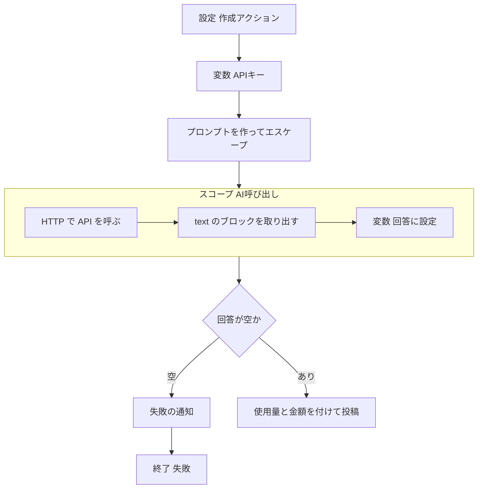

# Power Automate から生成 AI の API を呼ぶ実装パターン

| 項目 | 内容 |
|---|---|
| 対象 | Power Automate のクラウドフローから、Claude などの生成 AI の API を HTTP アクションで呼ぶ実装 |
| 読み手 | フローの中で生成 AI を使いたい人 |
| 調べた時点 | 2026-11-09〜2026-11-11 |

## 1. 概要

チャットのように早く返したい用途では、HTTP アクションで AI の API を同期で呼ぶ形が合っていた。Claude の Messages API の呼び出しは 2〜5秒だった（実測）。非同期の Message Batches API では、回答まで 2分48秒かかった（実測）。

実装の要点は次のとおり。

- 設定は先頭の「作成」アクション1つに JSON でまとめる。
- API キーは変数1つに置き、実行履歴で隠す。ヘッダーに入れるときは `trim()` する。
- プロンプトはJSON 用にエスケープしてから本文に入れる。
- 応答からは、`type` が `text` のブロックだけを取り出す。
- AI の呼び出しをスコープで囲み、失敗したら通知してから失敗で終える。

Claude で実装と実測をした。OpenAI の経路は作ったが、動かしていない。

## 2. 理解に必要な前提

### HTTP アクションの時間の上限

HTTP アクション1回の上限は120秒である。タイムアウトの設定を長くしても延びない。フロー全体は30日まで動かせるので、待ちを分ければ長い処理もできる。

### セキュリティで保護された入力と出力

アクションの設定で、入力と出力を実行履歴から隠せる。隠した値は実行履歴の画面に表示されない。ただし、フローを編集できる人は定義の中の値を見られる。

### スコープと実行条件

スコープは複数のアクションを1つにまとめる入れ物である。各アクションには実行条件（`runAfter`）があり、前のアクションが成功、失敗、タイムアウト、スキップのどれのときに動くかを決める。

### Claude の応答の形

Messages API の応答の `content` はブロックの配列である。回答の文は `type` が `text` のブロックに入る。考えた内容は `thinking` のブロックに入る。`usage` には、入力と出力のトークン数が入る。考えたトークンも出力のトークンに数えられる。

## 3. 解説

### 全体の流れ



### API キーの置き方

キーを変数1つに置き、HTTP アクションのヘッダーからその変数を参照する。キーを入れる場所が1か所になり、実行履歴にも出ない。

1. 変数「APIキー」（文字列）を初期化する。そのアクションの設定で、入力と出力の保護をオンにする。定義では `runtimeConfiguration.secureData` に `inputs` と `outputs` を入れる。
2. キーを使う HTTP アクションでは、ヘッダーを `@{trim(variables('APIキー'))}` にする。そのアクションの入力の保護もオンにする。
3. キーはポータルで入力する。チャットやファイルには貼らない。キーが入ったフローの定義は、そのまま書き出さない。

`trim()` は省けない。キーの前後に改行が混じると、HTTP のヘッダーがおかしくなり、本文が空として届いた（実測）。

### 設定のまとめ方

モデル名、effort、出力の上限、システムプロンプト、料金表などを、先頭の「作成」アクション「設定」に JSON でまとめる。参照は `outputs('設定')?['項目']` で書く。次の2つは、「設定」にはまとめられない。

- トリガーの値：トリガーは後ろのアクションの値を参照できない。
- 変数の初期化：スコープの中に置けないので、「設定」と並べて一番外側に置く。

### プロンプトのエスケープ

プロンプトにダブルクォートや改行がそのまま入ると、本文の JSON が壊れる。JSON の文字列に入れる前に、次の式でエスケープする。

```
replace(replace(replace(replace(
  outputs('プロンプト'),
  '\', '\\'), '"', '\"'),
  decodeUriComponent('%0A'), '\n'),
  decodeUriComponent('%0D'), '')
```

### Claude の Messages API の呼び方

```
POST https://api.anthropic.com/v1/messages
x-api-key: @{trim(variables('APIキー'))}
anthropic-version: 2023-06-01
content-type: application/json

{"model":"@{outputs('設定')?['Claudeモデル']}",
 "max_tokens":@{outputs('設定')?['Claude最大トークン']},
 "output_config":{"effort":"@{outputs('設定')?['effort']}"},
 "system":"@{outputs('システムのエスケープ済み')}",
 "messages":[{"role":"user","content":"@{outputs('エスケープ済み')}"}]}
```

- `max_tokens` は数値なので、引用符で囲まない。考えたトークンも含むので、小さすぎると回答が途中で切れる。
- `effort` は `output_config` の中に置く。
- 再試行ポリシーは「なし」にする。二重の課金と、長い待ちを避けるためである。
- 拒否されたときに別のモデルへ回すには、`"fallbacks":"default"` と、ヘッダー `anthropic-beta: server-side-fallback-2026-07-01` を足す。

### 応答の取り出し

1. 「配列のフィルター処理」で、`body('Claude送信')?['content']` のうち、`item()?['type']` が `text` のものだけを残す。
2. 回答は `coalesce(first(body('テキストのみ'))?['text'], '')` で取る。空の配列では `first()` が null を返すためである。

### 失敗の扱い

- スコープの中では、成功したときだけ変数「回答」に設定する。失敗したら、回答は空のままにする。
- スコープの後ろに、条件「回答の確認」を置く。実行条件は成功、失敗、タイムアウト、スキップのすべてにする。スキップを入れないと、スコープより前で失敗したときに通知が出ない。
- 回答が空なら、失敗の通知を投稿してから、「終了」を失敗で実行する。実行履歴に失敗を残すためである。
- 失敗の文面には原因を書かない。例：「回答を生成できませんでした。もう一度試してください。続く場合は管理者に連絡してください。」

スコープの中で「終了」を実行すると、フロー全体がその場で止まる。その場合、後ろの通知まで進まない。分岐の中で終えるなら、先に通知してから終了する。

### 使用量と金額

応答の `usage` と、「設定」の料金表（USD／100万トークン）から、1回ごとの金額を計算する。

```
div(add(mul(float(入力トークン), float(入力単価)),
        mul(float(出力トークン), float(出力単価))), 1000000)
```

- 単価は応答の `model` で料金表から引く。料金表に無いモデルは「不明」と表示する。
- 拒否で別のモデルが答えたときは、`usage.iterations` に `fallback_message` が出る。トップレベルの `usage` は最終の回答の分だけの可能性がある（推測）。
- 金額の計算に失敗しても、回答は出す。表示のアクションの実行条件に、失敗とスキップを入れる。
- 単価は変わる。料金表に出典と日付を書いて、定期的に確かめる。

### 会話のツールに出すときの整え方

入力の整理は次のとおり。

- 本文の HTML は素のテキストにして渡す。絵文字のタグなどが残ると、AI がそれに触れる。
- 呼び出した投稿は履歴から除き、依頼としてだけ渡す。
- 仮の返信と失敗の通知は、履歴から除く。
- ボットの過去の回答は残してよい。ただし、末尾の使用量の行は切る。
- 材料と依頼を分けて渡す。例：「【会話（古い順）】…【依頼】…」

Teams に出すときの整え方は次のとおり。

- Teams は Markdown を表示しない。システムプロンプトで、記法を使わないよう指示する。
- 回答を HTML エスケープ（`&`、`<`、`>`）してから、改行を `<br>` にする。
- Teams のメッセージの長さには上限（約28KB）がある。文字数で切り、切ったら「（長いため省略しました）」を足す。切るのはエスケープの前にする。`&amp;` の途中で切らないためである。

システムプロンプトの要点は次のとおり。

- 結論から短く書く（目安200字、まとめでも400字）。
- 前置き、あいさつ、依頼の復唱を書かない。
- あいまいな依頼には一言で聞き返す。
- 頼まれていない要約をしない。過去の自分の回答を繰り返さない。
- 呼び出しの方法に触れない。
- 記法を使わず、箇条書きは「・」にする。

## 4. 似たものとの違い

### 同期と非同期

| 呼び方 | 仕組み | 実測 | 向く用途 |
|---|---|---|---|
| 同期（Claude の Messages API） | 1回の HTTP で回答が返る | Claude 2〜5秒、フロー全体 11〜17秒 | チャットの回答、短い要約 |
| 非同期（Claude の Message Batches API） | 送信し、30秒おきに状態を確かめ、結果を取る | 2分48秒 | 急がない大量の処理。料金は同期より安い |
| 非同期（OpenAI の Responses API の background） | 送信し、15秒おきに状態を確かめる | 未検証 | 長い生成 |

同期で120秒を超えそうなときは、`effort` か `max_tokens` を下げる。

### API キーの置き方

| 置き方 | キーの見え方 | 使える条件 |
|---|---|---|
| HTTP アクションに直接書く | 実行履歴の入力に出る | 使わない |
| 変数1つと保護の設定（採用） | 実行履歴では隠れる。フローを編集できる人には見える | すぐ使える |
| カスタムコネクタ（API キー認証） | キーは接続の側に保存され、フローには入らない | コネクタを作る必要がある。会社の許可を確かめる |
| シークレット型の環境変数 | 値は Azure Key Vault に保管される | Azure のサブスクリプションと、ソリューションが要る |
| テキスト型の環境変数 | 一般のユーザーにも読める | 認証情報には使わない |

## 5. 会話でわかったこと

### 式でつまずいたところ

| 式 | 起きたこと | 対処 |
|---|---|---|
| `substring(文字列, 開始位置)` | 開始位置が文字列の長さと同じだと、範囲外で失敗した。HTML を `<` で区切ると、`/p>` のような断片で必ず起きた | `>` より後ろは `last(split(item(), '>'))` で取る |
| `coalesce(a, b)` | 空文字は null ではないので、`a` が空文字だと `b` に切り替わらなかった | `if(empty(a), b, a)` にする |
| `div(整数, 整数)` | 整数の割り算になった | `float()` で変換してから割る |
| `first(配列)` | 空の配列で null を返し、文字列の変数への設定が失敗した | `coalesce(first(…)?['text'], '')` にする |
| `if(条件, a, b)` | 使わない側は評価されない | 実行されなかったアクションを参照する式は、`if` の中に入れる |
| `replace`、`contains` | 大文字と小文字を区別した | 判定の前に `toLower` でそろえる |
| 「配列のフィルター処理」 | 各要素の変換には使えなかった。残すかどうかを真偽で決める場所である | 変換は「選択」アクションで行う |
| `trim()` | 空白だけでなく、改行も除く | ヘッダーに入れる値は、必ず `trim()` する |
| 変数の初期化 | スコープや条件の中に置けなかった | 一番外側に置き、中では「変数の設定」を使う |
| 「終了」 | スコープの中で実行すると、フロー全体がその場で止まった | 通知を先に済ませてから終了する |

### 回答の質の改善

- 整理する前は、AI に渡す内容が1,486字で、回答が198字だった（実測）。
- 入力を整理し、システムプロンプトで書き方を指示した。渡す内容は138字に、回答は17〜90字になった（実測）。
- 90字の回答でも、出力は426トークンだった。大半は考えたトークンである（実測）。

### 時間の制約の確かめ方

- HTTP アクションのタイムアウトを長くすれば延ばせる、と一度は誤って考えた。実際は120秒が上限で、設定では延びない。上限は公式の情報で確かめる。

## 6. 未解決事項

- OpenAI の経路は動かしていない。本文をオブジェクトで組み立てる場合は、エスケープ済みの文字列が二重にエスケープされるおそれがある。
- `effort` が `high` のまま、考える時間が長い依頼を送ると、120秒を超えるおそれがある。超えたときの頻度は測っていない。
- 拒否で別のモデルが答えたときの課金の内訳は、確かめていない。

## 7. 参考資料

| 資料 | 参照日 |
|---|---|
| Anthropic の Claude API の資料（料金表は 2026-10-06 時点） | 2026-11-11 |
| 作業役の AI（Claude Code）が作った作業記録 | 2026-11-11 |

## 8. 更新履歴

| 日付 | 内容 |
|---|---|
| 2026-11-11 | 初版 |
