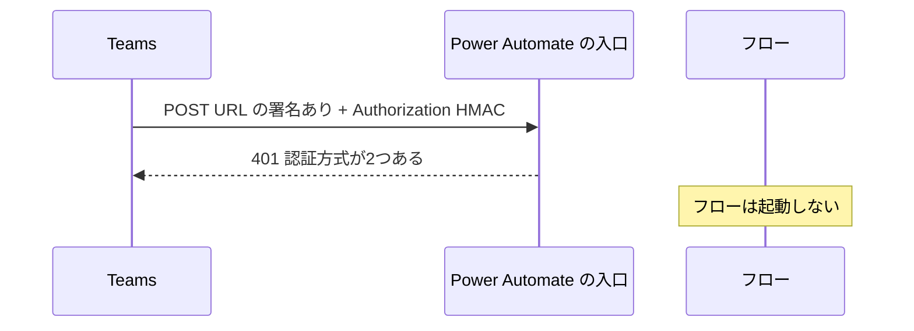
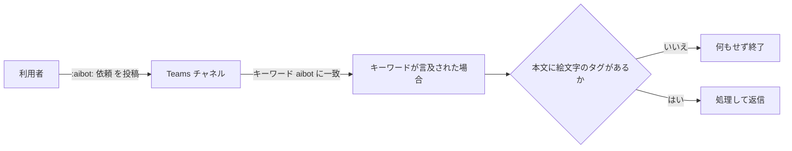

# Teams から Power Automate のフローを呼ぶ方式

| 項目 | 内容 |
|---|---|
| 対象 | Teams のチャネルでの操作をきっかけに、Power Automate のクラウドフローを動かす方式 |
| 読み手 | Teams と Power Automate をつなぐものを作る人 |
| 調べた時点 | 2026-11-09〜2026-11-11 |

## 1. 概要

Teams の送信 Webhook から、Power Automate の HTTP トリガーは呼べない。リクエストが 401 で拒否される（実測）。

サーバー、専用ユーザー、Copilot Studio を使わずに Teams からフローを呼べたのは、次の方式だった。カスタム絵文字 `:aibot:` を付けた投稿を、Teams コネクタの「キーワードが言及された場合」で拾う。

「`@` の候補から選ぶメンション」で呼ぶには、次のどれかが必要になる。

- 専用のユーザーアカウント
- 中継（Azure Functions、Azure API Management など。Azure のサブスクリプションが要る）
- Copilot Studio

## 2. 理解に必要な前提

### 送信 Webhook

送信 Webhook はチーム単位で登録する Teams の機能である。チャネルで `@名前` とメンションすると、Teams が登録先の URL に POST する。受け側は5秒以内に返事を返す必要がある。Teams は本文を HMAC で署名し、`Authorization: HMAC …` ヘッダーに入れて送る。このヘッダーを外す設定は無い。

### HTTP 要求の受信時と SAS

Power Automate の「HTTP 要求の受信時」トリガーは、呼び出し用の URL を発行する。誰でも呼べる設定にすると、URL に `sig=` の署名（SAS）が入る。この署名を持っていることが、呼び出しの許可になる。

### Graph の変更通知と Teams コネクタのトリガー

Teams コネクタの Webhook 型のトリガーは、Microsoft Graph の変更通知を、チャネルごとに購読する。投稿が条件に合うと、Teams からフローに通知が届く。定期的に見に行くポーリング型のトリガーもある。

### メンションできる相手

Teams のチャネルでメンションできる相手は、人、タグ、チャネル、チーム、ボットやアプリ（送信 Webhook を含む）である。メンションした相手はメッセージのメンション一覧に記録される。送信 Webhook は、種類が `outgoingWebhook` のアプリとして記録される。

### カスタム絵文字

組織で登録する絵文字である。投稿欄で `:名前` と打つと候補に出る。選ぶと、本文の HTML に `<customemoji id="…" alt="名前" source="…"></customemoji>` というタグで残る。チャネルの返信でも使える。

## 3. 解説

### 送信 Webhook が拒否される理由

Power Automate の HTTP トリガーは、1つのリクエストに認証方式を1つしか認めない。Teams のリクエストにはURL の署名と HMAC のヘッダーの2つが付いている。



実測で返ったエラーは次のとおり（2026-11-09）。実行もトリガーの履歴も残らない。Teams には「Sorry, there was a problem encountered with your request」と表示される。

```
401 DirectApiRequestHasMoreThanOneAuthorization
The request has SAS authentication scheme, 'HMAC' authorization scheme or internal token scheme. Only one scheme should be used.
```

トリガーの設定を変えても、通る組み合わせは無い。

| トリガーの設定 | 入口が受け付ける認証 | 結果 |
|---|---|---|
| すべてのユーザー | URL の署名（SAS）だけ | 署名と HMAC の2つで拒否される（実測） |
| URL から署名を外す | basic か bearer のトークン | HMAC は受け付けない（他サービスの事例） |
| テナント内のユーザーなど | Microsoft Entra の Bearer トークン | HMAC は受け付けない |

同じ URL を `Authorization` ヘッダーなしで呼ぶと、フローは正常に起動した（実測）。旧形式の URL（logic.azure.com）でも、同じエラーが報告されていた。この組み合わせが動いた実例は、見つからなかった。

確かめ方は次のとおり。トリガーの URL に `Authorization: HMAC dGVzdA==` を付けて、1回だけ POST する。401 と上のエラーが返れば、この問題である。

### 採用した方式：カスタム絵文字



1. カスタム絵文字を `aibot` という名前で1回だけ登録する。管理者がカスタム絵文字を許可している必要がある。
2. 利用者は投稿欄で `:aibot` と打って候補から選び、続けて依頼を書く。
3. キーワードのトリガー（キーワード `aibot`）は、絵文字の名前（`alt`）に一致して起動する（実測）。
4. フローは、本文の HTML に `<customemoji ` と `alt="aibot"` があるときだけ処理する。文字だけの「aibot」はここで終わる。

この方式の注意点は次のとおり。

- 判定は本文の文字ではなく、絵文字のタグで行う。ID で判定することもできる。絵文字の名前はテナント内で一意である。
- 文字の「aibot」を含む投稿でも、トリガーは起動する。実行履歴にその投稿が残る（約3秒で終わる）。
- ボットの投稿に「aibot」の文字が入ると、トリガーが起動する。投稿者がボットなら終える確認を入れる。
- 絵文字に変わらずに文字のまま送られた `:aibot:` には、反応しない。
- 本物のメンションではない。通知も、候補でのメンバー表示も無い。

### Teams のトリガーの違い

| トリガー | 起動の仕組み | 返信で起動 | 対象 | 注意 |
|---|---|---|---|---|
| キーワードが言及された場合 | Webhook 型（実測 0.3〜1.3秒） | する（実測） | キーワードを含む投稿だけ | キーワードは1語。送信者名などもメッセージ全体が検索の対象になる |
| チャットまたはチャネルに新しいメッセージが追加されたとき | Webhook 型 | する（実測） | チャネルの全投稿 | 全投稿で起動するので、条件で絞る必要がある |
| チャネルに新しいメッセージが追加されたとき | ポーリング型 | しない | 新規の投稿だけ | 遅い |
| チャネルで自分がメンションされたとき | ポーリング型（3分おき） | しない | 接続したユーザーへのメンション | 遅い |
| 自分が @メンションされたとき | Webhook 型 | する | 接続したユーザーへのメンション（チャットとチャネル） | 既定の環境でだけ動く。ゲストからのメンションでは起動しない |

どのトリガーもチームとチャネルを指定して作る。チャネルの指定は1件以上が必須で、チームの全チャネルという指定はできない（実測）。新しいチャネルを検知するトリガーも無い。非公開チャネルと共有チャネルは対象外である。トリガーは後ろのアクションの値を参照できない。

## 4. 似たものとの違い

調べた12の方式を比べた。サーバー、専用ユーザー、Copilot Studio、文字列判定のどれも使わずに動いたのは、カスタム絵文字の方式だけだった。

| 方式 | 呼び方 | 必要なもの | 結果と制約 |
|---|---|---|---|
| 送信 Webhook から HTTP トリガー | メンション（Webhook） | なし | 401 で拒否されて動かない（実測） |
| 送信 Webhook と中継 | メンション（Webhook） | 中継（Azure Functions、API Management など） | 動く（他サービスの事例）。Azure のサブスクリプションが要る。社内サーバーで中継するなら、インターネットから HTTPS で届き、公開証明書が要る |
| Bot Framework のボット | メンション（ボット）。チャットでも使える | Azure Bot Service とサーバー | 動く。作るものが多い |
| 専用ユーザーと「自分が @メンションされたとき」 | メンション（人） | Teams が使える専用アカウント | 動く。返信とチャットにも反応する |
| タグとキーワードのトリガー | メンション（タグ） | タグ | タグには人を1人以上割り当てる必要があり、その人に毎回通知が届く |
| 送信 Webhook を相手にしてメッセージ側で検知 | メンション（Webhook） | なし | Webhook の呼び出しが毎回失敗し、エラー表示が残る |
| Copilot Studio のエージェント | メンション（ボット） | Copilot Studio のライセンス | 動く。チャネルで使うには、組織向けの公開とチームへの追加の設定が要る |
| Power Pages のサーバーロジックで中継 | メンション（Webhook） | Power Pages | 動かない。API の呼び出しには CSRF トークンが必須で、Teams は付けられない |
| アプリのスラッシュコマンド | `/` の候補から選ぶ | コマンドを定義した Teams アプリと、その受け側 | 受け側にサーバーが要る |
| 文字の「@AIBot」などに反応 | 文字で書く | なし | 動くが、普通の会話にも反応する |
| 「…」や「+」のメニューから Workflows を実行 | メニューから選ぶ | なし | 動く。メンションではない。既定の環境でだけ動く |
| カスタム絵文字とキーワードのトリガー（採用） | 候補から選ぶ絵文字 | カスタム絵文字の登録 | 動く（実測）。返信にも反応する。メンションではない |

## 5. 会話でわかったこと

### Teams のメッセージの挙動（実測）

| 項目 | 挙動 |
|---|---|
| 新規と返信の見分け | トリガー出力の `replyToMessageId` が、新規ならメッセージ ID と同じになり、返信なら親の ID になる。`resource` に `/replies` を含むのは返信だけである |
| 返信の取得 | 「メッセージの詳細を取得する」に返信の ID を渡すと、NotFound になる。返信は、親の ID で「返信を一覧表示」から取り、ID で絞る。一覧は新しい順で、最大50件である |
| 先頭の投稿 | 返信の一覧には入らない。詳細の取得で別に取る |
| 本文の形 | 本文は HTML である。`plainTextContent` は新規にだけあり、絵文字の名前は入らない |
| ボットの投稿 | `from.user` が無く、`from.application` がある（表示名「Workflows」、種類 bot） |
| 保存された HTML | ボットが投稿した `<br><br>` は、`<br>` と改行の形で保存される。文字列で判定するときは、タグを含めない |
| システム通知 | ボットがチームに初めて投稿したとき、`<systemEventMessage/>` という本文の投稿が、新規として届く |
| チャネルの形式 | スレッド形式のチャネルでも、通常のチャネルでも、同じように動く |
| 購読 | キーワードのトリガーは、チャネルごとに購読を1件作る。期限は72時間で、約6時間おきに登録し直される |

### 検討の進め方

- 最初は送信 Webhook の構成で設計し、作り終えてから 401 で拒否されると分かった。組み合わせの実績を、設計の前に確かめるべきだった。
- 中継で解決できることは分かったが、条件では中継サーバーを置けなかった。社内サーバーはインターネットに公開できず、Azure のサブスクリプションも無かった。
- 「`@` の候補から選ぶ」に近い操作として、候補から選ぶカスタム絵文字を採用した。別の AI に調査を頼んで見つかった方式である。

## 6. 未解決事項

- 購読の応答に、`Deprecation`（2024-04-29）と `Sunset`（2026-04-29）のヘッダーが付いていた。期限は過ぎたが、通知は届いている。意味は確かめられていない。
- 「自分が @メンションされたとき」が返信で起動することは、コミュニティの解説で確かめた。公式の記載と実機では確かめていない。
- 送信 Webhook と中継の組み合わせは、他サービスの事例で確かめた。Teams では試していない。

## 7. 参考資料

| 資料 | 参照日 |
|---|---|
| [Microsoft Teams コネクタのリファレンス](https://learn.microsoft.com/en-us/connectors/teams/) | 2026-11-09 |
| [Create an Outgoing Webhook（Microsoft Learn）](https://learn.microsoft.com/en-us/microsoftteams/platform/webhooks-and-connectors/how-to/add-outgoing-webhook) | 2026-11-09 |
| [teamworkApplicationIdentity resource type（Microsoft Graph）](https://learn.microsoft.com/en-us/graph/api/resources/teamworkapplicationidentity?view=graph-rest-1.0) | 2026-11-09 |
| [Get chatMessage（Microsoft Graph）](https://learn.microsoft.com/en-us/graph/api/chatmessage-get?view=graph-rest-1.0) | 2026-11-09 |
| [Power Pages server logic overview](https://learn.microsoft.com/power-pages/configure/server-logic-overview) | 2026-11-09 |
| [Power Automate: Teams - When I'm @mentioned（コミュニティの解説）](https://manueltgomes.com/reference/power-automate-trigger-reference/power-automate-teams-when-im-mentioned/) | 2026-11-09 |
| 作業役の AI（Claude Code）が作った作業記録 | 2026-11-11 |

## 8. 更新履歴

| 日付 | 内容 |
|---|---|
| 2026-11-11 | 初版 |
