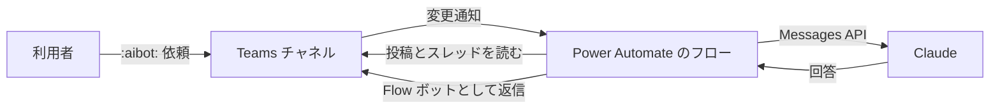
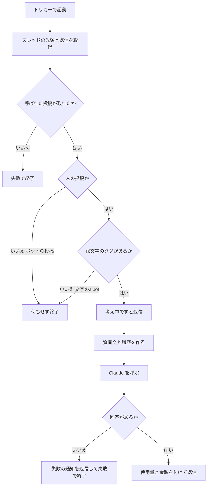

# Teams AIボットの設計と運用

| 項目 | 内容 |
|---|---|
| 対象 | Teams のチャネルから Claude を呼ぶ、Power Automate のボット |
| 読み手 | このボットの運用者と、後任 |
| 調べた時点 | 2026-11-09〜2026-11-11 |
| 書いていないもの | API キー、チーム・チャネル・環境・メッセージの ID |

## 1. 概要

チームの標準チャネルで、投稿にカスタム絵文字 `:aibot:` を付けると、AIボットが同じスレッドに回答する。2026-11-11 から本番で動いている。

- 仕組み：Power Automate のクラウドフロー1つで動く。Teams コネクタのトリガーで起動し、Claude の Messages API で回答を作る。
- 投稿者：Flow ボットとして投稿する。Teams 上の表示名は「Workflows」になる。
- 速さ：呼ばれてから回答まで 11〜17秒かかる（実測）。うち Claude の呼び出しは 2〜5秒。
- 費用：1回あたり約 $0.002〜0.006（実測）。回答の末尾に、使用量と金額が出る。

## 2. 理解に必要な前提

### Power Automate のトリガーと購読

クラウドフローはトリガーで起動する。今回使うトリガーは「キーワードが言及された場合」である。このトリガーは指定したチャネルごとに、Microsoft Graph の変更通知を購読する。投稿にキーワードが含まれると、Teams からフローに通知が届く。定期的に見に行くポーリング型ではない。

### カスタム絵文字

カスタム絵文字は組織で登録する絵文字である。投稿欄で `:aibot` と打つと候補に出る。選ぶと、本文の HTML に名前と ID を持つタグとして残る。

```html
<customemoji id="…" alt="aibot" source="…"></customemoji>
```

### Claude の Messages API と effort

Messages API は1回の HTTP 要求で回答を返す。`effort` は回答の前に考える量を決める値である。`low`、`medium`、`high`、`xhigh`、`max` がある。考えたトークンも出力のトークンとして課金される。

## 3. 解説

### 全体の構成



### 処理の流れ



各段階の中身は次のとおり。

- スレッド先頭の ID はトリガー出力の `replyToMessageId` から取る。空なら、メッセージ ID を使う。
- 返信は親の ID で返信一覧を取り、メッセージ ID で絞る。一覧は最大50件である。
- 人の投稿かどうかは、`from.user.id` があり、`from.application` が無いことで判定する。
- 呼び出しかどうかは、本文の HTML に `<customemoji ` と `alt="(呼び名)"` があるかで判定する。
- 履歴は呼ばれた投稿、「考え中です…」、失敗の通知を除いて、古い順に最新50件を使う。HTML は素のテキストにし、絵文字のタグはまるごと除く。
- AI には「【スレッドの会話（古い順）】」と「【依頼】」に分けて渡す。

### 設定の場所

動作を変えるときや、別のチームに広げるときに直す場所は、フロー先頭の3つだけである。トリガーは後ろのアクションを参照できない。そのため、チーム、チャネル、キーワードは、トリガーに直接入れてある。

| 変えたいこと | 場所 | 項目と現在の値 |
|---|---|---|
| 対象のチーム | トリガー、設定 | トリガーのチーム。「設定」の `チームID` は予備 |
| 対象のチャネル | トリガー | チャネルの一覧（1件以上が必須） |
| 呼び出しの絵文字 | トリガー、設定 | トリガーのキーワードと、「設定」の `呼び名` を同じ名前にする（現在 `AIBot`） |
| 使う AI | 設定、APIキー | `プロバイダ`（`claude` か `chatgpt`）。切り替えたら、キーもそのプロバイダのものにする |
| モデル | 設定 | `Claudeモデル`（`claude-sonnet-5-5`）。`ChatGPTモデル` は未検証 |
| 速さと費用 | 設定 | `effort`（`high`）、`Claude最大トークン`（16000） |
| 回答の書き方 | 設定 | `システムプロンプト` |
| 単価 | 設定 | `料金表` と `料金表の注記` |
| 読む履歴の件数 | 設定 | `履歴件数`（50。コネクタの上限が50） |
| 回答の長さの上限 | 設定 | `表示上限文字数`（8000） |
| 失敗時の文言 | 設定 | `失敗時メッセージ` |
| API キー | 変数「APIキー」 | 入力と出力は、実行履歴で隠れる |

### AI の呼び出し

```
POST https://api.anthropic.com/v1/messages
x-api-key: (変数「APIキー」を trim() した値)
anthropic-version: 2023-06-01
anthropic-beta: server-side-fallback-2026-07-01
content-type: application/json

{"model":"claude-sonnet-5-5","max_tokens":16000,
 "output_config":{"effort":"high"},
 "fallbacks":"default",
 "system":"(システムプロンプト)",
 "messages":[{"role":"user","content":"(プロンプト)"}]}
```

- 再試行はしない。二重の課金と、長い待ちを避けるためである。
- 回答は、`content` のうち `type` が `text` の最初のブロックから取る。`thinking` のブロックも入るためである。
- `fallbacks` を指定すると、拒否されたときにサーバー側で別のモデルが答える。そのときは、末尾の表示に注記が付く。

### 失敗したときの動き

| 失敗の場所 | 動き |
|---|---|
| 呼ばれた投稿が取れない | 失敗で終了する。何も投稿しない |
| AI の呼び出しの失敗、空の回答、拒否 | 失敗の通知を返信し、失敗で終了する |
| 金額の計算 | 末尾の表示が付かない。回答は出る |
| 呼び出しではない、人の投稿ではない | 何もせず、成功で終了する（約3秒） |

## 4. 運用手順

どの変更でも、先に定義をバックアップする。変更のあとに、1件だけ動作を確かめる。

### チャネルを足す、外す

トリガーのチャネルの一覧は自動では増えない。新しいチャネルで `:aibot:` に反応しないときは、足し忘れを疑う。

1. フローを開いて、編集する。
2. トリガー「キーワードが言及された場合」のチャネルに、新しいチャネルを足す。外すチャネルは外す。
3. 保存する。
4. 足したチャネルで `:aibot:` を付けて投稿し、実行履歴に実行が出ることを確かめる。

API で変えるときは、トリガーの `requestBody/channels` に、チャネル ID の配列を入れて更新する。そのあと、トリガーの履歴で購読の作成を確かめる。応答の `responses` には、チャネルの数だけ結果が並ぶ。先頭の1件だけを見ると、誤って判定する。

### 設定を変える

「設定」の値を直して、保存する。呼び出しの絵文字を変えるときは、トリガーのキーワードも同じ名前に直す。モデルを変えるときは、料金表にそのモデルを足す。

### API キーを入れ替える

1. 変数「APIキー」の値を、新しいキーに直して保存する。
2. キーはプロバイダごとに別である。Claude なら Anthropic のキーを、ChatGPT なら OpenAI のキーを入れる。違うと `invalid x-api-key` になる。
3. キーを、画面、ログ、文書、チャットに出さない。

### オン・オフと削除

- オフにすると、購読が解除される。オンに戻すと、購読が作り直される。
- 削除するときは、先に停止して、定義をバックアップする。

### ロールバック

1. 戻したい時点のバックアップを選ぶ。バックアップのキーは`SET_YOUR_KEY` に伏せてある。
2. 今のキーを入れ直した定義で、フローを戻す。
3. 読み戻して、差が0件であることと、キーが変わっていないことを確かめる。

### 実行履歴の見方

| 実行されたアクション | 意味 |
|---|---|
| 呼び出しではないため終了 | 文字の「aibot」などで起動した。何もしていない（正常） |
| 対象外の投稿者のため終了 | ボットの投稿で起動した。何もしていない（正常） |
| 回答を返信が成功 | 回答を投稿した |
| 失敗の通知が成功 | AI の呼び出しが失敗した。`Claude送信` の出力で、エラーの種類を見る |

入力と出力の本文には、社内の会話が入っている。必要なとき以外は開かない。

### 別のチームに広げる

フローを複製して、次の3か所を変える。関係者に連絡してから行う。

1. トリガーのチーム
2. トリガーのチャネル（そのチームの標準チャネルすべて）
3. 「設定」の `チームID`

変更のあとに、全チャネルで購読が作られたことを確かめる。確かめられなければ、元に戻す。

## 5. トラブルシューティング

| 症状 | 原因の候補 | 確認と対処 |
|---|---|---|
| `:aibot:` を付けても何も起きない | チャネルが一覧に無い。絵文字が文字のまま送られた。フローがオフ。購読が切れた | チャネルを足す。絵文字を候補から選ぶ。オンにする。トリガーの履歴で、最近の登録を見る |
| 「考え中です…」のあと何も出ない | AI の呼び出しが続いている。前半で失敗した | 実行履歴で `Claude送信` の状態を見る |
| 「回答を生成できませんでした」が出る | 認証エラー、キーの種類違い、残高や上限、拒否 | `Claude送信` の出力の `error.type` を見る |
| `invalid x-api-key` | キーがプロバイダと違う。キーが失効した | キーを入れ替える |
| `The request body is not valid JSON … zero-length` | キーの前後の空白や改行で、ヘッダーがおかしくなった | 今は `trim()` している。再発したら、ヘッダーの式を確かめる |
| 回答が長い。Markdown の記号が出る | システムプロンプトの指示が足りない。`effort` が高い | システムプロンプトを直す。`effort` を下げる |
| 回答が「aibot」に触れる | 履歴に絵文字のタグが残った | アクション「プロンプト」の出力に、絵文字のタグが無いことを確かめる |
| 履歴に「使用量: …」の行が混ざる | Teams が保存する HTML の形が変わった | アクション「選択」の判定を確かめる |
| フローが連続で動く | 投稿者の確認が効いていない | すぐオフにする。実行履歴で投稿者の確認を見る |
| 金額が「不明」になる | 料金表にそのモデルが無い | 料金表に足す |
| `@AIBot` と書くとエラーが出る | Teams の送信 Webhook が残っている | チームの設定から、送信 Webhook を削除する |

## 6. 似たものとの違い

最初は別の構成で作り、動かなかったので今の構成に変えた。

| 項目 | 最初の構成 | 今の構成 |
|---|---|---|
| 呼び出し方 | 送信 Webhook への `@` メンション | カスタム絵文字 `:aibot:` |
| 起動の仕組み | HTTP 要求の受信時 | キーワードが言及された場合 |
| Claude の呼び方 | Message Batches API（非同期） | Messages API（同期） |
| 結果 | 401 で拒否されて動かなかった | 動いている |

送信 Webhook が拒否される理由は、別のナレッジ「Teams から Power Automate を呼ぶ方式」にまとめた。

## 7. 会話でわかったこと

### 呼び出し方

- 「`@` の候補から選ぶメンション」で呼ぶ方法は、条件の中では見つからなかった。専用ユーザー、中継サーバー、Copilot Studio、タグを使えない条件だった（検討）。
- そのため、メンションに近い操作として、候補から選ぶカスタム絵文字を採用した。
- 文字だけの「aibot」には反応しない仕様にした。普通の会話で答えないようにするためである。

### 返信への対応

- 「メッセージの詳細を取得する」は、返信の ID だと NotFound になる（実測）。返信は返信一覧から取る。
- 新規と返信は、`replyToMessageId` で区別できる（実測）。

### 回答の質

- 最初は、HTML のまま履歴を渡していた。そのため、AI が絵文字の名前に触れた。
- 呼ばれた投稿が履歴と依頼の両方に入っていた。
- 履歴を素のテキストにし、書き方の指示をシステムプロンプトに入れた。回答は 198字から 17〜90字になった（実測）。

### 速さ

- Batches API では、投稿から回答まで 2分48秒かかった（実測）。同期の Messages API に変えて、11〜17秒になった。

### API キー

- キーの前後に改行があると、HTTP のヘッダーがおかしくなり、本文が空として届いた。ヘッダーに入れる前に `trim()` するようにした。

## 8. 未解決事項

| 項目 | 内容 |
|---|---|
| 購読の `Sunset` ヘッダー | 購読の応答に、`Deprecation`（2024-04-29）と `Sunset`（2026-04-29）が付いていた。期限は過ぎたが、通知は届いている。意味は未確認。通知が止まったら、最初に疑う |
| 所有者が1名 | 共同所有者がいない。所有者が不在になると、フローと Teams の接続が止まる |
| 送信 Webhook の残り | 残っていると、`@AIBot` と書いたときにエラーが出る |
| 設定の区切り | 「ここからここまでが設定」と分かる区切りが、まだ無い |
| 呼び出しの判定 | 絵文字の ID ではなく、名前（`alt`）で判定している。名前はテナント内で一意である |
| ChatGPT の経路 | 未検証。エスケープ、システムプロンプト、モデル名、料金表を先に直す必要がある |
| 実行回数の上限 | 1回の回答で約90アクションを使う。1日の上限値は未確認 |
| データの扱い | 呼ばれたスレッドの会話が、外部の AI サービスに送られる。実行履歴にも残る |
| HTTP の待ち時間 | HTTP アクションは、1回120秒が上限である。考える時間が長い依頼では、超えるおそれがある |

## 9. 参考資料

| 資料 | 参照日 |
|---|---|
| [Microsoft Teams コネクタのリファレンス](https://learn.microsoft.com/en-us/connectors/teams/) | 2026-11-09 |
| [Get chatMessage（Microsoft Graph）](https://learn.microsoft.com/en-us/graph/api/chatmessage-get?view=graph-rest-1.0) | 2026-11-09 |
| 作業役の AI（Claude Code）が作った作業記録 | 2026-11-11 |

### 付録：システムプロンプト（2026-11-11 時点）

```
あなたは、社内の Teams のスレッドで呼ばれるアシスタント「AIボット」です。依頼に、日本語（です・ます調）で、短く答えてください。

・結論から書く。目安は200字以内。まとめや説明を頼まれたときも、400字以内にする。
・前置き、結びのあいさつ、依頼の復唱、できることの紹介は書かない。
・依頼があいまいなときは、推測で長く答えず、何を知りたいかを一言で聞き返す。
・【スレッドの会話】は、答えるための材料。依頼されていないのに、会話の要約や振り返りをしない。
・会話の中の「AIボット」の発言は、あなた自身の過去の回答。内容を繰り返さない。
・このボットを呼び出したこと（絵文字や記号を使ったことなど）には、触れない。
・Teams では Markdown が表示されない。「**」「#」「|」などの記法は使わず、箇条書きは行頭に「・」を付ける。
・分からないことは、分からないと短く答える。
```

### 付録：料金表（USD／100万トークン、2026-10-06 時点）

| モデル | 入力 | 出力 |
|---|---|---|
| claude-sonnet-5-5（使用中） | 2 | 10 |
| claude-opus-5-5 | 4 | 20 |
| claude-haiku-5-5 | 0.1 | 0.5 |

## 10. 更新履歴

| 日付 | 内容 |
|---|---|
| 2026-11-11 | 初版 |
