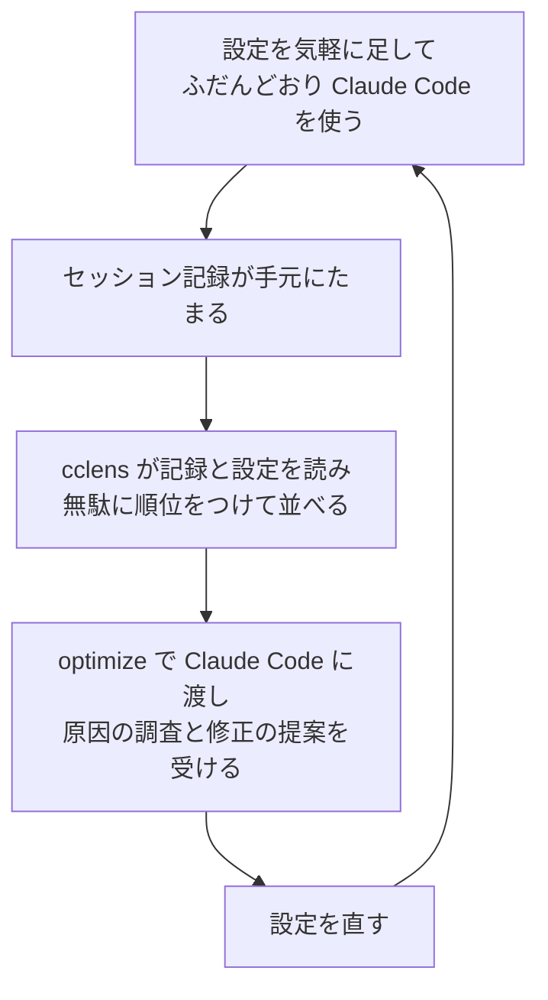
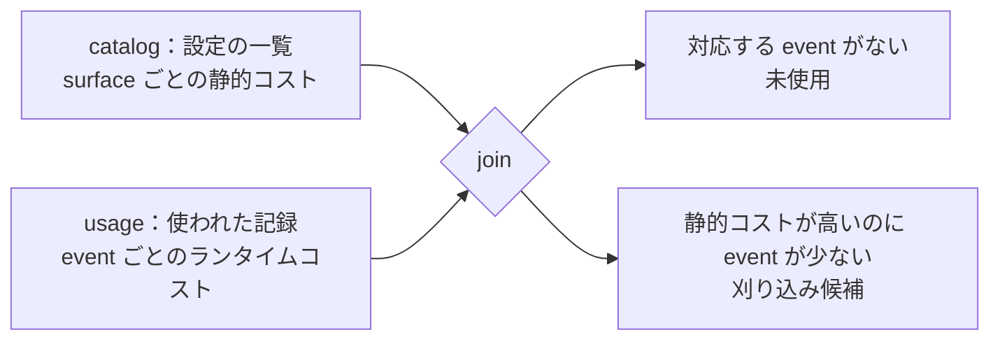
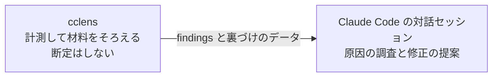
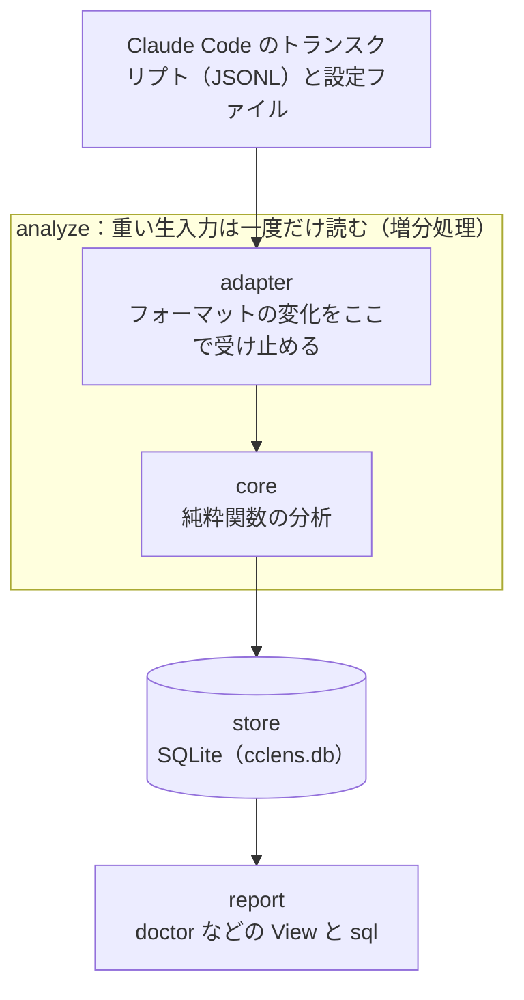

# cclens ナレッジ

Claude Code の「無駄」を可視化するツール cclens の解説。2026-11-02 に、作者による紹介記事（参考資料1）を読んでキャッチアップした内容をもとにしている。

記事に書かれている事実はそのまま書く。記事にない補足には「（補足）」、推測には「（推測）」、会話の中で整理した点には「（会話での整理）」を付けて区別する。

## 1. 概要

cclens は Claude Code のセッション記録（トランスクリプト）と設定ファイルを手元で読み、時間・トークン・手間がどこで無駄になっているかを計測して見せる CLI ツール。作者は Alisue（lambdalisue）さんで、Rust で書かれている。

要点は次の4つ。

- 計測のために何かを別に走らせず、ふだんの使用で残る記録をそのまま解析する。設定は気軽に足しておき、あとでまとめて答え合わせをする「雑な棚卸し」ができる
- 判定の中心は設定の一覧（catalog）と使われた記録（usage）の突き合わせ（join）にある。対応する記録がない設定は「未使用」、静的コストが高いのに使われない設定は「刈り込み候補」になる
- 直し方は AI に決めさせる。cclens は計測して確かなデータを用意するところに徹し、`optimize` で findings を Claude Code の対話セッションに渡す
- 処理はローカルで完結し、cclens 自体はデータをどこにも送信しない

## 2. 理解に必要な前提

この節は記事を読むために会話の中で補った一般的な知識をまとめたもの（補足）。

### Claude Code の設定

- CLAUDE.md：Claude Code がセッションの始めに読み込む指示のファイル。毎回読み込まれるので、長いほど毎回の読み込み量が増える
- ルール：Claude に守らせたい決まりを書いた設定。記事では常に読み込まれるルールを、CLAUDE.md と同じ「自分の設定ファイル由来で削れる部分」に数えている
- スキル：特定の作業のやり方をまとめた設定で、必要なときに呼び出される。記事ではスキルの呼び出しを記録上の出来事（event）の1種類として扱う
- MCP サーバー：外部のサービスや道具を Claude Code につなぐための仕組み。有効にすると、その道具の説明（スキーマ）が、毎回読み込まれる分に加わる
- グローバル設定とプロジェクト設定：`~/.claude` に置いた設定はすべてのプロジェクトに効き、プロジェクトのフォルダに置いた設定はそのプロジェクトだけに効く

### トークンとコンテキスト

- トークン：AI が文章を処理するときの単位。使用量や上限はトークンで数える
- コンテキスト：会話の中で AI が読み込んでいる文章の全体。指示、会話の履歴、道具の説明などが含まれる
- 常時オンのコンテキスト（床値）：まだ何も作業していないのに、セッションのたびに必ず読み込まれる分。記事では「見えない固定費」として扱っている
- コンパクション：会話が長くなったときに、Claude Code が古いやりとりを要約して詰め直す仕組み。記事はこれに左右されずにコンテキストの量を測ることを、分析の工夫の1つに挙げている
- サブエージェント：Claude Code が作業の一部を任せる、別のコンテキストで動く Claude。記事はその作業を正しく帰属させることも、分析の工夫に挙げている

### 記事の例に出てくる言葉

- worktree：Git で、1つのリポジトリから作業用のフォルダを別に作り、ブランチごとに並行して作業する仕組み
- cwd（カレントディレクトリ）：コマンドを実行するときに「今いる」フォルダ
- awk と sed：テキストを加工するコマンド。ファイルの一部を取り出す用途にもよく使われる

### 作りの説明に出てくる言葉

- SQLite：1つのファイルで動く軽いデータベース。cclens は解析の結果を `cclens.db` に保存する
- 純粋関数：同じ入力には必ず同じ結果を返し、ファイルの読み書きや時計などの外部に触れない関数。単体テストがしやすい
- キャッシュ：元のデータから作り直せる控え。消しても作り直せる

## 3. 解説

### 3.1 解決したい問題

AI は同じ指示でも毎回同じように動くとは限らない。そのため、ルールやスキルを書いても、本当に効果があるのか、あるとしても十分なのかを数字で確かめるのは難しい。結局「しばらく使って様子見」になるが、見直す機会はなかなか来ず、使われない設定が気づかないうちにたまっていく。いざ棚卸ししようとしても、「知らないところで効いているかもしれない」と思うと消せない。

作者はこれを、パフォーマンスチューニングと同じ構造だと見ている。当てずっぽうに変更を入れて速くなることを祈り、「様子見」にした変更ほど外しにくくなる。そこでパフォーマンスの世界の「推測するな、計測せよ」を、Claude Code の設定に当てはめた。

### 3.2 ふだんの記録をそのまま読む

設定の前後で同じタスクを何度か測る A/B テストをすれば、効き目は分かる。ただし時間もトークンもかかる。さらにモデルの賢さ、プロンプトの解釈、ツールの挙動が日々変わるので、コストをかけて確かめた設定が明日には意味をなくしているかもしれない。

cclens は計測用に何かを走らせず、ふだんの使用で残るセッション記録をそのまま解析する。計測のための追加のコストは払わない（解析そのもののコストはかかる）。これにより、設定は気軽に足しておき、気が向いたときに cclens でまとめて答え合わせをする「雑な棚卸し」ができる。

### 3.3 見えるもの：doctor と View

最初に使うのは `cclens doctor`。健康診断の総合結果のように1画面で全体の状態を見せ、直すべきことを「グローバル（`~/.claude`）」と「プロジェクトごと」に分けて並べる。初回は解析（`analyze`）も自動で走る。読み取り系のコマンドは表示の前にストアを自動で最新化し、変更のないトランスクリプトは読み飛ばす。最新化したくないときは `--frozen` を付ける。

`doctor` で当たりを付けたら、観点ごとのコマンド（View）で掘り下げる。どれも単なる集計ではなく、分類や順位付け、直し方の提案まで含む。

| コマンド | 見せるもの |
|---|---|
| `waste` | 最適化の余地のランキング。削除、スリム化、トリムの推奨アクション付き |
| `inventory` | すべての設定（スコープ付き）と、実際の使用状況 |
| `overhead` | セッションごとの常時オンのコンテキスト量を、設定と突き合わせて表示 |
| `usage` | スキルごとの使用回数のランキング。`--by month` などで期間別にも出せる |
| `failures` | ツールの失敗をカテゴリ別に集計。修正案付き |
| `stuck` | Claude が短時間に何度も編集し直して行き詰まったファイル |
| `prompts` | 自分の指示の傾向（steer / correct / question / instruct の割合） |

`failures` を見ると、あるツールが毎回同じ理由で失敗していたことに気づける。記事によると、ルールやプロンプトを1行足すだけで消える無駄が意外と多い。`stuck` に出るファイルは Claude が堂々巡りしている場所で、指示や設計がうまくいっていないサインになる。

`--scope` は `doctor`、`waste`、`inventory`、`failures`、`optimize` で使え、`--scope global` や `--scope project:<slug>` で対象を絞る。不要な設定や重い設定はそのファイルが置かれている場所に、繰り返す失敗はその失敗の大半が起きているプロジェクトに振り分けられる。どのプロジェクトにも属さない失敗は、横断的なクセとしてグローバル扱いになる。

用意された View で足りなければ、`cclens sql` でストアに直接 SQL を投げられる。ストアは読み取り専用で開くので、クエリでストアの中身が変わる心配はない。表を出す View は `--format markdown` に、ほぼすべてのコマンドは `--format json` に対応する。`doctor` は要約なので markdown はなく、json だけを出せる。

### 3.4 overhead：見えない固定費の内訳

`overhead` は、まだ何も作業していないのにセッションのたびに必ず払っているコンテキスト量（常時オンの床値）を見せる。内訳は次の2つに分かれる。

| 内訳 | 中身 | 削れるか |
|---|---|---|
| 自分の設定ファイル由来 | CLAUDE.md と常時オンのルール | 削れる |
| 残り | システムプロンプト、組み込みツール、MCP のスキーマ | ファイルからは削れない |

これで、重いのが自分の設定なのか、Claude Code がもとから読み込む分なのかが一目で分かる。床値はプロジェクトごとにも出るので、ある MCP サーバーを有効にしているプロジェクトと、していないプロジェクトを比べれば、その差からその MCP サーバーのトークン量を逆算できる。

### 3.5 判定の仕組み：catalog × usage

判定の中心は集計ではなく、2つの一覧の突き合わせ（join）にある。

- surface：設定できるもの1つ（スキル、ルール、MCP サーバーなど）。設定ファイルを読んで測った静的コスト（定義のトークン量）を持つ
- event：タイムスタンプ付きの出来事1つ。トークン、コンテキストの増加、実行時間といったランタイムコストを持つ。スキルの呼び出しも event の1種類にすぎない

surface に対応する event がなければ「未使用」、静的コストが高いのに event が少なければ「刈り込み候補」になる。作者は、この join が最適化の足がかり（wedge）になると書いている。

使われた記録だけを数えても、一度も使われていない設定は記録に現れないので見つからない。設定の一覧と突き合わせて初めて「あるのに使われていない」ことが分かる（会話での整理）。`inventory` はこの突き合わせをそのまま見せる表示で、`overhead` も常時オンのコンテキスト量を設定と突き合わせている。

### 3.6 直し方：optimize と役割の分け方

`cclens optimize` は、主な findings を、最適化アドバイザー用のプロンプトと一緒に、対話的な `claude` セッションに渡す。findings は一時ファイル経由で渡し、コマンドライン引数には載せない。

作者のこだわりは役割の分け方にある。AI は日進月歩なので、最適化そのものは AI 自身にやらせたほうがいい。cclens は計測して確かなデータを用意するところに徹し、そのデータをどう読み、どんな設定に直すかは、その時点でいちばん賢い AI に決めさせる。そのため cclens は「これを消せ」と断定せず、材料をそろえて渡す。View にも推奨アクションや修正案は付くが、cclens が直し方を決めるわけではない（会話での整理）。

記事で紹介された提案の例は次の2つ。

- cd の打ちすぎ：「worktree で作業する」スキルを入れていたが、そのスキルが cwd を変えていなかったため、Claude はコマンドのたびに `cd` を打っていた。cclens がこれを検出し、Claude Code 内蔵の worktree コマンド（cwd ごと切り替わる）でスキルを直せば毎回の `cd` が不要になる、という提案が返ってきた
- awk と sed の禁止ルールの過剰さ：awk や sed を禁止するルールは効いていたが、実際の用途はたいてい「ファイルの部分読み込み」だった。そこで、perl を案内するより、組み込みの部分読み込み機能も案内したほうが筋がいい、とルールの書き換え方まで提案された。もとのルールが代わりに perl を案内していたことは、記事の書き方からの推測

どちらも言われてみれば確かにと思える一方で、データを眺めているだけでは気づきにくい。作者は計測データを AI に渡して一段深い最適化を引き出せる点を、`optimize` のいちばんの魅力に挙げている。

cclens は Claude Code のプラグインマーケットプレイスにもなっていて、導入すると `/cclens:doctor`（セッションの中で健康診断）、`/cclens:optimize`（今のセッションで原因を調べ、具体的な修正を提案）、`/cclens:query`（読み取り専用の SQL で質問に答える）を呼び出せる。

### 3.7 作りの工夫

#### 2ステージと SQLite

cclens は解析（`analyze`）とレポート（各 View と `sql`）の2ステージに分かれ、両者は SQLite のストアだけでつながっている。トランスクリプトは数百 MB になりうるのに、分析は何度も繰り返す。そこで重い生入力は一度だけ読んでコンパクトなストアにまとめ、以降のレポートはストアだけを読む。`analyze` は増分で動き、2回目以降は差分だけを処理する。コマンド名を `build` ではなく `analyze` にしたのは、「成果物をビルドする」のではなく「生入力を事実へと解析する」という意味を込めたため。

#### レイヤー分離

Claude Code の入力フォーマット（トランスクリプトの JSONL と各種設定ファイル）は、リリースごとに変わりうる。そこで、フォーマットの変更が1つのレイヤーにしか及ばないように、層を分けている。

| レイヤー | 担当 | 知ってはいけないこと |
|---|---|---|
| adapter | 2つの入力フォーマットの生の形を、内部ドメインモデルへ写す | SQLite のスキーマ、コストの計算方法 |
| core | イベント抽出、静的コストの計量、catalog × usage の join、集計。すべて純粋関数 | Claude Code のフィールド名や設定のパス、SQL |
| store | sessions、surfaces、events を SQLite で保存し、問い合わせる | 生入力の形 |
| report | クエリ結果を表や Markdown に整え、最適化の候補に順位をつける | 生入力の形、store の API を超える SQL |

adapter とほかのレイヤーの間の取り決めは、内部ドメインモデル（Claude Code のリリースをまたいで安定した、ツール中心の名前）。上流のフィールド名が変わっても、直すのは adapter の写し方だけで済む。この境界は `.claude/rules/format-isolation.md` に明文化されていて、フォーマット変更の修正が adapter の外に出たら、境界のバグとして扱う。

図は記事の説明をもとにした概略で、レイヤー間の呼び出しの細かい順序までは記事に書かれていない。

core を純粋関数に保つのも方針の1つ。作者はこのツールの価値を、分析のロジック（イベントの境界、コンパクションに強いコンテキストの計量、サブエージェントの帰属、catalog × usage の join）に置いている。ここはバグが潜みやすく、テストで固めたい部分なので、I/O、時計、SQL を外し、小さな合成フィクスチャで規則を1つずつ単体テストできるようにしている。現在時刻やチューニング用の定数のように実行ごとに変わりうる値は、外から渡す。

#### 前方互換とデータの扱い

adapter は防御的にデシリアライズする。必要なフィールドだけを読み、未知のフィールドは無視し、任意のフィールドが欠けていても受け入れる。新しいフィールドや設定キーが増えても `analyze` が動かなくならない、という方針。

cclens は生のトランスクリプトや設定をリポジトリにもストアにもコピーしない（`.claude/rules/session-data-privacy.md`）。Claude Code が置いた場所を読み取り専用で読むだけ。ストアは作り直せるキャッシュで、スキーマが変わったときは古いファイルを使わずにヒントを出す。`cclens.db` を消せば、次に読み込むときに作り直される。

### 3.8 導入と動作環境（記事の時点）

- 対応 OS：macOS と Linux（Intel、ARM64）。Windows は非対応
- Homebrew：`brew install lambdalisue/cclens/cclens`
- Nix：`nix run github:lambdalisue/cclens -- doctor` で、インストールせずに試せる。入れるときは `nix profile install github:lambdalisue/cclens`
- ソースから：Rust のツールチェインがあれば `cargo build --release` でビルドできる
- Claude Code のプラグインとして：`/plugin marketplace add lambdalisue/cclens` のあと、`/plugin install cclens@cclens`

## 4. 似たものとの違い

| 比べるもの | cclens との違い |
|---|---|
| 設定の A/B テスト | 設定の前後で同じタスクを何度も測るので、効き目は確かめられる。ただし時間とトークンがかかり、モデルやツールの変化で結果がすぐ古くなる。cclens は計測用の実行をせず、ふだんの記録を解析する |
| 使用回数の集計 | 集計は使われたものしか数えられない。cclens は設定の一覧と突き合わせるので、一度も使われていない設定も見つけられる（会話での整理） |
| パフォーマンスチューニングの計測 | 「推測するな、計測せよ」という考え方は同じ。対象がプログラムの速さではなく、Claude Code の設定の効き目と負担になっている |
| 直し方まで決め打ちする作り | cclens は「これを消せ」と断定しない。直し方は、その時点の AI に材料を渡して決めさせる |

## 5. 会話でわかったこと

### 判定の考え方

記録を数えるだけでは、未使用の設定は見つからない。設定の一覧と突き合わせることが判定の要になる。View のうち `inventory` と `overhead` はこの突き合わせの考え方をそのまま使っている（会話での整理）。

### 勧めと断定の関係

View には推奨アクションや修正案が付く一方で、記事は cclens が「これを消せ」と断定しないことを強調している。この2つは矛盾しない。勧めは材料の一部で、どう直すかを決めるのは AI だ、と整理した（会話での整理）。

### 例とコマンドの対応

cd の打ちすぎの例も、awk と sed の例も、`optimize` で Claude Code から返ってきた提案である。cclens が検出したものを AI に渡した結果として読むと、役割の分け方がつかみやすい（会話での整理）。

## 6. 未解決事項

- 判定の細かい規則は記事に書かれていない。`stuck` の「短時間に何度も」の基準、`failures` のカテゴリの分け方、`waste` の順位の付け方などで、リポジトリの `docs/specs/` は未確認
- 刈り込み候補を決める「静的コストが高い」「event が少ない」のしきい値。チューニング用の定数を外から渡す作りであることは分かるが、値や変え方は未確認
- `optimize` を使うと、findings は Claude Code のセッションに渡され、ふだんの会話と同じようにモデルへ送られると考えられる（推測）。cclens 自体はデータを送信しないが、`optimize` を使うときの扱いはチームで確かめる必要がある
- Windows 対応：記事の時点では非対応。記事のコメント欄には issue #10 のブランチを当てたら Windows 11 で動いた、という読者の報告がある。現在の対応状況は未確認
- 記事は 2026-08-05 の公開で、その後の更新でコマンドや機能が変わっている可能性がある
- 解析そのもののコスト（時間やディスクの使用量）の大きさは、記事に書かれていない

## 7. 参考資料

1. Alisue「Claude Code の「無駄」を可視化するツール cclens を作った」Zenn、2026-08-05 公開。https://zenn.dev/lambdalisue/articles/introduce-cclens （2026-11-02 に確認）
2. lambdalisue/cclens（GitHub）。https://github.com/lambdalisue/cclens （記事の中のリンク。中身は未確認）
3. cclens の設計資料 `docs/specs/`。https://github.com/lambdalisue/cclens/tree/main/docs/specs （記事の中のリンク。中身は未確認）

## 8. 更新履歴

- 2026-11-02：初版。紹介記事（参考資料1）をもとにしたキャッチアップの内容をまとめた
